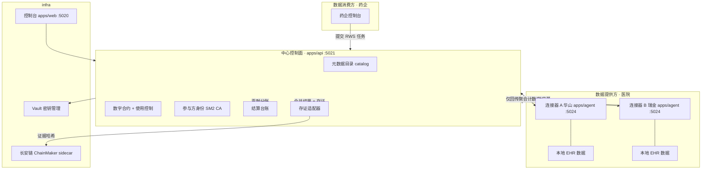
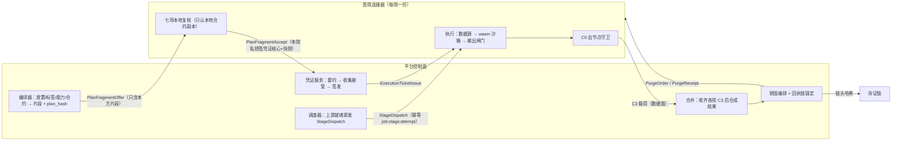

# MedTrust 架构设计 — 单一事实源

> **本文件是架构层面的唯一权威。** 与 README / CLAUDE.md / deepreq / openspec / PROJECT_OVERVIEW 冲突时，以本文件为准。
> 关联：[`DESIGN.md`](./DESIGN.md)（前端设计规范）· [`docs/deepreq/`](./docs/deepreq/)（深度需求与 ★ 落地决策）· [`openspec/changes/archive/2026-07-21-federated-data-space-rws/design.md`](./openspec/changes/archive/2026-07-21-federated-data-space-rws/design.md)（方向决策 D1–D12 全文）

---

## 0. 决策摘要（30 秒抓住全局）

> 下表是视图；全部决策已收编登记于 [`DECISIONS.md`](./DECISIONS.md)（机器校验：代码决策标记必须在册）。

| 议题 | 结论 | 决策出处 |
|------|------|----------|
| 形态 | **联邦可信数据空间**（非中心化多租户数据平台） | D1 |
| 部署拓扑 | 中心控制面（瘦）+ 本地连接器（重）；原始数据永久留在各参与方本地 | D1 / D2 |
| 连接器 | 双生产分工：`apps/connector`（NestJS）以 rws-worker 执行 L1.5–L3 计算+闸门与 L4 轮询；`apps/agent`（Python）为 gRPC 重计算节点（L3 内核 / L4 训练） | D2 / D-CN-1 |
| RWS 第一通道 | 只走 TEE 通道（本地算聚合），FL 后置 | D3 |
| 授权模型 | **Usage Control**（可强制策略）取代一次性访问审批 | D4 |
| 输出闸门 | 连接器侧强制：DP + 小单元格抑制（n<5），fail-closed | D5 / D-UC-2 |
| 上链 | **只存证据**（哈希/指纹/时间戳），不存数据 | D6 |
| 存证链 | **长安链 ChainMaker**（原 FISCO BCOS 因 SDK JNI 死结已弃） | D6 / D-RWS-3 |
| 数据库 | 拆分中心元数据 schema + 连接器本地 schema；**当前用 SQLite**（Postgres 定义了但未启用） | D7 |
| 信任链 | 国密 SM2 证书 + SM2/SM3 加密签名 | D8 |
| TEE 表述 | `attestationLevel` 字段如实标注 `software`（非硬件），硬件目标海光 CSV | D9 / D-RWS-4 |
| 连接器协议 | 对齐国标 NDI-TR-2025 系列，不自创不照搬 IDS | D10 |
| MDOP 编排内核 | 在国标连接器接口**之上**加一层跨节点算子编排（作业/片段/凭证/回执），全面替换现有编排，绞杀者迁移、新表并行；参与方密钥自持 + 平台三钥分离 | D-MDOP-1 / D-MDOP-3 |
| C2 与可信空间节点 | 协议语义完整；**放置改判「目标节点证明登记有效且与合约策略相符」**（2026-09-26 开关翻转）；无硬件证明的部署里 C2 仍为零（软件实现不得作 C2 目标）；C1 边仍不开放 | D-MDOP-6 |
| 跨空间互联 | 身份/目录/合约的"跨空间版"，数据仍不出源（规格化，实现后置） | D11 |
| 价值共创 | 数字合约计价 + 编排器贡献计量（cohortSize）+ 上链清算 | D12 |
| 合约撤销 | 立即中止（fail-closed，复用 FSM compensation） | D-DC-1 |
| RWS 形态 | 信号检测（不成比例分析）先行 + `analysisType` 预留队列疗效 | D-RWS-2 |
| 贡献度口径 | cohortSize 样本量代理先行，CI/GTG-Shapley 为升级路径 | D-VS-1 |
| 信任清单 | 静态清单 + 拉模式 CRL 吊销（第一版） | D-ID-1 |
| 技术栈 | Next.js 16 + React 19 + NestJS 10 + TypeORM + pnpm workspace | §2 |
| 部署 | real services 栈在线（medtrust-web/api/chain/connector-a/b/rws-worker/fl/mpc/vault）；lite 栈已下线 | §6 |

---

## 1. 这是什么

MedTrust 是一个**联邦可信数据空间**（Federated Trusted Data Space）。数据提供方（医院）、数据消费方（药企）、平台运营方、技术提供方通过连接器接入；**原始数据永远不离开数据源所在的本地连接器**，跨域只流动聚合结果（计数 / 效应量 / 加密梯度）。

最小切口是**药企 × 医院的真实世界研究（RWS）**：药企提交分析任务 → 各医院本地连接器在 TEE 内计算 → 仅回传聚合结果 → 结果哈希上链存证。

**目标**

- 跑通 RWS 最小闭环：1 药企 + 2 医院，原始数据从未离开医院。
- 确立"中心控制面（瘦）+ 本地连接器（重）"的部署与代码骨架，且不退化回中心化汇聚。
- 对齐国家数据局《可信数据空间技术架构》(TC609-6-2025-01) 的**数字合约 + 使用控制**核心技术体系。

**非目标（本阶段）**

- FL 多院联合训练通道（第一版只做 TEE 通道，FL 后置）。
- 真实硬件 TEE 落地（第一版用软件机密计算，硬件目标海光 CSV）。
- 与其他数据空间的跨空间互联（仅接口层预留）。
- 生产级高可用 / 真实支付接入。

---

## 2. 技术栈现状（已纠偏）

> 以下纠正了 README / CLAUDE.md 中的过时描述。

| 层 | 实际栈 | README 声称（过时） |
|----|--------|---------------------|
| 前端 `apps/web` | **Next.js 16.1.6 + React 19.2.3** + Tailwind v4 + shadcn/ui + TanStack Query + Zustand | Next 14 / React 18 ❌ |
| 后端 `apps/api` | **NestJS 10** + TypeORM 0.3 + Swagger + Passport(JWT+local) + gRPC | — |
| 数据库 | **SQLite（better-sqlite3，WAL 模式）**；Postgres 在 docker-compose 定义但未启用 | docker-compose 有 Postgres（暗示在用）❌ |
| 国密 | `sm-crypto`（SM2/SM3/SM4）+ HashiCorp Vault 密钥管理（5min 缓存） | — |
| 区块链 | **长安链 ChainMaker**（Java sidecar，纯 Java SDK 无 JNI）；原 FISCO BCOS 已弃 | FISCO BCOS ❌ |
| 连接器 | `apps/connector`（NestJS，**rws-worker 生产**：L1.5–L3 本地计算+闸门、L4 出站轮询）；`apps/agent`（Python，torch + gRPC，**重计算节点**：L3 内核 / L4 训练） | — |
| 同态加密 | `apps/connector` 用 `node-seal`（Microsoft SEAL CKKS） | — |
| Monorepo | **pnpm workspace**（`apps/*` + `packages/*`），无 Nx / Turborepo | 引用了不存在的 packages/shared ❌ |
| 端口约定 | 5020（web）/ 5021（api + WS）/ 5022（connector）/ 5023–5029（其他服务） | — |

**已知代码缺陷**（来自 CLAUDE.md，待修）：`apps/api/src/main.ts:16` 调用 `app.useGlobalPipe(...)`（应为 `useGlobalPipes` 复数），真实 NestJS app 本地无法直接启动。

---

## 3. 总体架构

**核心不变量**：图中没有一条线把原始行级数据带出医院本地连接器。跨域流动的只有 ① 任务定义（入）② 聚合结果（出）③ 证据哈希（上链）。

**MDOP 内核视图（mdop-kernel，D-MDOP-1）**：上图的「下发任务 + 合约策略」「仅回传聚合」
两条边，在 MDOP 通道里被展开成**平台只发片段、只收 C3** 的协议：

四道拦截互不替代：**编译期**（C0 边不得跨节点、C1 边本期拒、C2 边须目标节点证明有效）、
**复核期**（本地重算标签与能力）、**执行前**（凭证 + 数据快照重算比对）、
**出节点**（只投 C3 且目标在合约接收方列表）。
任一环节缺失都必须 fail-closed —— 宁可作业不跑，不可让 C0 出域。

**C2/可信空间节点（TEE）的适用性**：协议把「数据在可信空间内受控流动」保留为 C2。**2026-09-26 起
编译器不再「一律拒」**：C2 边的放置以**目标节点的证明登记**为准（合约须声明 `attestation_policy`，
且该节点的证明未过期、链型与度量、TCB 均达标——见 D-MDOP-6 开关翻转补注）。**但这不等于已具备
机密计算能力**：没有硬件节点时没有任何节点会通告 `tee{kind}`（软件提供者恒 `tee: null`，软件实现
不得作 C2 目标），C2 边在任何真实部署里仍被拒。**什么时候值得付 C2 的代价、它与聚合出域各自能算什么、
代价对照与选型约束**，权威写在 MDOP v0.2 协议 §4.5；本节不复制该内容，以免两处维护。
接入进度与转正条件见 TRUST P-CTL-8（远程证明与密钥释放）。

> 2026-09-25 进展：开启 C2 的变更已立（`openspec/changes/tee-confidential-node`，设计已定稿），
> D-MDOP-6 补注登记了开启方向与三条硬前提，D-TEE-1 / D-TEE-2 定下「运营方与密钥释放权分离」
> 与「节点内强制预算与发布审查」，首个业务场景定为**跨院队列交集**（D-TEE-4），证明链选型按 D-TEE-3
> 的条件式默认。**协议核心、节点运行时与可部署节点组件均已落地**（信封/`seal`/证明契约与一次性公钥/
> KMS 释放凭据/入口守卫/发布审查/出口守卫/回执链/销毁/会话装配/会话见证的登记与持有方核验，
> 以及 `apps/connector/src/tee-node/` 的独立进程组件，均有可复跑用例）。
> **2026-09-26：开关已与内核代码同步翻转**——C2 放置改判「目标节点证明有效」，不再是一条硬编码拒绝；
> **尚未落地的只剩硬件与真实 KMS**，因此无硬件证明时 C2 依旧为零，任何节点都不得虚标 `tee{kind}`。
>
> 「持有方独立核验证明」（D13）的载体已按 D14 落地：节点 →平台（`AttestationReport`）→持有方
> （`AttestationWitness`）两条控制面消息，验签公钥来自部署配置，平台只搬运不下结论。
> **发送端**也已落地（节点组件 `apps/connector/src/tee-node/`：自持身份 0600、两道配置闸门
> 拒绝「软件顶上」、两处可插拔接缝、会话执行与见证上报，独立进程部署）。
> **C2 的数据面传输**也已按 D15 落地主路径：持有方 → 平台（`C2EnvelopeSubmit`，只转运不解密）
> → 节点（`C2EnvelopeRelay`）→ 节点跑会话 → 回投 C3 与见证；平台在中继上做六项可判定检查
> （含密文摘要与「目标必须是本作业的片段节点」），节点侧用**自己的证书**长轮询取回（仍然只出站）。
> 该链路已在 `FLOWS.md` 登记为 **FLOW-MDOP-02**（14 步全部指向真实 enforcement 符号，
> 并新增 `control→node` / `node→control` / `node→kms` 三条边与 `sealed-envelope` 载荷及其红线）。
> 控制台也已能看到这条链的**证据**：作业详情里逐节点展示「会话证明与本院核验」（通过 / 未通过 /
> **尚未核验**三态分开），以及 C3 交付物随带的**发布审查清单**（抑制汇总数、DP 声明、预算消耗——
> 逐格明细仍留在节点本地与回执里）。
> 节点组件也已**本地持久化**（回执链 / 未销毁制品 / 中继去重表落进 `TEE_NODE_DATA_DIR`，
> 目录 0700、文件 0600、原子写；`tee-node -- export-receipts <jobId>` 可从**节点自己的一手链**
> 导出离线核验文件），重启不再丢一手证据、也不再重跑同一封中继。
> 首个场景（跨院队列交集）的**配对算子已入库为 Wasm 模块**（`packages/wasm-algorithms` 的
> `paired-cohort.wasm`：数字列 ABI、零能力、可复现构建、与 TS 参考语义逐字段对拍），
> 模块对「假名键怎么对齐」保持中立——剩下的是医院/合规侧对该对齐方案的接受（§3.12b）。
> 节点的**两阶段执行也已落地**（合成数据上端到端可跑）：会话拆成「跑阶段」与「出口」两半，
> 发布审查**只做一次**并由 `declassify.small_cell` 算子承载；节点内中间制品（如跨院配对结果）
> 留在本节点制品库、**只登记句柄不出节点**，出口与否只看片段里「有没有同节点下游」这一条结构事实；
> 一次阶段可吃多家持有方各自的封存输入（齐了才跑、一次会话解封全部）；每个阶段结束后节点按平台同一套
> `StageStatus` 口径回报状态（成功带摘要与等级、失败带错误码），否则多阶段作业会停在第一个节点阶段。
> 可信空间节点也已是**一等参与方**：平台下发的要约/凭证/C2 中继/阶段派发/销毁指令五类消息都有处置判据
> （要约走九项本地复核并由**节点自己签名接受**，平台收齐全部片段签名才签发凭证；C2 信封按已复核片段里的
> 入边绑定到阶段；信封与派发两个来源做**会合**；销毁回签名回执）。节点签入的是**执行环境快照**
> （算子摘要 + 期望 + 本节点当下证明能力），环境漂移即 `E_SNAPSHOT_CHANGED`（D-TEE-5）。
> 节点**执行面也已接齐**：配对走注册中心签发的 wasm 模块（零能力沙箱、数字列 ABI，宿主显式判定调用形状），
> 降密走节点内发布审查；未接线的算子一律拒、不回退内置实现。对齐与分层留在宿主，
> 因此 §3.12b 的两种对齐方案都不改模块与调用代码。
> 节点还随长轮询同步**算子清单与吊销名单**（分别用部署配置的注册中心公钥、平台节点公钥验签；版本单调；
> 未同步到有效吊销名单即拒绝执行 wasm），并从**本地模块库**按摘要取字节执行——平台给不了节点
> 「凭空多一个能跑的算子」的能力，只能提供清单与吊销。
> 节点进程本身也已可启动（`tee-node -- serve`）：心跳（60s）、证明探针（5min，须短于背书有效期）、
> 长轮询（25s）与消息处置接成一条长驻循环，**配置不全起不来**；复核用的**已双签合约副本随要约下发**，
> 节点本地验签后存档（持有方公钥来自部署锚 `TEE_NODE_PARTICIPANT_KEYS_FILE`，不取自消息）。
> 首个场景的**单进程端到端**也已跑通（`apps/api/src/mdop/c2-conformance-e2e.spec.ts`：背书 → 编译 →
> 要约 → 三方接受 → 凭证 → 封存与中继 → 节点内配对降密 → 收集 → 销毁 → 回执链），
> 它一次抓出两处「分块用例看不出来」的真 bug（节点句柄缺 `expires_at`、节点 C3 载荷缺规范分层表 `strata`），
> 均已修复并有用例钉住。
> 「规格写了、代码没做」这类缺口也已固定成**机器判据**：`openspec/changes/tee-confidential-node/traceability.md`
> 把两个变更的 67 个 spec 场景逐条指向真实的 enforcement 符号与用例，`scripts/check-c2-traceability.mjs`
> （含负例自检，已挂进根 `pnpm test`）在场景缺记录、符号不存在、用例找不到时**当场判红**。
> 同一轮还加了**错误码对拍**（`scripts/check-protocol-error-codes.mjs`，同样挂进 `pnpm test`）：
> 代码里的错误码集合与协议 §11 表必须一一对应、可重试标记必须一致——它第一次跑就抓出 4 个
> **只在代码里、不在正册表里**的码（`E_MEASUREMENT_NOT_ALLOWED` / `E_TCB_TOO_OLD` /
> `E_KEY_RELEASE_DENIED` / `E_ENVELOPE_POLICY`），已补齐 §11。
> 端到端也补齐了**熔断分支**（`apps/api/src/mdop/c2-failure-e2e.spec.ts`）：节点内降密失败
> （发布审查拒放）→ 作业 `FAILED` 且无任何 C3 交付物 → 销毁编排覆盖两院与节点 → **收齐全部回执才 `PURGED`**。
> 另外还有一支**多可信空间节点（多分片）**的端到端（`c2-multi-node-e2e.spec.ts`）：四家持有方分两组配对、
> 两个节点各出一份 C3、平台**按分层 key 求和并重算率**，销毁覆盖 4 家持有方 + 2 个节点、
> 收齐六份回执才 `PURGED`（该分支在文档里标为「异常/未来多分片」，属于覆盖面而非首个场景必经路径）。
> **仍缺**：真实硬件证明/KMS（提供者与 KMS 目前都是替身）、跨院假名键对齐方案的医院接受
> **作业之前的证明登记已定并落地（D-TEE-6）**：编译期要求节点有一份未过期的证明登记，而会话见证
> 要等一次作业绑定的密钥释放（先有鸡还是先有蛋），因此由**部署白名单内的校验方**签名推送背书
> （协议核共享判据 + 部署侧接口 `POST /mdop/attestations`，平台用部署配置的 KMS 公钥验签、
> 仍不自己验 quote），节点侧配一条探针并**自己验**回传的背书。**仍缺**：真实硬件证明/KMS
> （提供者与 KMS 目前都是替身）、跨院假名键对齐方案的医院接受（§3.12b）、
> 以及 C2 开关本身（尚未打开）；带链上锚定的整跑（§8.5）待与真实实现一起做。

**限界上下文**：参与方身份 · 元数据目录 · 数字合约 · 使用控制 · RWS 计算 · 输出闸门 · 存证 · 结算 · 联邦互联（后置）

---

## 4. 联邦数据空间核心能力

### 4.1 RWS 分析阶梯（L1.5 → L4）

| 层级 | 分析类型 | 跨域内容 | 状态 |
|------|----------|----------|------|
| **L1.5** | 失衡信号检测（PRR/ROR，药物警戒） | 仅汇总计数（四格表 a/b/c/d） | [已实现] |
| **L2** | 比较效果 Meta 分析（DerSimonian-Laird） | 效应量 + SE | [已实现] |
| **L3** | 因果推断生存分析（PSM + Cox） | 匹配后 HR/ATE + SE | [已实现] |
| **L4** | 联邦学习预测（SecureBoost） | 加密梯度 | [已实现] |

> 每个层级的通俗解释见 [`docs/demo/medtrust-rws-presentation-real.html`](./docs/demo/) 的"方案简介"标签页。

### 4.2 八大能力 × 实现状态

| 能力 | 位置 | 状态 | 说明 |
|------|------|------|------|
| 连接器（本地节点） | `apps/connector` / `apps/agent` | [已实现] | 数据不出域守卫 + TEE 计算 + 输出闸门 |
| 身份与可信通信 | `apps/api/src/runtime/participant-identity` | [已实现] | SM2 CA、安全通道、双认证/分级分类准入 |
| 数字合约 + 使用控制 | `apps/api/src/runtime/digital-contract` | [已实现] | 合约生成/状态 + 哈希存证；连接器 PEP 强制 |
| 同态加密盲聚合 | `apps/connector` HE 通道 | [已实现 PoC] | node-seal CKKS，接入编排器 |
| 控制台 UI | `apps/web` `/space` | [已实现] | Vital Ink 暗色仪表盘（见 DESIGN.md） |
| 角色与鉴权 | `apps/api/src/auth` + `apps/web` | [已实现] | provider/consumer/operator/compliance 角色 |
| 存证上链 | `apps/api/src/blockchain` + chain sidecar | [已实现] | 长安链 ChainMaker，残留：密钥治理 + solo 单节点 |
| 价值共创结算 | `apps/api/src/runtime/settlement` | [已实现 最小] | cohortSize 代理分账 + 上链 |
| 跨空间互联 | `apps/api/src/runtime/federation` | [已实现 最小] | 全局 URN + CA 信任清单互认 |

状态定义：**[已实现]** 有代码且通过测试/可演示；**[已实现 PoC/最小]** 核心路径通但非生产级；**[Mock]** 有抽象与接口、底层为占位；**[后置]** 已规划未实现。

---

## 5. 安全与合规（国密 / 等保）

`apps/api/src/security/` 是安全中枢：

- **国密三件套**：SM2（非对称加密/签名）、SM3（哈希）、SM4（对称加密），经 `sm-crypto` 实现。用于连接器身份证书、通道加密、签名。
- **密钥管理**：HashiCorp Vault，5 分钟密钥缓存。**残留风险**：ChainMaker sidecar 仍从文件系统读证书/私钥 + 硬编码 mysql 口令（D-RWS-3-a），生产前须治理。
- **列级加密**：`@EncryptedColumn('<key-id>')` 装饰器，在实体/DTO 字段上声明，勿手工加密。
- **数据脱敏**：`@Masked('<type>')` 装饰器，API 响应自动脱敏。
- **TEE 信任表述（★ 硬约束）**：当前 `apps/agent` 跑软件隔离（torch 进程隔离），**无硬件远程证明**。在数字合约 / 审计 / UI 中必须通过 `attestationLevel` 字段如实标注 `software`，**绝不向医院声称硬件级机密计算**，直到海光 CSV 可用（D9 / D-RWS-4）。字段已贯穿实体列（cp_attestation_ref / cp_rws_task / cp_fl_prediction_task）、存证回执、链 payload 与 TeeAttestation.level（TRUST CTL-09）；表述红线见 TRUST.md 红线 4。

---

## 6. 部署现状（已纠偏）

> 纠正 CLAUDE.md "Fly 部署是 mock" 的过时描述。截至 2026-07，real services 栈已上线。
>
> **2026-09 起线上栈迁至阿里云主机 docker compose（下表 Fly 地址为历史记录）**：公网 `web.szchada.top` → Cloudflare → nginx → web :5020。前端对 API 与 WS 一律走**同源**：`/api/v1/*`、`/ws*` 由同一 nginx 在服务器本机转给 api :5021（构建参数 `NEXT_PUBLIC_API_URL=/api/v1`，见 `DEPLOY.md` §2）。`api.szchada.top` 仅保留给非浏览器调用方。控制面 SQLite 在 api 容器内，重建 api 容器即回到种子数据。

### 6.1 在线服务（real services 栈）

| App | 类型 | 公网 | 说明 |
|-----|------|------|------|
| `medtrust-web` | Next.js 前端 | https://medtrust-web.fly.dev | 控制台 + landing |
| `medtrust-api` | NestJS 控制面 | https://medtrust-api.fly.dev | API + WS |
| `medtrust-chain` | 长安链节点 + Java sidecar | https://medtrust-chain.fly.dev | 存证 |
| `medtrust-connector-a` | Python agent（华山） | 内部 gRPC | L3/L4 重计算节点（Dockerfile.agent） |
| `medtrust-connector-b` | Python agent（瑞金） | 内部 gRPC | 同上 |
| medtrust-rws-worker-a / -b | NestJS connector worker | 出站轮询 | L1.5–L3 计算+闸门、L4 轮询（Dockerfile.connector，按院烘焙 Synthea） |
| `medtrust-fl` | 联邦学习服务 | — | — |
| `medtrust-mpc` | MP-SPDZ 网关 | https://medtrust-mpc.fly.dev | — |
| `medtrust-vault` | HashiCorp Vault | 内部 | — |

### 6.2 已下线

- ~~`medtrust-lite`~~ 及 `medtrust-lite-*`（mock demo 栈）——**已下线**，不在 fly app 列表中。CLAUDE.md 中关于"Fly 部署是 mock"的描述是历史快照，不再准确。

### 6.3 部署配置

- 区域：`sin`（新加坡）
- `fly-services/` 下每个服务有独立 `fly.toml` + `Dockerfile`
- `medtrust-web` 的 `public/` 目录可放静态资源（如 `rws-poc.html` 宣传页），但需重新部署才生效（Next.js standalone 运行时不动态扫描 `public/`）

### 6.4 院内连接器推荐部署拓扑（部署指引，非机检契约）

> 本节是**面向院方 IT/安全的部署建议**，读者与八件套不同（他们做的是"是否让连接器进内网"的决策）。
> 其中唯一的架构不变量（**仅主动出站**）已在 [`FLOWS.md`](./FLOWS.md) 的 `control→connector` 边机检；
> 其余（DMZ 分区、防火墙、mTLS、端口）是院内网络团队的 ops 配置，**刻意不进机检契约**——
> 环境/网络配置写进 spec 是硬度红线明令避免的。当前 Fly 部署（rws-worker 出站轮询）是此拓扑的简化。

- **部署区**：连接器置于医院 DMZ / 前置机区，与 HIS 核心库、业务内网区网络分隔。
- **网络边界**：**仅允许连接器主动出站**（长轮询领任务 / 结果回传），平台无法主动访问内网；
  双向 TLS 1.3 + mTLS + 证书校验；出站白名单锁定平台域名/IP + 固定端口（443/专用端口）。
  **院内唯一出站组件就是连接器**（D-CN-4）：Python agent 是院内计算后端，只在参与方内部网络
  监听、不对平台暴露端口，每次调用须带院内共享凭证；联邦训练的每一轮由连接器领取并在院内
  调用本院 agent，控制面不再直连计算后端。任务下发用长轮询（服务端挂起 ≤25s，有新任务立即返回），
  每个下发任务带平台 SM2 签名，连接器验签后才执行；连接器请求亦须带平台 CA 证书签名。
- **数据访问**：连接器经"本地数据访问接口层（最小权限）"读 HIS/数据集市的**只读 + 脱敏视图**，
  不直连底层库；目标态经 OMOP CDM 视图 + 受限接口（D-CN-3）。
- **算法执行**：目标态在 **Wasmtime 独立进程**内跑签名 `.wasm`（无网络/文件/进程/系统调用）。
  起步版已落地（D-CN-2 / CTL-20）：模块源码在 `packages/wasm-algorithms`（AssemblyScript
  锁定版本，可复现构建，产物与 SM3 清单入库），连接器按合约固定的 SM3 从
  `GET /api/v1/connector/modules/:sm3` 取模块，运行前做 SM3 + 平台 CA 签名双重校验，
  然后在 worker 线程内以**零能力**方式实例化（只导入宿主提供的有上限内存）并执行，
  超时/内存超限即终止且不回退。**沙箱与连接器同进程**：代码能力受限 ≠ 进程隔离，
  `attestationLevel` 仍为 `software`；未固定模块的分析走内置实现并如实标注
  `executionIsolation: none`（勿向院方声称已具备 TEE）。
- **ali29 现状（演示）**：单机模拟两院，每院两个容器——NestJS 连接器 `medtrust-rws-worker-{a,b}`（SoftwareSealedCompute 是其进程内的类）
  与 Python agent `medtrust-connector-{a,b}`（名为 connector 实为 agent）；已按 `deploy/ali29/compose.hardening.yaml` 加固，
  每院独立 internal 网络、仅通本院节点与 api。
- **管理面**：连接器本地管理界面仅内网访问（`https://127.0.0.1:<port>`）；运维经内网终端查
  状态/日志，不直接触达原始数据。
- **审计**：操作日志本地留存 + 关键证据上链（全链路可追溯，见 CTL audit + 存证）。

**升级触发器（第九根契约的判据）**：若上述拓扑变成**连接器可自检的 manifest**
（如启动时校验网络能力/接口白名单并 fail-closed），或 Wasm 沙箱建成且能力校验可机检，
则考虑立 `DEPLOY.md`/`RUNTIME.md`。当前按 YAGNI 不立——可机检部分已在 FLOWS，其余是 ops 配置。

---

## 7. 动工前硬约定（ADR）

> 借鉴 nursehome §14。下列条目在写业务代码前锁定。

### 7.1 契约层 — OpenSpec spec-driven

- 新功能先在 `openspec/changes/` 建 change set，再写代码。
- 架构方向决策记在 OpenSpec design.md（D1–D12）；落地技术选型记在 `docs/deepreq/04-技术选型-架构级决策点.md`；全部收编登记于 `DECISIONS.md`。
- 禁止绕过 OpenSpec 直接改架构。

### 7.2 输出闸门 — fail-closed（D-UC-2）

| 义务类 | 处理 |
|--------|------|
| **出域前关键义务**（输出闸门校验、ε/小单元格 n<5、白名单塑形） | **同步 fail-closed**：任一失败 → 结果不出域 |
| 出域后旁路义务（上链存证、写结算台账、通知） | **异步 fail-open + 补偿队列**：不阻塞已合规出域的结果 |

**划线**：凡"决定数据能否出域"的义务必须在闸门内同步完成；凡"事后留痕"的义务异步补偿，不得反向阻断已出域结果。

### 7.3 数据硬约定

| 议题 | 约定 |
|------|------|
| 国密 | 连接器信任链强制 SM2/SM3/SM4；禁用非国密替代做信任链 |
| TEE 表述 | `attestationLevel` 字段贯穿任务记录 + 上链证据 + 合约表述；当前 `software`，如实标注 |
| 最小队列 | 输出闸门小单元格抑制 n<5 |
| 主键 | UUID（现有实体沿用） |
| 审计列 | `created_at` / `updated_at` / `created_by`，敏感业务加审计日志 |
| 时区 | Asia/Shanghai |
| 数据库 | SQLite（dev + 当前 prod 元数据量小）；生产前控制面迁 Postgres（docker-compose 已定义） |

### 7.4 测试 DoD

| 层 | 工具 | 范围 |
|----|------|------|
| 单测 | Jest（`*.spec.ts` coloated） | service / 纯函数 |
| e2e | Jest（`*.e2e-spec.ts`） | API 端到端 |
| 连接器 demo | `pnpm --filter @medtrust/connector demo` / `demo:e2e` | 单院闭环 / 1药企+2医院 |

### 7.5 连接器双实现约定（D-CN-1，2026-07-21 修订）

- **`apps/connector`（NestJS）= rws-worker 生产执行者**：经 `TaskPuller`/`ControlPlaneClient` 出站轮询拉取 assignment，L1.5–L3 本地 TEE 计算 + 输出闸门，L4 轮询转发；同时保留离线 demo（`demo`/`demo:e2e`）。
- **`apps/agent`（Python）= gRPC 重计算节点**（connector-a/b）：L3 统计内核（PSM/IPTW、Cox/KM）+ L4 torch 训练 + SecretFlow 安全信封闸（`build_safe_result`）。
- 重叠域规格（数据不出域守卫、PEP、闸门语义、retention）以 DOMAIN.md / FLOWS.md 的 `ts:`/`py:` 双锚点对齐，不强求代码共享（跨语言）。

---

## 8. 与旧文档的关系

**本文件为架构权威。** 其他文档的角色：

| 文档 | 角色 | 已知过时点 |
|------|------|------------|
| `README.md` | 项目入门 + 快速开始 | 技术栈（Next14 ❌→16）、packages/shared（不存在）、部署（描述 lite mock 栈，实际 real services 已上线） |
| `CLAUDE.md` | 编码 agent 指南 + 命令 | "Notes / known discrepancies" 中"Fly 是 mock"已过时（见本文 §6）；其余 discrepancies 仍有效 |
| `docs/PROJECT_OVERVIEW.md` | 功能 × 实现状态明细 | 基本准确，是 §4.2 状态表的事实源 |
| `docs/deepreq/` | 8 大能力 9 维深度规格 + ★ 落地决策 | 准确，是 §0 决策表的事实源 |
| `openspec/changes/archive/2026-07-21-federated-data-space-rws/design.md` | 方向决策 D1–D12 全文 | 准确，是 §0 决策表的事实源 |
| `apps/web/src/components/console/REGISTRY.md` | 组件清单 | 准确，见 DESIGN.md §5 |

---

## 9. 现状状态总表

| 能力 | 实现状态 | 关键残留 |
|------|----------|----------|
| 联邦连接器架构 | ✅ 已实现 | agent 生产 / connector 参考的双实现需持续对齐 |
| 身份与可信通信 | ✅ 已实现 | — |
| 数字合约 + 使用控制 | ✅ 已实现 | — |
| MDOP 编排内核 | ✅ 已实现（L1.5 一条链路已上 ali29 实跑）；C2/可信空间节点：代码层开关已翻转（证明有效才放置），部署层仍为零 | 真实硬件证明与真实 KMS 未接（D-MDOP-6 翻转补注、TRUST P-CTL-8）；连接器与数据持有方通告的硬件 TEE 恒 `null`；连接器侧的已复核片段与凭证**只在内存**，重启后靠平台重发要约/凭证恢复（发件箱按至少一次投递并定期清理终态消息） |
| RWS L1.5 信号检测 | ✅ 已实现 | — |
| RWS L2 Meta 分析 | ✅ 已实现 | — |
| RWS L3 因果推断 | ✅ 已实现 | — |
| RWS L4 联邦学习 | ✅ 已实现 | — |
| 输出闸门 | ✅ 已实现 | n<5 抑制 + KM 尾部截断；DP ε 预算待接入（TRUST P-CTL-3） |
| 存证上链 | ✅ 已实现 | sidecar 密钥治理（D-RWS-3-a）+ solo 单节点（D-RWS-3-b） |
| 结算分账 | ✅ 已实现最小 | cohortSize 代理，CI/GTG-Shapley 为升级路径 |
| 跨空间互联 | ✅ 已实现最小 | 静态信任清单 + 拉模式 CRL |
| TEE 硬件 attestation | 📐 后置 | 软件隔离先行，海光 CSV 为目标 |
| 控制台 UI | ✅ 已实现 | legacy `/dashboard` 迁往 `/space` 进行中 |
| 真实支付接入 | 📐 后置 | — |

---

## 10. 治理元语路由（八份根契约）

全部机器校验：`pnpm check:meta`（已前置进根 `pnpm test`），校验器 `scripts/check-meta-docs.mjs`。
命名空间 `D-x` / `INV-x` / `CTL-x` / `EVD-x` / `FLOW-x` / `TD-x` 正交。改代码前按对象路由、切片读取：

| 契约 | 管什么 | 核心对拍 |
|------|--------|----------|
| [`DOMAIN.md`](./DOMAIN.md) | 实体/关系/公式/状态词汇（双平面）；D-CN-1 跨语言对齐载体 | 覆盖矩阵 ↔ `@Entity` 全表；INV enforcement/spec 存在性 |
| [`FLOWS.md`](./FLOWS.md) | 跨域任务链（crosses × payload） | 红线：raw-local 不出跨域边；actor 符号存在性 |
| [`DECISIONS.md`](./DECISIONS.md) | 不可逆决策登记（本表 §0 的事实源） | 代码决策标记必须在册 |
| [`TRUST.md`](./TRUST.md) | 安全∪合规控制点 + 敏感字段分级 + 红线 + 待接入缺口 | 分级表 ↔ `@EncryptedColumn`/`@Masked` 双向 |
| [`EVIDENCE.md`](./EVIDENCE.md) | 研究效度（RWS 方法学，对齐药监指导原则）：要素覆盖 + `EVD-x` | 要素覆盖矩阵 ↔ `TteSpec`/`RwsAnalysis` 字段 |
| [`AGENT.md`](./AGENT.md) | 智能体治理（AGT-x）：平面/权限/供应商登记 | 四条规矩 + LLM 调用点反向对拍（连接器平面出现即红） |
| 本文件 | 结构/边界/部署 | 引用路径存在性（WARN 级） |
| [`DESIGN.md`](./DESIGN.md) | UI 唯一事实源 | 状态色注册表对拍（v2，待 TD-2 迁移后） |

---

## 11. 平台愿景 × 已建边界（★ 防误读）

> 存在一张**平台全景愿景图**（「医疗数据可信空间为基础的 医疗 + 数据 + AI + 商业闭环平台」，
> 三闭环 × 八层）。**本节是它与本仓现实之间的对账表。**
> 铁律：**愿景图不是架构现状，更不是契约**。治理元语（七件套）只登记
> 已有代码可守护的部分——把愿景写进元语会让"违反了会被抓住"变成"作者建议你这么做"，
> 那是元语失效的开始（见 `docs/governance-primitives-design.md` 的硬度红线）。

| 愿景层 | 本仓现实 | 治理落点 |
|---|---|---|
| 行业应用层（9 类应用） | **仅 RWS 一类**（L0 验证 + L1.5–L4 阶梯）。其余 8 类无代码 | RWS 归 EVIDENCE + FLOWS；其余不入册 |
| AI Agent 层（11 类智能体） | **仅 1 个**：任务设计助手（`secretflow-assistant`，调外部 DeepSeek） | FLOW-AI-01 + CTL-11 + D-AI-1 + P-EVD-10 |
| AI 能力平台层 | 无（无模型注册/仓库/网关/RAG/向量库） | 不入册 |
| 医疗数据可信空间层（核心） | **主体已建**：接入、脱敏、目录/数据产品、合约与使用控制、隐私计算（TEE/HE/FL）、结算 | DOMAIN + FLOWS + TRUST 全覆盖 |
| 安全合规层 | **主体已建**：国密、Vault、列级加密/脱敏、PEP、输出闸门、存证、审计 | TRUST（CTL-01..11） |
| 基础设施层 | 部分：Fly 部署、ChainMaker、SQLite（非图中的大数据/K8s/GPU 集群） | ARCHITECTURE §2/§6 |
| 跨层横向能力 | 部分：统一身份权限、API、日志审计 | 分散在 DOMAIN/TRUST |
| 三闭环 | 技术闭环 ≈ FLOWS；合规闭环 ≈ TRUST + FLOW-DC/ID；商业闭环 ≈ value-settlement（两轨道，见主 spec） | 已有映射，无需新契约 |

**愿景图中尚未建模的生态角色**（登记为缺口，不预建）：数据提供方侧的检验机构 /
影像中心 / 生物样本库（数据形态与 EHR 差异大）；治理监管侧图中分为运营方 / 治理方 /
合规审核方 / 监管部门四类，本仓 `operator` + `compliance` 二类合并承担；
使用方侧的保险公司 / 公众。扩展任一角色前须先在 DOMAIN 状态词汇表登记。

**第八根契约已立**：[`AGENT.md`](./AGENT.md)（2026-07-21）。原触发器（agent ≥3 或触达连接器数据）
尚未达到，但提前立册的理由是：agent 的治理价值全在**建之前**划边界——等三个 agent
都建完再补规矩，等于承认既成事实。当前只登记 1 个真实 agent（AGT-01）+ 四条按平面
划分的硬规矩；§4 另列愿景 agent 的平面预判，其中数据治理/智能问数/模型训练三类
被 R1 挡在连接器平面之外。

## 附录：格式契约

本文件的解析目标是**分层与边界表**、**RWS 分析阶梯表**、**边界表**（§11）。

1. 表格首列的反引号标识符（`D-n` / `INV-n` 等）须在 [DECISIONS.md](DECISIONS.md) 在册。
2. 反引号包裹的仓内路径（`apps/...` / `packages/...`）应真实存在（v1 仅 warning）。
3. 解析空转兜底（MS-8）：分层表或边界表解析为 0 行 = 格式契约破坏 = 红（防"表格被改成散文后静默通过"）。
