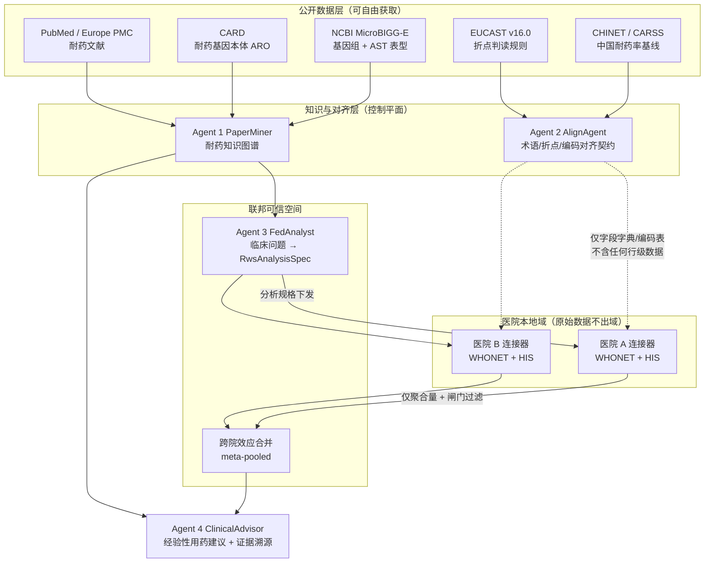

# Antimicrobial Sentinel — 项目整体方案

> 基于联邦可信数据空间的抗菌药物耐药性协同监测与用药决策系统
> 对应 SDG 3.3 ｜ 依托 MedTrust 可信数据空间
> 版本 v0.1 ｜ 2026-08-15
>
> **续做与论文**：正式文稿 [`PAPER.md`](./PAPER.md)（含 §8 开发映射）· 场景路线 [`SCENARIO-ROADMAP.md`](./SCENARIO-ROADMAP.md) · 提纲索引 [`PAPER-REVIEW-OUTLINE.md`](./PAPER-REVIEW-OUTLINE.md) · 数据声明 [`DATA-DISCLAIMER.md`](./DATA-DISCLAIMER.md)（AMR=CHINET 先验合成；Synthea 不进主结果）。

---

## 1. 一句话

**在原始数据不出医院的前提下，把全球公开耐药知识与多家医院的临床药敏数据接到同一套分析规格上，回答单家医院回答不了的耐药问题，并把结论下沉成经验性用药建议。**

---

## 2. 为什么是这个题

抗菌药物耐药（AMR）是 WHO 认定的十大全球公共卫生威胁之一，直接对应 SDG 3.3（战胜流行病与抗生素耐药性）。它的特殊之处在于：**这是一个天然的联邦问题，不是被强行套上联邦外壳的问题。**

三条硬约束同时成立：

1. **单院样本不够。** 罕见菌种、新出现的耐药表型，在任何一家医院的年度分离株里都只有个位数，统计上说不了话。
2. **数据不能出院。** 药敏结果绑定患者标识、科室、住院过程，是最敏感的一类临床数据；医院拒绝共享的第一理由就是数据外流风险。
3. **结论必须回到床边。** 耐药率不是学术数字，它直接决定经验性用药方案——培养结果出来要 48–72 小时，这段时间医生靠的就是本院/本科室的耐药率先验。

前两条的冲突正是可信数据空间要解决的；第三条保证了它有真实的临床出口。**没有联邦，这个问题做不了；有了联邦，它立刻能落地。**

---

## 3. 核心判断：主线定在药敏，不定在基因组

这是本方案与常见 AMR 提案最重要的分歧，也是决定项目能否在 10 月前跑通的分水岭。

**常见做法**：拿医院的细菌全基因组测序（WGS）数据，预测耐药突变。

**问题**：国内医院临床微生物室的常规产出是 VITEK 2 / BD Phoenix 的自动化药敏，WGS 只在科研课题里零星做几十到几百株，不成体系、拿不到、也无法在两个月内验证模型。以 WGS 为主线 = 项目在数据获取阶段就停摆。

**本方案的选择**：

| | 主线 | 加分项 |
|---|---|---|
| 医院侧数据 | **药敏（AST）+ 抗菌药物使用 + 结局** | WGS / 耐药基因分型 |
| 数据可得性 | 微生物室 WHONET 导出，成本近乎为零 | 需科研课题配合，不确定 |
| 能否两月内验证 | 能 | 不能 |
| 与 MedTrust 已有能力的契合 | 1:1 落在现有 RWS 阶梯上 | 需新建 |

WGS 保留在方案里，但作为**演示性加分模块**——有数据就做亮点，没有不影响主线交付。

---

## 4. 差异化：为什么不是"又一个耐药预测模型"

三个别人做不了的点，全部来自可信数据空间这一层：

**（1）小细胞抑制的反转叙事。**
连接器的输出闸门会抑制 n<5 的格子——单院发不出的罕见菌耐药率，多院合并后能发。这是代码里真实存在的行为，不是 PPT 话术。**"单院压制、联邦解锁"是本项目最好讲的一句话。**

**（2）跨院可比性作为一等公民。**
不同医院可能用不同折点体系（CLSI vs EUCAST）、不同版本，同一个 MIC 判读出不同的 S/I/R。绝大多数多中心耐药研究默默忽略这件事。本方案把折点对齐做成显式、可机器校验的契约，这是方法学上真正站得住的贡献。

**（3）从描述走到因果。**
"抗生素用得多所以耐药率高"是相关性。要说清楚**某种经验治疗方案是否真的改善了 30 天死亡**，需要目标试验模拟（TTE）+ 倾向评分/生存分析，并且要在多院之间合并效应量。MedTrust 的 RWS 阶梯已经把这条链路建好了。

---

## 5. 系统架构



**关键红线**：医院连接器只回传经过输出闸门的聚合量（计数、率、效应量、KM 分箱），原始行级数据在任何跨域边上都不出现。

---

## 6. 四个 Agent

链条是 **知识 → 对齐 → 分析 → 决策**。

### Agent 1 · PaperMiner（知识构建）
- **输入**：PubMed 摘要、PMC OA 全文、CARD 本体、MicroBIGG-E 记录
- **做什么**：抽取 `菌种 → 耐药基因/突变 → 抗生素 → 耐药表型 → 机制` 五元组，构建耐药知识图谱
- **真正的价值**：不是"发现新突变"（两个月做不到也验证不了），而是**为跨院数据对齐提供本体和先验分布**，以及为 Agent 4 的建议提供可溯源的证据链

### Agent 2 · AlignAgent（对齐，最关键）
- **输入**：各院 LIS/WHONET 的**字段名、菌种编码表、抗生素字典、折点体系与版本**（元数据，不是数据）
- **做什么**：映射到统一本体（NCBI taxid / ATC J01 / EUCAST 折点），产出可机器校验的对齐契约；MIC 与抑菌圈按统一折点重新判读
- **为什么必须用 LLM**：各院导出的字段名、菌种中文名、抗生素商品名千奇百怪，规则映射覆盖不全，LLM 做候选映射 + 人工确认是真实可行的工作流
- **治理约束**：按仓库 `AGENT.md` R1，**连接器平面禁止部署 agent**。AlignAgent 运行在控制平面，医院只上传**码表**不上传数据——这个边界恰好成立，不是绕过

### Agent 3 · FedAnalyst（联邦分析）
- **输入**：自然语言临床问题
- **做什么**：翻译成 `RwsAnalysisSpec`（含 `TteSpec`），经数字契约下发到各院连接器，本地算、只回聚合，跨院合并效应量
- **复用**：仓库已有 `secretflow-assistant`（自然语言 → 任务规格草稿 + 引导式向导），这是现成的地基

### Agent 4 · ClinicalAdvisor（临床决策）
- **输入**：科室 / 标本类型 / 初步菌种 / 患者基本特征
- **输出**：本院与区域耐药率先验（带置信区间）→ 经验性用药建议排序 → **每条建议附证据来源**（哪几家医院的多少株、哪篇文献、哪条因果分析）
- **底线**：只做辅助与证据呈现，不做处方决策；所有输出标注证据等级与样本量

---

## 7. 分析任务清单（RWS 阶梯映射）

这张表是项目的技术骨架，每一行都对应仓库中已有的 `RwsAnalysisType`。

| 编号 | 临床问题 | 阶梯 | 分析类型 | 输出 |
|---|---|---|---|---|
| Q1 | 主要致病菌对关键抗生素的耐药率与时间趋势（按科室/标本类型分层） | L1 | `condition-prevalence` | 分层耐药率 + 95% CI |
| Q2 | 单院被小细胞抑制的罕见菌种/罕见耐药表型，多院合并后能否发布 | L1 | `cohort-count` | 合并计数（差异化演示核心） |
| Q3 | 抗菌药物使用强度（DDDs/100人天）与耐药检出的关联信号 | L2 | `disproportionality` | ROR / PRR + 信号阈值 |
| Q4 | 碳青霉烯经验治疗 vs β-内酰胺酶抑制剂复方，对 30 天全因死亡的因果效应 | L3 | `causal-psm` / `causal-survival` | HR / ATE + KM 曲线 |
| Q5 | 耐药预测算法在各院的外部验证与迁移性 | L4 | `algorithm-validation` | 各院 AUC / 校准 + 异质性 |

**Q4 的 `TteSpec` 填法**（可直接落到代码）：

```jsonc
{
  "exposureArm":   "碳青霉烯类经验治疗",
  "comparatorArm": "β-内酰胺酶抑制剂复方经验治疗",
  "timeZeroRule":  "首次阳性血培养采样日",
  "inclusion":     ["血培养肠杆菌目阳性", "年龄 >= 18"],
  "exclusion":     ["入院 48h 内死亡", "多重菌血症", "入组前 90 天内同类暴露"],
  "outcome":       { "type": "time_to_event", "event": "30天全因死亡",
                     "censoring": "administrative" },
  "graceDays":     3,
  "washoutDays":   90,
  "matchingCovariates": ["ageBand", "sex", "icuAtBaseline",
                         "charlsonIndex", "specimenType", "priorAbxExposure90d"]
}
```

---

## 8. 与 MedTrust 现有代码的复用映射

| 能力 | 仓库位置 | 本项目用途 | 状态 |
|---|---|---|---|
| 分析规格类型 | `apps/api/src/runtime/rws-orchestrator/types.ts` | Q1–Q5 全部规格 | 已有 |
| 失衡分析 ROR/PRR | `.../rws-orchestrator/disproportionality.ts` | Q3 | 已有 |
| 跨院效应合并 | `.../rws-orchestrator/causal-effect-merge.ts` | Q4 多院合并 | 已有 |
| 因果运行时 | `apps/agent/src/medtrust_agent/rws_causal_runtime.py` | Q4 本地 PSM/Cox | 已有 |
| 小细胞抑制闸门 | `apps/connector/src/domain/output-gate` | Q2 差异化叙事 | 已有 |
| 本地执行 / 去标识 | `apps/connector/src/domain/{rws-executor,deidentifier}` | 医院侧全部计算 | 已有 |
| 数字契约 + PEP | `apps/api/src/runtime/digital-contract/` | 授权与用途绑定 | 已有 |
| 身份 / SM2 CA | `apps/api/src/runtime/participant-identity/` | 双向认证 | 已有 |
| 自然语言 → 规格 | `apps/api/src/secretflow-assistant/` | Agent 3 地基 | 已有 |
| 联邦学习编排 | `apps/api/src/runtime/fl-orchestrator/` | Q5 加分项 | 已有 |
| **折点规则表 + 重判读引擎** | — | Agent 2 核心 | **待建** |
| **WHONET/LIS → 统一 schema 对齐层** | — | Agent 2 核心 | **待建** |
| **公开数据知识库** | — | Agent 1 | **待建** |
| **AMR 前端工作台** | — | Agent 4 出口 | **待建** |

**结论：底座是现成的，需要新建的是 AMR 领域适配层和前端。** 这是本项目相对于从零开始的团队的最大结构性优势。

> 附带的叙事资产：CHINET 由复旦大学附属示范甲医院牵头，而仓库的端到端用例 `e2e-demohospa-demohospb.spec.ts` 恰好以示范甲/示范乙为租户。演示时可直接沿用。

---

## 9. 数据与合规

### 医院侧数据需求（分三档）

| 档 | 内容 | 来源 | 说明 |
|---|---|---|---|
| **T0 必须** | 患者ID（哈希）、性别、年龄段、科室/病区/ICU 标记、标本类型、采样日期、菌种代码、各抗生素 MIC 或抑菌圈 + S/I/R、ESBL/碳青霉烯酶表型标记 | 微生物室 WHONET / LIS 导出 | WHONET 是 WHO 免费软件，中国耐药监测网本就在用，导出成本近乎为零 |
| **T1 强烈建议** | 抗菌药物医嘱（ATC J01、DDD、起止时间、途径）、入出院与转科、30 天全因死亡、侵入性操作、查尔森合并症指数 | HIS / 药剂科 | **没有 T1 就只能做描述，做不了因果（Q4 落空）**。抗菌药物使用强度本就是强制上报指标 |
| **T2 加分** | 碳青霉烯酶基因 PCR 分型、科研留存 WGS | 科研课题 | 有则做亮点，无不影响主线 |

**连接键**：`患者ID_hash + 采样日期窗口`，把一次感染事件的用药暴露与药敏结果对齐——这本身就是标准的目标试验模拟结构。

### 合规路径

1. **伦理**：回顾性去标识研究，走伦理委员会**免知情同意**申请。**8 月底前必须启动**，这是时间线上唯一不可压缩的外部依赖。
2. **技术证明**：用 MedTrust 给出"原始数据不出院"的可验证证明（连接器 + 契约 + 输出闸门 + 存证）。医院拒绝的第一理由是数据外流，能从技术上消掉它，比任何合作意向书都管用。
3. **数据分级**：细菌基因组本身不含人类遗传信息，合规负担较轻；**真正重的是与之关联的患者临床信息**，这部分全程留在院内。

---

## 10. 分工

| 角色 | 负责 |
|---|---|
| 数说信息科技 | 可信空间平台、连接器部署、四个 Agent 实现、前端工作台、公开数据流水线 |
| 陈秋云老师团队 | 耐药领域知识、折点与判读标准审校、知识图谱抽取结果验证、医院对接、学术背书 |
| 合作医院（微生物室 + 药剂科 + 信息科） | WHONET 导出与 HIS 抽取、伦理申报、结果临床合理性评审 |

---

## 11. 时间线（至 10 月 10 日）

| 周次 | 日期 | 里程碑 | 判定标准 |
|---|---|---|---|
| W0 | 8/15–8/20 | 组队、报名、与陈老师对齐主线 | 报名完成；主线纠偏获认可 |
| W1–W2 | 8/20–9/5 | 公开数据抓取；**EUCAST 折点表结构化**；合成数据跑通 L1–L3 | 折点覆盖率 > 95%；Q1/Q3 在合成数据上出结果 |
| W3–W4 | 9/5–9/20 | 医院数据接入（或合成数据 fallback）；Agent 1 + Agent 2 实现 | 双院连接器真实联通；对齐契约可机器校验 |
| W5–W6 | 9/20–9/30 | Agent 3 + Agent 4；Q4 因果分析跑通 | Q4 出 HR + KM；建议附证据链 |
| W7 | 9/30–10/5 | 前端工作台；端到端联调 | 演示全流程无人工干预 |
| W8 | 10/5–10/10 | 文档、演示视频、提交 | 交付物齐备 |

**关键路径是折点表结构化**（W1–W2）。它是所有跨院对齐的前提，也是唯一有"做不完"风险的基础工作，必须最先启动、最先完成。

---

## 12. 交付物

1. **可交互 Demo**：从"输入科室 + 标本类型 + 初步菌种"到"耐药率先验 + 用药建议 + 证据溯源"的完整流程，双院连接器真实联邦
2. **技术方案文档**：本文 + 数据采集方案 + 架构设计
3. **数据报告**：知识图谱规模、折点覆盖率、Q1–Q5 分析结果、与 CHINET 基线的一致性对照
4. **演示视频**：3–5 分钟，重点讲"单院压制、联邦解锁"

---

## 13. 风险登记

| 编号 | 风险 | 影响 | 应对 |
|---|---|---|---|
| R1 | 医院数据在期限内拿不到 | 高 | **W1 就建好合成数据 fallback**：用 CHINET 年报的耐药率分布作先验生成分离株数据，双院连接器仍真实联邦运行。演示不依赖真实数据 |
| R2 | 各院折点体系/版本不一致（CLSI vs EUCAST） | 高 | Agent 2 按 EUCAST v16.0 统一重判读，保留原判读做敏感性分析；折点体系与版本作为必填元数据 |
| R3 | 罕见菌种被输出闸门抑制，无结果 | 中 | **这是特性不是缺陷**，直接转成 Q2 的差异化叙事 |
| R4 | 伦理审批周期超出时间线 | 高 | 8 月底前启动；同时走 R1 的 fallback，两条腿并行 |
| R5 | WGS 拿不到 | 低 | 已降级为 T2 加分项，主线不依赖 |
| R6 | 知识图谱抽取质量不足 | 中 | 限定在 MeSH 检索式约束的高质量语料；抽取结果由陈老师团队抽样校验，报告准确率而非只报规模 |

---

## 14. 立即行动（本周）

1. 完成报名，与陈老师确认主线从 WGS 改为药敏
2. 启动 EUCAST v16.0 折点表结构化（关键路径）
3. 把第 9 节的 T0/T1 清单发给候选医院，同步启动伦理申报
4. 用 CHINET 分布先验搭建合成数据 fallback，在现有 `rws-orchestrator` 上跑通 L1 → L3

---

**相关文档**：[数据采集方案](./DATA-ACQUISITION.md)
