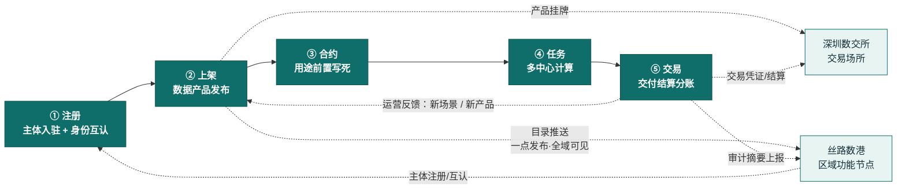
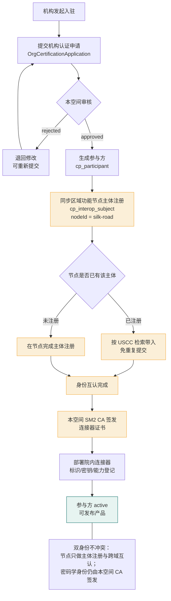
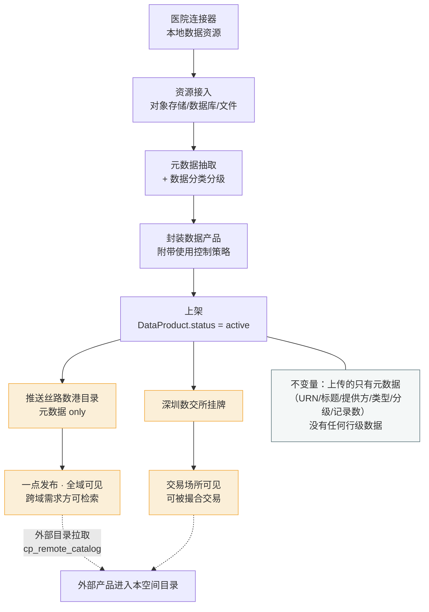
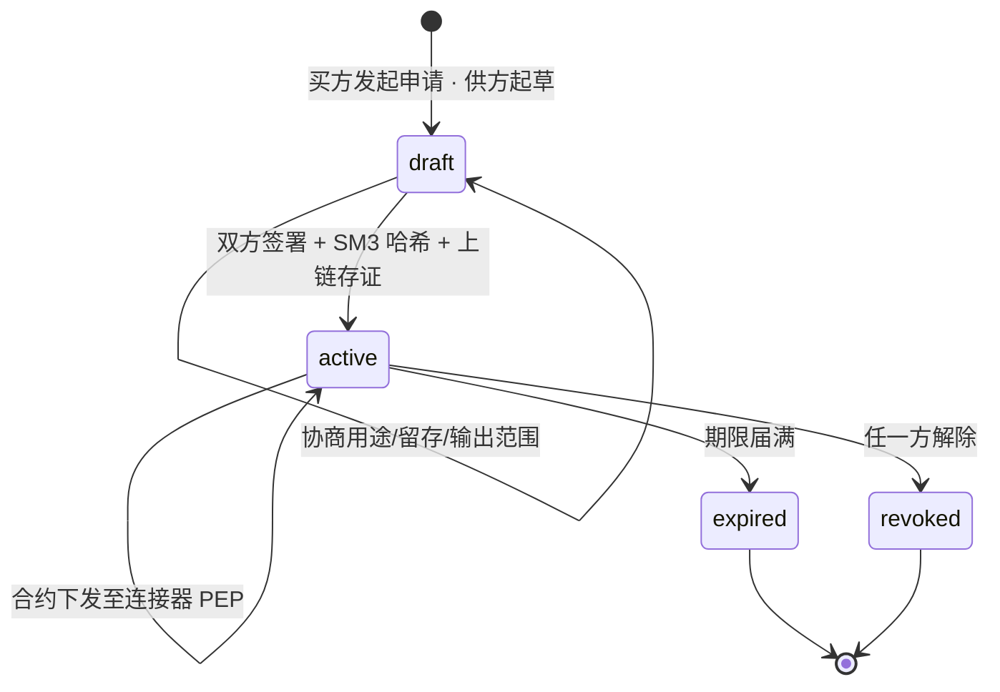
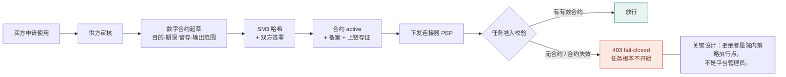
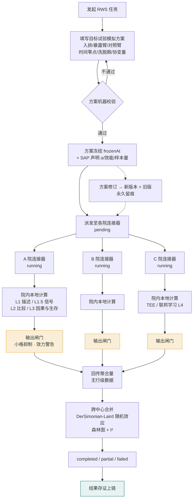
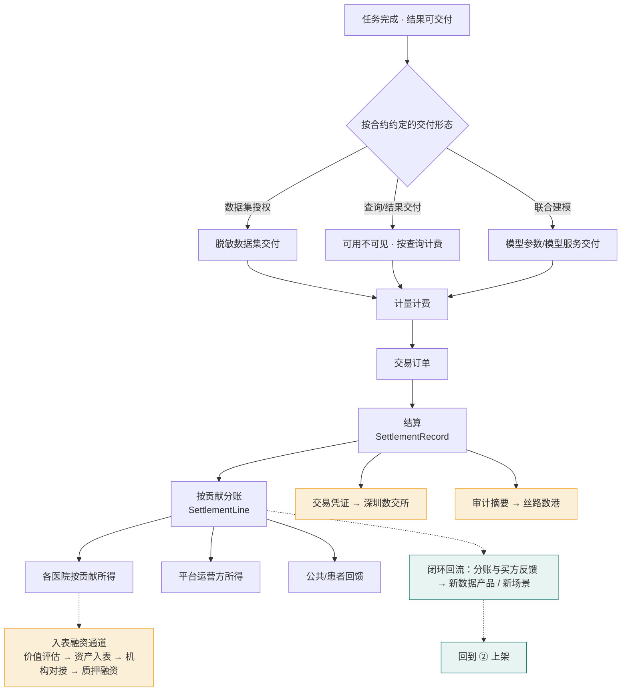
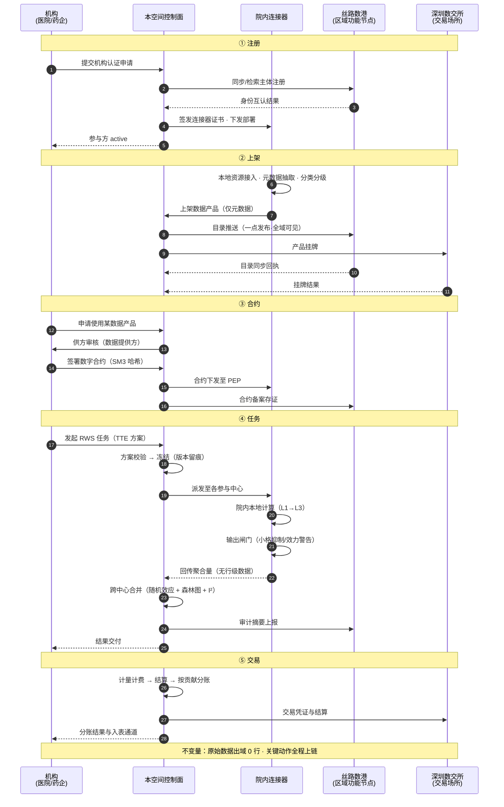

# MedTrust × 丝路数港 × 深圳数交所 · 全业务闭环流程图

> 前提：丝路数港（区域功能节点）与深圳数据交易所（交易场所）**均已对接**
> 图基于代码中的真实状态机绘制，非示意：`OrgCertificationStatus` / `ContractStatus` / `DataProduct.status` / `RwsOrchestrationStatus` / `RwsAssignmentStatus`
> 渲染：GitHub / Typora / VS Code 直接渲染 Mermaid；若需 PNG，用 <https://mermaid.live> 粘贴导出（本机未装 `mmdc`）

---

## 0. 读图前必须建立的两个前提

### 前提一：两个外部节点不是同类，不二选一

| 外部节点 | 类型 | 职责 | 在闭环中的位置 |
|---|---|---|---|
| **丝路数港**（国家数据流通利用基础设施·西安节点） | **区域功能节点** | 主体注册 · 身份互认 · 目录同步 · 日志上报 | 管**注册**与**跨域可见** |
| **深圳数据交易所** | **交易场所** | 产品挂牌 · 交易撮合 · 交易凭证与结算 | 管**挂牌**与**交易** |

同一家机构可以**同时在区域功能节点完成注册、在多个交易所挂牌**——这是层次关系，不是地区分店。「一点接入、全国通行」「一点发布、全域可见」说的正是这个。

### 前提二：两条贯穿全程的不变量

1. **原始数据出域 0 行**——数据永在院内，出域的是聚合量、计算结果与元数据
2. **每个关键动作上链存证**——签约、准入、修订、出域均可核验

---

## 图 1 · 五阶段闭环总览



**闭环的含义**：交易不是终点。分账结果与买方反馈回流到运营侧，产生新的数据产品与新场景，回到「上架」——这才是数据空间的飞轮。

---

## 图 2 · 注册阶段（主体入驻 + 双身份）



**要点**：`OrgCertificationStatus` 是 `draft → submitted → approved / rejected`，**被驳回可修改重提**，不是一次性判定。

---

## 图 3 · 上架阶段（一次发布，两处可见）



**要点**：上架的**同一份元数据**分别流向两类节点，用途不同——丝路数港解决"被别人看见"，深数所解决"被交易撮合"。

---

## 图 4 · 合约阶段（含真实状态机）





**这是全系统最有说服力的一环**：合规不是事后稽查，而是**运行时的硬约束**——没有合约，任务在物理上无法开始。

---

## 图 5 · 任务阶段（多中心计算 + 出域闸门）



**两种终止态要分清**：`partial`（部分中心完成）与 `failed`（失败）都保留在状态机里，因为多中心研究现实中经常不是全绿——**如实呈现比强行 completed 更重要**。

---

## 图 6 · 交易阶段（交付 · 结算 · 分账）



---

## 图 7 · 端到端时序（跨四方）



---

## 图 8 · 状态机汇总（与代码一致）

| 对象 | 状态值 | 代码位置 |
|---|---|---|
| 机构认证 | `draft → submitted → approved \| rejected`（可驳回重提） | `OrgCertificationStatus` |
| 数据产品 | `active \| archived` | `DataProduct.status` |
| 数字合约 | `draft \| active \| expired \| revoked` | `ContractStatus` |
| 任务编排 | `pending \| running \| completed \| partial \| failed` | `RwsOrchestrationStatus` |
| 单中心作业 | `pending \| running \| completed \| failed` | `RwsAssignmentStatus` |
| 主体互认缓存 | `synced \| mapped \| ignored` | `InteropSubject.status` |

---

## 附 · Word / PPT 用的纯文本版（Mermaid 无法渲染时）

```
                    ┌─────────────── 丝路数港（区域功能节点）───────────────┐
                    │  主体注册 · 身份互认 · 目录同步 · 日志上报            │
                    └───────▲───────────────────────────▲─────────────────┘
                            │ 主体注册/互认              │ 目录推送 / 审计上报
                            │                           │
 ① 注册 ──▶ ② 上架 ──▶ ③ 合约 ──▶ ④ 任务 ──▶ ⑤ 交易 ──┴──▶ (回流) ──┐
   │          │           │           │           │                  │
 机构提交   连接器      数字合约     TTE 方案    计量计费             │
 认证申请   封装产品    用途写死     冻结派发    结算分账             │
   │          │           │           │           │                  │
 本空间     DataProduct  SM3 哈希   各院本地    按贡献分配           │
 审核       active      +上链      计算+闸门    SettlementLine       │
   │          │           │           │           │                  │
 SM2 CA    元数据推     下发 PEP    聚合回传    交易凭证 ──▶ 深圳数交所
 签证书    丝路数港     无合约      跨中心合并
           深圳数交所   → 403      森林图 + I²
                                                    │
                              ┌─────────────────────┘
                              ▼
                   新数据产品 / 新场景 ──▶ 回到 ② 上架

  贯穿不变量：原始数据出域 0 行 ｜ 关键动作全程上链存证
```

---

## 附 · 三处最容易被画错的地方

| 容易画错 | 正确画法 | 为什么 |
|---|---|---|
| 把丝路数港和深数所画成"二选一的分支" | 画成**两条并行的不同层次**：上架阶段同时流向两者 | 前者管注册与可见性，后者管交易与结算，不是替代关系 |
| 把"数据"画成在网络中流动 | 数据**永在院内**；流的是**元数据**（上架阶段）与**聚合量/计算结果**（任务阶段） | 这是全系统的第一性原理，图上必须体现，否则失去说服力 |
| 合约画成"走过场的一步" | 合约要画成**任务的前置闸门**，并画出 `403 fail-closed` 的分支 | 合规的价值在于"没有合约任务发不出去"，这是运行时强制而非文本承诺 |
