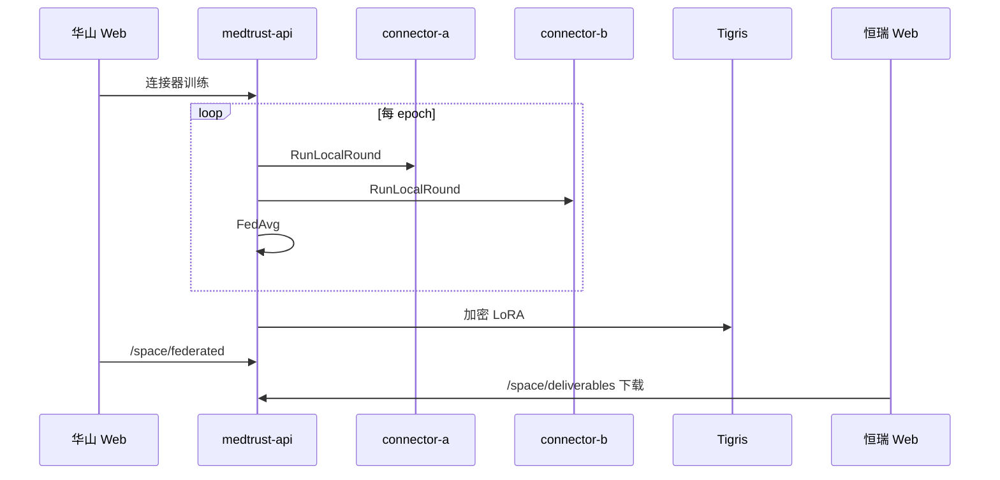

# 联邦 Connector FedAvg 端到端测试流程

> **环境：** Production Fly — https://medtrust-web.fly.dev  
> **密码：** 所有演示账号 `demo123456`  
> **预计耗时：** 连接器训练约 15–90 秒（2 epoch × 华山 + 瑞金）

## 核心结论

**数据使用方（恒瑞医药）不需要再发起或执行「汇集训练」。**

多 connector FedAvg 由控制面 `medtrust-api` 编排器自动完成：各院 connector 本地训练 → API 轮次同步 FedAvg 合并 → 加密 LoRA 写入 Tigris → 分账 + 存证。恒瑞只需在 **模型交付** 页下载 `.enc.json` 并对账哈希。

```
提供方点「连接器训练」
  → 自动签 2 份数字合约（华山 + 瑞金 → 恒瑞）
  → API 调用 connector-a / connector-b RunLocalRound
  → 控制面 FedAvg 合并
  → Tigris 持久化 + 分账 + 存证
  → 恒瑞：查看 / 下载交付物（无二次训练）
```

## 前置条件

| 组件 | 说明 |
|------|------|
| medtrust-web / medtrust-api | 控制台与编排 API |
| medtrust-connector-a | 华山（sin） |
| medtrust-connector-b | 瑞金（nrt） |
| medtrust-deliverables | Tigris bucket，LoRA 交付物持久化 |
| catalog `dataPath` | `dp-insulin-panc-huashan` 等产品含 `/data/synthea/ingested`，目录页显示「连接器训练」 |

## 演示账号

| 角色 | 登录页快捷按钮 | 邮箱 |
|------|----------------|------|
| 数据提供方 | 华山医院 · 提供方 | `admin@huashan-hospital.com` |
| 数据使用方 | 恒瑞医药 · 使用方 | `pv@hengrui-pharma.com` |
| 监管方（可选） | 卫健委 · 监管方 | `data-governance@health.gov.cn` |
| 合规方（可选） | 合规审查官 · 合规方 | `compliance@medtrust.org` |

瑞金医院无需单独登录：华山发起一次「连接器训练」会同时驱动华山 + 瑞金两个 connector。

---

## 测试步骤

### 阶段 0 — 登录（提供方）

| # | 页面 | 操作方 | 操作 | 目的 |
|---|------|--------|------|------|
| 0.1 | `/login` | 华山管理员 | 点击 **华山医院 · 提供方** | 以提供方身份进入 |
| 0.2 | 侧边栏 | — | 确认有 **运行面** 菜单，**无**「模型交付」 | 验证 RBAC |


**通过标准：** 左下角显示「华山医院管理员 / 数据提供方」。

---

### 阶段 1 — 发起联邦训练

| # | 页面 | 操作方 | 操作 | 目的 |
|---|------|--------|------|------|
| 1.1 | `/space/catalog` | 华山管理员 | 打开 **数据产品** | 进入目录 |
| 1.2 | 产品行 | 华山管理员 | 找到 **CKD 患者结构化随访队列**（`dp-insulin-panc-huashan`） | 确认 `dataPath` 已配置 |
| 1.3 | 同行右侧 | 华山管理员 | 点击 **连接器训练** | 触发联邦全流程 |
| 1.4 | 按钮下方状态 | — | 观察 `签约并派发…` → `训练中…` → `联邦 LoRA ✓ …` | 确认完成 |


**按钮背后自动执行：**

1. `POST /contracts` ×2（华山→恒瑞、瑞金→恒瑞）
2. `POST /secretflow/tasks`（双 connector FedAvg）
3. connector-a/b `RunLocalRound` × epochs
4. API `finishMultiAgentFedAvg` 合并
5. `LoraDeliverableService` → Tigris
6. 分账 100 CNY + 链上存证

**通过标准：** 状态行含 `联邦 LoRA ✓` 与 `hospital-huashan` + `hospital-ruijin`。

---

### 阶段 2 — 提供方验收联邦结果

| # | 页面 | 操作方 | 操作 | 目的 |
|---|------|--------|------|------|
| 2.1 | `/space/federated` | 华山管理员 | **联邦密算** 列表 | 定位新任务 `catalog-fl-*` |
| 2.2 | `/space/federated/{taskId}` | 华山管理员 | 进入任务详情 | 验收合并结果 |


**详情页必查：**

| 字段 | 期望 |
|------|------|
| 状态 | 已完成 |
| 合并 LoRA 哈希 | `LORA:…` |
| 参与 connector | 华山 + 瑞金（2 方） |
| 聚合方式 | **FedAvg（编排器轮次同步）** |
| 贡献占比 | 各约 50% |
| 分账 | 总额 100 CNY，两院各约 50 CNY |

---

### 阶段 3 — 提供方查看结算（可选）

| # | 页面 | 操作方 | 操作 | 目的 |
|---|------|--------|------|------|
| 3.1 | `/space/settlements` | 华山管理员 | **结算** | 查看本院收益 |

---

### 阶段 4 — 使用方接收交付物（非再训练）

| # | 页面 | 操作方 | 操作 | 目的 |
|---|------|--------|------|------|
| 4.1 | `/login` | — | 退出，点击 **恒瑞医药 · 使用方** | 切换消费方 |
| 4.2 | 侧边栏 | 恒瑞 PV | 确认 **使用方 · 模型交付** | consumer RBAC |
| 4.3 | `/space/deliverables` | 恒瑞 PV | **模型交付** 列表 | 找到同一 taskId |
| 4.4 | `/space/deliverables/{taskId}` | 恒瑞 PV | 进入详情 | 对账 + 下载 |
| 4.5 | 详情页 | 恒瑞 PV | **下载 .enc.json** | 获取 SM2 信封加密包 |


**通过标准：**

- `loraDeltaHash` 与阶段 2 完全一致
- `encryptedDeltaRef` 形如 `ENC:…`
- 可下载 `lora-adapter-{taskId}.enc.json`

---

### 阶段 5 — 监管抽检（可选）

| # | 页面 | 操作方 | 操作 | 目的 |
|---|------|--------|------|------|
| 5.1 | `/space/attestations` | 卫健委 | 存证账本 | 核对 `ATT:` 哈希 |
| 5.2 | `/space/contracts` | 卫健委 | 数字合约 | 核对 purpose / 双方 |
| 5.3 | `/space/federated/{taskId}` | 卫健委 | 联邦详情 | 审计 FedAvg + 分账 |

---

## 验收清单

| 步骤 | 操作方 | 页面 | 关键结果 |
|------|--------|------|----------|
| 1 | 华山 | `/space/catalog` | `联邦 LoRA ✓` |
| 2 | 华山 | `/space/federated/{id}` | FedAvg + 2 connector |
| 3 | 恒瑞 | `/space/deliverables/{id}` | 同哈希 + 下载 `.enc.json` |
| 4 | 华山 | `/space/settlements` | 收益 ≈ 50 CNY |
| ✗ | 恒瑞 | — | **不需要**汇集训练 |

## 数据流



## Demo 限制（诚实说明）

| 设计意图 | 当前实现 |
|----------|----------|
| 恒瑞发起、医院授权 | 华山 catalog 按钮代发，consumer 固定 `pharma-hengrui` |
| Meditron-7B + LoRA | stand-in 模型（UI 已标注） |
| 药企侧 SM2 解密 | 演示密钥在 API `demo-consumer-keys.ts` |

## 截图索引

本目录 `screenshots/` 由 WebBridge 自动化演示生成，与上述步骤一一对应。

| 文件 | 对应步骤 |
|------|----------|
| `01-login-provider.png` | 阶段 0 |
| `02-catalog-train-button.png` | 阶段 1.1–1.2 |
| `03-catalog-training-done.png` | 阶段 1.4 |
| `04-federated-detail-provider.png` | 阶段 2 |
| `05-login-consumer.png` | 阶段 4.1 |
| `06-deliverable-download.png` | 阶段 4.4 |

---

*最后验证：2026-07-04 · Fly production · 示例任务 `catalog-fl-1783205258949`*

## 自动化截图

```bash
# 需 Kimi WebBridge 守护进程 (127.0.0.1:10086) 与浏览器扩展已连接
./docs/demo/run-e2e-screenshots.sh
```

输出目录：`docs/demo/screenshots/`（6 张 PNG，与上文步骤对应）。
