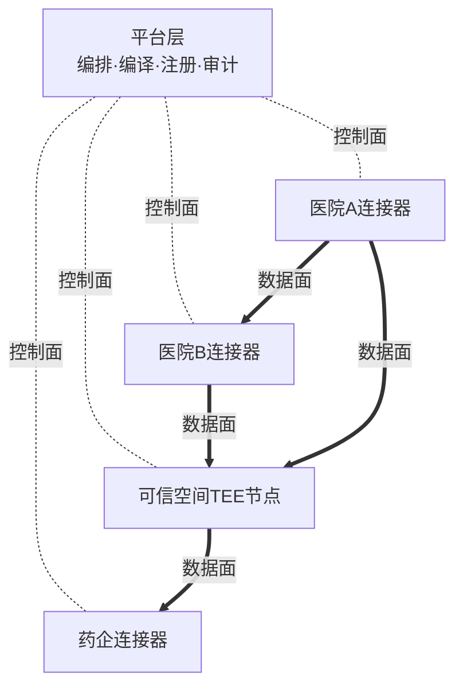
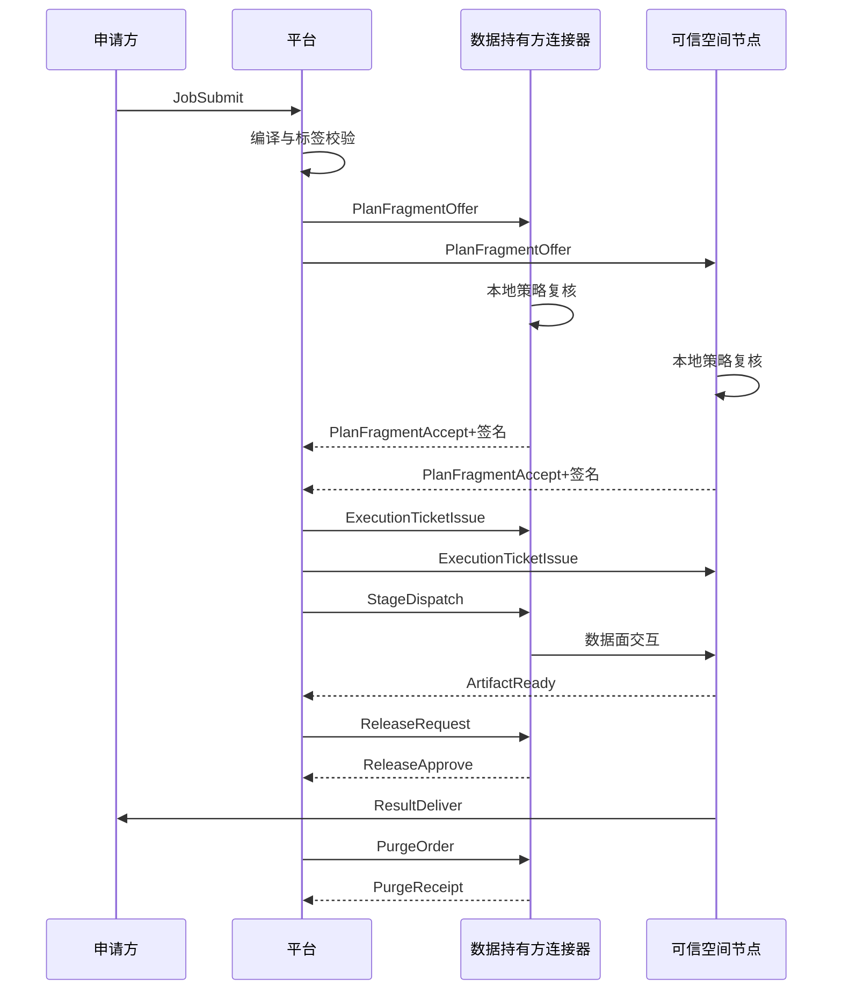
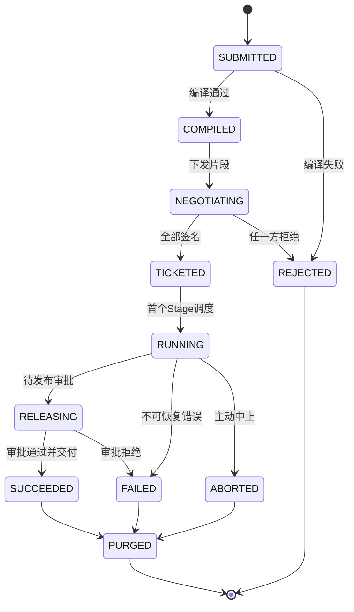
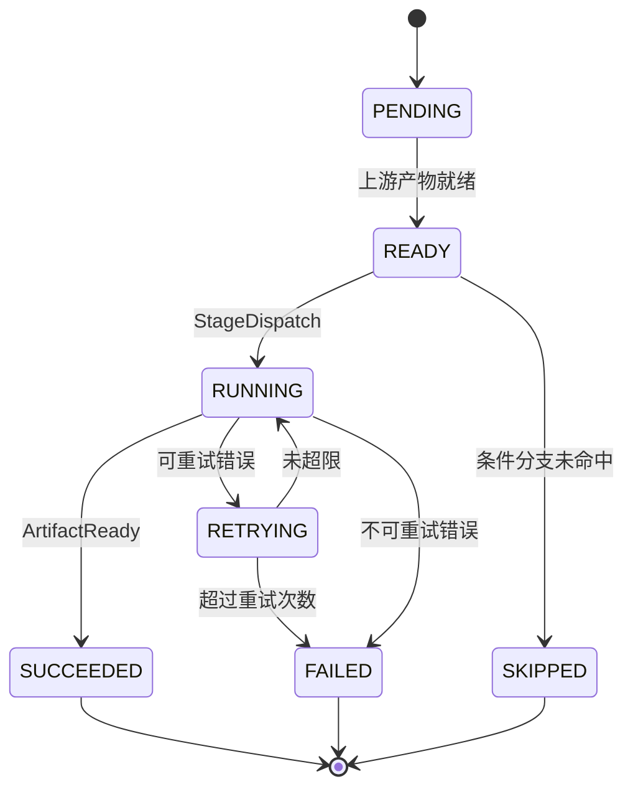

# 医疗数据跨节点算子编排协议规范（MDOP）v0.1

Sep 24, 2026 · @goly

## 1. 概述

MDOP 定义平台层与医院、药企、可信数据空间连接器之间的算子编排协议。它用一套协议同时承载"数据不流动"（联邦学习、MPC、本地计算）和"数据在可信空间内受控流动"（TEE、使用控制）两种体系，支持多步骤、跨节点的计算任务。

**适用范围。** 本规范覆盖任务描述、策略校验、计划编译、控制面消息、执行状态、制品句柄、安全与审计。不覆盖具体隐私计算协议的密码学实现（如 MPC 电路、同态方案），这些由算子实现方自行保证并在算子清单中声明。

**术语与缩写。**

| 术语 | 含义 |
| --- | --- |
| 平台（Orchestrator） | 负责任务编排、计划编译、算子注册、审计的中心服务；不接触明文数据 |
| 连接器（Connector） | 部署在数据持有方或使用方的代理，含本地策略引擎、执行器、数据适配器 |
| 可信空间节点（Enclave Node） | 部署在可信数据空间内、具备远程证明能力的执行节点 |
| 算子（Operator） | 经注册、签名的可执行计算单元 |
| 逻辑计划（Logical Plan） | 用户提交的算子 DAG，不含放置与协议细节 |
| 物理计划（Physical Plan） | 编译后的、按节点切分的可执行计划 |
| 子计划片段（Plan Fragment） | 物理计划中分配给单个节点的部分 |
| 执行凭证（Execution Ticket） | 所有参与方对物理计划哈希的联合签名 |
| 制品句柄（Artifact Handle） | 中间结果的引用，含位置、标签、摘要、有效期，不含数据本身 |
| 流动等级（Flow Label） | L0–L3 安全标签，见第 4 节 |
| 降密（Declassify） | 将产物从高保护等级降为可发布等级的受控操作 |

**规范性用语。** "必须"（MUST）表示强制要求；"应当"（SHOULD）表示除非有充分理由否则应遵守；"可以"（MAY）表示可选。

## 2. 设计原则

协议的安全性不依赖平台诚实，数据持有方对涉及自身数据的每一步拥有最终否决权。以下六条原则是后续所有章节的约束来源。

| 编号 | 原则 | 协议层面的体现 |
| --- | --- | --- |
| P1 | 控制面与数据面分离 | 平台只传递计划、状态、句柄；数据经节点间点对点通道流转，不经平台 |
| P2 | 平台不可信假设 | 连接器独立校验子计划；执行凭证锁定计划哈希，平台无法事后篡改 |
| P3 | 持有方否决权 | 任一数据持有方的本地策略引擎拒绝，整个 Job 不得执行 |
| P4 | 流动性边级化 | "数据是否流动"是 DAG 中每条边的标签属性，而非整个系统的模式 |
| P5 | 可信空间节点化 | 可信空间被建模为一类执行节点；数据进入后，对编排器等同于该节点的本地数据 |
| P6 | 默认最小化 | 输出默认不可发布；只有显式降密算子、经合约授权和审批后才能出域 |

由 P4 和 P5 可以推出一个关键结论：联邦学习、MPC 与 TEE 汇聚可以出现在同一个 DAG 中，编译器用同一套标签规则校验，无需两套编排系统。

## 3. 总体架构与参与角色

系统由一个平台层和若干连接器组成；可信空间节点是一类特殊连接器。控制面汇聚到平台，数据面只在节点之间点对点连接。



虚线为控制面（计划、凭证、状态、句柄、回执），粗线为数据面（MPC 份额、联邦梯度、密封数据、可发布结果）。

**平台层组件。**

| 组件 | 职责 |
| --- | --- |
| 任务编排器 | 接收 Job，调度 Stage，汇总状态 |
| 计划编译器 | 标签校验、算子放置、协议选择、切分子计划 |
| 算子注册中心 | 存储算子清单、签名、审核记录、版本 |
| 合约与策略中心 | 存储数据使用合约（ODRL 表达），供编译器和连接器引用 |
| 隐私预算账本 | 按数据集记录 DP 预算消耗 |
| 审计存证服务 | 接收各方签名回执，形成哈希链 |
| 身份与证书服务 | 节点、项目、人员身份；证书签发与吊销 |

**连接器组件。**

| 组件 | 职责 |
| --- | --- |
| 本地策略引擎 | 独立校验子计划片段，签发或拒绝执行凭证 |
| 执行器 | 在本地运行时（容器、TEE、MPC 运行时、联邦客户端）中执行算子 |
| 数据适配器 | 对接 HIS/EMR/LIS/PACS 或数据仓库，映射到 OMOP CDM 或 FHIR |
| 算子白名单 | 本机构允许执行的算子哈希集合 |
| 制品存储 | 本地保存中间产物，按 TTL 销毁 |
| 本地审计 | 记录本地执行与数据访问，向平台上报签名回执 |

**可信空间节点**在连接器组件之外，额外具备远程证明、基于证明的密钥释放（KMS）、使用控制（禁止明文导出、会话隔离）三项能力。

**信任边界。** 平台被视为"诚实但好奇且可能出错"的编排者：可以看到元数据和执行状态，看不到记录级数据。各数据持有方彼此不信任。可信空间节点的可信性来源于硬件证明，而非运营方声明。

## 4. 安全标签模型

每个制品和每条边都携带一个流动等级标签，编译器据此在执行前拒绝任何可能泄露数据的计划。两套体系的差异全部收敛到这四个等级上。

### 4.1 等级定义

| 等级 | 含义 | 允许出现的位置 | 典型形态 |
| --- | --- | --- | --- |
| L0 本地明文 | 原始数据或明文中间结果 | 仅所属节点内部 | 本地队列、特征表、联邦客户端本地模型 |
| L1 密态 | 单方无法还原的密态数据 | 仅同一协议实例的参与方之间 | MPC 份额、同态密文、安全聚合掩码梯度、PSI 中间值 |
| L2 受控流动 | 加密封装、附带使用策略的数据信封 | 仅流向通过远程证明的可信空间节点 | 数据信封（见 9.3） |
| L3 可发布 | 满足发布条件的结果 | 可交付给合约约定的接收方 | DP 统计量、阈值抑制后的汇总表、已审批模型 |

四个等级构成一个格（lattice）而非全序：L0 最严格，L3 最宽松，L1 与 L2 互不可比。L1 与 L2 之间不能直接转换，除非经过同时声明两类能力的显式算子（如在 TEE 内合并 MPC 份额）。

### 4.2 传播规则

- **R1 取严。** 普通算子的输出标签等于其全部输入标签在格上的最严上界；若输入同时含 L1 与 L2，输出为 L0，即只能留在执行节点本地。
- **R2 显式降密。** 只有类别为 `declassify` 的算子可以降低标签；其输出等级由清单声明，且必须满足合约中的 `release_conditions`。
- **R3 协议升级。** 协同算子（PSI、MPC、安全聚合）可以将 L0 输入转为 L1 边上的传输形态，但各参与方的本地输出仍按清单声明，通常为 L0。
- **R4 进入可信空间。** L0 数据只能经 `seal` 算子封装为 L2 信封后流向可信空间节点；在节点内解封后视为该节点的 L0。
- **R5 不可逆出。** 可信空间节点内的 L0 数据不得以任何形式回流到原持有方以外的节点，除非经过 R2。

### 4.3 能力匹配规则

- 一条 L1 边的所有端点必须声明支持同一协议及版本（如 `mpc.aby3@2`）。
- 一条 L2 边的目标节点必须声明 TEE 能力，且其证明策略满足数据合约中的 `attestation_policy`。
- 一条 L3 边的目标必须在合约的 `recipients` 列表中。

### 4.4 编译期校验

编译器按拓扑序遍历 DAG，对每个 Stage 计算输出标签并检查 R1–R5 与 4.3。任何一条失败，编译器必须返回 `E_LABEL_VIOLATION` 或 `E_CAPABILITY_MISMATCH`，并指出违规的边。连接器在本地复核时必须对自己相关的子图重复这一校验，不得信任平台的编译结果。

## 5. 算子模型

连接器只执行"在注册中心签名、且在本机构白名单中"的算子；任务中不得携带临时代码。这一条是"算子动、数据不动"不退化为"任意代码进院"的前提。

### 5.1 算子分类

| 类别 | 标识 | 典型算子 | 执行环境 |
| --- | --- | --- | --- |
| 数据接入 | `source` | 数据集引用、CDM 映射、快照锁定 | 本地 |
| 本地计算 | `local` | 队列筛选、特征工程、本地统计、本地推理 | 本地 / TEE |
| 协同计算 | `collab` | PSI、MPC 统计、安全聚合、横向/纵向联邦 | MPC 运行时 / 联邦客户端 |
| 可信环境 | `enclave` | 多方汇聚、联合训练、记录链接 | TEE |
| 封装传输 | `seal` | 数据信封封装、解封 | 本地（封）/ TEE（解） |
| 降密发布 | `declassify` | DP 发布、小单元格抑制、去标识化、模型发布审查 | 产物所在节点 |
| 控制 | `control` | 条件分支、循环、人工审批网关、等待 | 平台 |

### 5.2 算子清单（manifest）

```yaml
apiVersion: mdop/v0.1
kind: Operator
metadata:
  id: cohort.filter
  version: 2.1.0
  publisher: did:web:ops.example-platform.cn
  category: local
implementation:
  image: registry.example.cn/mdop/cohort-filter@sha256:9f2c...   # 必须以摘要锁定
  entrypoint: ["/bin/run"]
  sbom: sha256:41ab...
environments: [plain, tee.sgx, tee.tdx, tee.csv]   # 可运行的执行环境
inputs:
  - name: dataset
    schema: omop.cdm/5.4#person,condition_occurrence,drug_exposure
    accept_labels: [L0]
  - name: criteria
    schema: mdop.criteria/1.0     # 入排标准的结构化表达，不得含可执行脚本
    accept_labels: [L3]
outputs:
  - name: cohort
    schema: mdop.cohort/1.0
    label_rule: inherit           # inherit = 遵循 R1；declassify 算子写具体等级
params:
  max_runtime_s: {type: int, default: 3600}
security:
  network: none                   # 执行期禁止外联
  writes: artifact_store_only
  side_channel_notes: "输出行数本身可能泄露信息，下游须经 declassify"
resources: {cpu: 4, memory_gb: 16}
signatures:
  - by: publisher
    alg: SM2        # 或 ECDSA-P256
  - by: auditor
```

字段要求：`implementation.image` 必须用内容摘要而非标签引用；`network` 除协同算子外必须为 `none`；协同算子必须在 `protocol` 字段声明协议名、版本和安全模型（半诚实或恶意）。

### 5.3 注册、审核与白名单


平台上架不等于机构授权；每个连接器独立决定白名单。算子升级产生新哈希，必须重新走白名单流程。清单可以声明 `revoked` 状态，连接器必须在心跳时同步吊销列表。

## 6. 逻辑计划描述语言

用户只描述"算什么"，不描述"在哪算、用什么协议算"；后者由编译器生成。逻辑计划由 Job、Stage、Edge 三类对象组成。

### 6.1 Job 字段

| 字段 | 必填 | 说明 |
| --- | --- | --- |
| `job_id` | 是 | 全局唯一，由平台分配 |
| `purpose` | 是 | 用途编码，须与各合约的许可用途匹配（见 13 节） |
| `requester` | 是 | 申请方主体标识（机构 + 项目） |
| `contracts` | 是 | 引用的数据使用合约列表 |
| `ethics_ref` | 视场景 | 伦理审查批件编号 |
| `privacy_budget` | 视场景 | 本 Job 申请的 DP 预算上限 |
| `data_snapshots` | 是 | 每个数据集锁定的快照版本，保证可复现 |
| `deadline` | 否 | 整体截止时间 |
| `stages` | 是 | Stage 集合 |

### 6.2 Stage 字段

| 字段 | 必填 | 说明 |
| --- | --- | --- |
| `op` | 是 | 算子 ID@版本 |
| `at` | 否 | 指定节点；省略则由编译器放置 |
| `inputs` | 是 | 数据集引用（`ds://`）或上游 Stage 输出（`stage.output`） |
| `parties` / `clients` | 协同类必填 | 参与方 Stage 列表 |
| `params` | 否 | 算子参数 |
| `expect_label` | 否 | 期望输出等级；与推导结果不一致时编译失败 |
| `approvals` | declassify 必填 | 审批人角色列表 |
| `retry` | 否 | 重试策略 |
| `ttl` | 否 | 中间产物保存时长，默认 72 小时 |

### 6.3 示例：混合模式的真实世界研究

医院 A、B 数据不出域，医院 C 数据已进入可信空间；三方联合训练，结果经 DP 发布给药企。

```yaml
apiVersion: mdop/v0.1
kind: Job
job_id: job-rws-drugx-t2dm-2026-001
purpose: RWS.EFFECTIVENESS
requester: org:pharma-x/proj-t2dm
contracts: [ctr-hospA-001, ctr-hospB-002, ctr-space-hospC-003]
ethics_ref: IRB-2026-0917
privacy_budget: {epsilon: 1.0, delta: 1.0e-6}
data_snapshots: {hospA: snap-0915, hospB: snap-0915, hospC: snap-0912}

stages:
  cohort_A: {op: cohort.filter@2.1, at: hospA, inputs: {dataset: ds://hospA/omop, criteria: inline:crit-01}}
  cohort_B: {op: cohort.filter@2.1, at: hospB, inputs: {dataset: ds://hospB/omop, criteria: inline:crit-01}}
  cohort_C: {op: cohort.filter@2.1, at: tee://space/enclave-02, inputs: {dataset: ds://space/hospC, criteria: inline:crit-01}}

  dedup:
    op: psi.ecdh@1.3
    parties: [cohort_A, cohort_B, cohort_C]
    expect_label: L0        # 各方只得到本地重复标记

  feat_A: {op: feature.build@1.4, inputs: {cohort: cohort_A.cohort, dup: dedup.flags}}
  feat_B: {op: feature.build@1.4, inputs: {cohort: cohort_B.cohort, dup: dedup.flags}}
  feat_C: {op: feature.build@1.4, inputs: {cohort: cohort_C.cohort, dup: dedup.flags}}

  train:
    op: fl.fedavg@3.0
    clients: [feat_A, feat_B, feat_C]   # 可信空间节点作为普通联邦客户端
    params: {rounds: 50, secure_aggregation: true, min_clients: 3}

  release:
    op: declassify.dp_release@1.0
    inputs: {metrics: train.metrics}
    params: {epsilon: 0.5, min_cell_count: 10}
    approvals: [hospA.data_office, hospB.data_office, space.operator]
    expect_label: L3
```

### 6.4 编译输出

编译器输出物理计划，内容包括：每个 Stage 的执行节点与运行时；每条边的标签、传输协议与通道；协同算子的会话参数（参与方顺序、协议版本、随机种子承诺）；每个节点的子计划片段及其哈希；整体计划哈希 `plan_hash`。未指定 `at` 的 Stage 按"数据就近、能力满足、代价最低"放置，且放置结果必须通过第 4 节校验。

## 7. 控制面协议

控制面采用"平台提议、各方独立复核、联合签名后执行"的流程；执行凭证锁定计划哈希，是整个协议安全性的锚点。

### 7.1 传输与封装

控制面必须使用双向 TLS（国密场景可用 TLCP），建议采用 gRPC 或 HTTPS + JSON。每条消息使用统一信封：

```json
{
  "mdop": "0.1",
  "msg_id": "01J8Z6...",
  "msg_type": "PlanFragmentOffer",
  "job_id": "job-rws-drugx-t2dm-2026-001",
  "sender": "did:web:platform.example.cn",
  "receiver": "did:web:hospA.example.cn",
  "timestamp": "2026-09-24T10:00:00+08:00",
  "nonce": "b7e1...",
  "idempotency_key": "job-...:stage:cohort_A:attempt:1",
  "body": {},
  "sig": {"alg": "SM2", "kid": "platform-2026-01", "value": "..."}
}
```

接收方必须校验签名、时间窗（建议 ±5 分钟）与 `nonce` 防重放。

### 7.2 消息类型总表

| 阶段 | 消息 | 方向 | 说明 |
| --- | --- | --- | --- |
| 注册 | `CapabilityAdvertise` | 连接器 → 平台 | 上报算子白名单、运行时、TEE 证明、协议版本 |
| 注册 | `CatalogPublish` | 连接器 → 平台 | 发布数据目录（仅元数据与粗粒度画像） |
| 注册 | `Heartbeat` / `RevocationSync` | 双向 | 存活、吊销列表同步 |
| 合约 | `ContractOffer` / `ContractAgree` / `ContractTerminate` | 双向 | 数据使用合约协商 |
| 提交 | `JobSubmit` / `JobCompiled` | 申请方 ↔ 平台 | 提交逻辑计划，返回物理计划摘要 |
| 复核 | `PlanFragmentOffer` | 平台 → 连接器 | 下发子计划片段与完整计划哈希 |
| 复核 | `PlanFragmentAccept` / `PlanFragmentReject` | 连接器 → 平台 | 附签名或拒绝理由 |
| 复核 | `ExecutionTicketIssue` | 平台 → 全体 | 汇集全部签名的执行凭证 |
| 执行 | `StageDispatch` | 平台 → 连接器 | 触发某 Stage，附执行凭证 |
| 执行 | `StageStatus` | 连接器 → 平台 | 状态迁移上报 |
| 执行 | `ArtifactReady` | 连接器 → 平台 | 产物句柄（不含数据） |
| 执行 | `SessionRendezvous` | 平台 → 参与方 | 协同算子的会话参数与对端地址 |
| 发布 | `ReleaseRequest` / `ReleaseApprove` / `ReleaseDeny` | 双向 | 降密产物的审批 |
| 发布 | `ResultDeliver` | 产物节点 → 接收方 | 数据面直接交付 L3 结果 |
| 收尾 | `JobAbort` / `PurgeOrder` / `PurgeReceipt` | 双向 | 中止、销毁与销毁回执 |
| 审计 | `AuditReceipt` | 各方 → 存证服务 | 每步签名回执 |

### 7.3 交互流程



流程按七个阶段推进：注册与发现、合约协商、提交与编译、本地复核与签发凭证、分阶段执行、发布与销毁、审计。其中第四阶段是安全关键路径，任何一方拒绝，Job 直接进入 `REJECTED`。

### 7.4 本地复核内容

连接器收到 `PlanFragmentOffer` 后必须逐项检查以下内容，全部通过才可签名：

1. 片段中每个算子的镜像摘要在本地白名单中，且未被吊销。
2. `purpose`、数据集、期限与本方合约一致。
3. 对本方相关子图重算标签，符合第 4 节规则。
4. 所有对端节点身份有效，L2 目标节点的证明策略满足合约。
5. 申请的 DP 预算不超过本方数据集剩余预算。
6. 需要伦理批件或知情同意范围的场景，引用的批件有效。
7. 片段哈希与完整计划中对应部分一致，完整计划哈希与凭证待签内容一致。

### 7.5 执行凭证

```json
{
  "ticket_id": "tkt-01J8Z7...",
  "job_id": "job-rws-drugx-t2dm-2026-001",
  "plan_hash": "sm3:5c1e...",
  "fragments": {
    "hospA": "sm3:a31f...",
    "hospB": "sm3:77d0...",
    "space.enclave-02": "sm3:e9b2..."
  },
  "not_before": "2026-09-24T10:30:00+08:00",
  "not_after": "2026-10-08T23:59:59+08:00",
  "signatures": [
    {"signer": "did:web:hospA.example.cn", "value": "..."},
    {"signer": "did:web:hospB.example.cn", "value": "..."},
    {"signer": "did:web:space.example.cn", "value": "..."},
    {"signer": "did:web:platform.example.cn", "value": "..."}
  ]
}
```

每个 `StageDispatch` 必须附带凭证；执行器必须校验签名完整、在有效期内、待执行片段的哈希与凭证一致。可信空间节点的 KMS 在释放密钥前，还必须校验证明报告中的度量值与凭证所指算子摘要一致。计划任何变化都要求重新签发凭证。

## 8. 状态机

Job 与 Stage 各有一套状态机；失败处理的原则是"可重试则幂等重试，不可重试则补偿销毁"，任何终态都必须以中间产物销毁结束。

### 8.1 Job 状态机



进入 `PURGED` 的条件是收齐所有相关节点的 `PurgeReceipt`；最终交付的 L3 结果不在销毁范围内。

### 8.2 Stage 状态机



### 8.3 幂等与重试

- 每个 `StageDispatch` 携带 `idempotency_key`（`job_id:stage:attempt`）；执行器对相同键必须返回已有结果而不重复执行。
- 本地算子默认可重试 3 次，指数退避。
- 协同算子的重试必须重建整个协议会话，不得复用旧会话的随机数或份额，否则可能泄露信息。
- 联邦训练以轮次为检查点，恢复时从最后一个完成的轮次继续。
- 消耗 DP 预算的算子，失败时已消耗的预算不退回，除非能证明结果未离开执行环境。

### 8.4 掉线处理

协同算子设置 `min_clients` 或 `min_parties`。参与方掉线但仍满足下限时可继续，但必须在结果元数据中记录实际参与方，因为某家机构缺席可能引入人群偏倚。低于下限时 Stage 进入 `FAILED`。

### 8.5 补偿与销毁

Job 进入失败或中止态后，平台向所有持有该 Job 中间产物的节点发送 `PurgeOrder`。节点销毁产物、TEE 会话密钥与临时缓存后，返回签名的 `PurgeReceipt`，内容包括被销毁的句柄列表与销毁时间。产物 TTL 到期时，节点必须自主销毁，无需等待平台指令。

## 9. 数据面与制品句柄

控制面只传句柄，数据面按边的标签选择通道；可信空间的解封密钥只对通过证明、且度量值与执行凭证一致的执行环境释放。

### 9.1 制品句柄

```json
{
  "handle": "art://hospA/job-rws-.../cohort_A/cohort",
  "label": "L0",
  "schema": "mdop.cohort/1.0",
  "digest": "sm3:0a9c...",
  "producer": {"stage": "cohort_A", "op": "cohort.filter@2.1", "image": "sha256:9f2c..."},
  "ticket_id": "tkt-01J8Z7...",
  "expires_at": "2026-09-27T10:00:00+08:00",
  "stats": null
}
```

句柄不含数据，也不应含行数等可能泄露信息的统计量；`stats` 仅在产物等级为 L3 时允许填写。

### 9.2 各等级的通道要求

| 等级 | 通道 | 要求 |
| --- | --- | --- |
| L0 | 无（不跨节点） | 执行器必须拒绝任何将 L0 产物发往其他节点的请求 |
| L1 | 参与方之间的点对点 mTLS | 每个会话独立密钥；平台仅通过 `SessionRendezvous` 交换地址与参数；可选经中继但中继不可解密 |
| L2 | 持有方到可信空间节点 | 数据以信封形式传输；接收方在证明通过前只能存储密文 |
| L3 | 产物节点到接收方 | 仅在审批通过后发送；附带发布记录编号 |

### 9.3 数据信封

> **现行实现更正（2026-09-26，权威在 v0.2 §9.3）**：本版示例写 `SM4-GCM`。本期落地的信封
> `payload.cipher` 是 **AES-256-GCM**（对 D8 的临时偏离，收回条件＝受审计的 SM4-GCM）。
> 在收回前，C2 载荷 MUST NOT 被表述为「国密信封 / 全链国密」。

```json
{
  "envelope": "mdop.env/1.0",
  "payload": {"cipher": "SM4-GCM", "ciphertext_ref": "blob://...", "digest": "sm3:..."},
  "wrapped_key": {"kms": "kms://space.example.cn", "key_id": "k-7781"},
  "policy": {
    "contract": "ctr-space-hospC-003",
    "purpose": ["RWS.EFFECTIVENESS"],
    "allowed_ops": ["sha256:9f2c...", "sha256:3be1..."],
    "attestation_policy": {"tee": ["tdx", "csv"], "min_tcb": "2026-06"},
    "export": "L3_only",
    "not_after": "2027-09-30"
  },
  "watermark": "wm:hospC:0912:space",
  "origin_sig": {"signer": "did:web:hospC.example.cn", "value": "..."}
}
```

### 9.4 密钥释放流程

1. 可信空间节点启动算子所在的 TEE 实例，生成证明报告，报告中包含算子镜像度量值和一次性公钥。
2. 节点向 KMS 提交证明报告、执行凭证和信封中的 `key_id`。
3. KMS 校验：证明有效且满足 `attestation_policy`；度量值在 `allowed_ops` 中且与凭证所指片段一致；凭证签名完整且在有效期内；合约未终止。
4. 全部通过后，KMS 用一次性公钥加密数据密钥返回，密钥只存在于该 TEE 实例内存中。
5. 实例退出即密钥失效；再次计算必须重新证明。

数据持有方可以自建 KMS 或与可信空间运营方共管密钥，以避免单一运营方获得解密能力。

## 10. 安全机制

安全机制按"谁能做、在哪做、做了什么、结果能不能出"四个问题分层；其中最容易被忽视的是跨任务的组合攻击，需要靠隐私预算账本和查询审计来防。

| 层次 | 机制 | 要点 |
| --- | --- | --- |
| 身份 | PKI / DID | 节点、机构、项目、人员分级身份；证书短期有效、可吊销；支持国密算法 |
| 授权 | 双重授权 | 平台做项目级授权；连接器本地策略引擎（如 OPA/Rego）逐片段复核，本地结果优先 |
| 执行环境 | 远程证明 | 证明结果绑定密钥释放，而非一次性检查；TCB 版本设下限 |
| 算子 | 供应链控制 | 摘要锁定、双签名、SBOM、本地白名单、吊销同步；执行期默认禁止外联 |
| 隐私 | 预算账本 | 按数据集累计 DP 消耗；超限拒绝 |
| 输出 | 发布审查 | 小单元格抑制、再识别风险评估、模型成员推断测试、人工审批 |
| 组合攻击 | 查询审计 | 检测差分查询（相似条件多次查询）、同一申请方的累计输出 |
| 追溯 | 审计存证 | 各方签名回执写入哈希链；支持第三方独立验证 |

### 10.1 隐私预算账本

账本以"数据集 × 快照版本"为单位，记录每个 Job 消耗的 ε 与 δ。账本由平台维护，但每个持有方连接器必须保留本地副本并独立累计，以本地副本为准，防止平台少记。预算上限在合约中约定，快照更新后是否重置预算也须在合约中明确。

### 10.2 输出发布审查

`declassify` 算子执行以下自动检查，任一不通过即拒绝发布：

- 统计表中任何单元格计数低于合约阈值（建议默认 10）时抑制，并做二次抑制防反推。
- 结构化数据发布前计算再识别风险（如 k-匿名、l-多样性指标）。
- 模型发布前做成员推断测试，记录攻击成功率。
- 自动检查通过后，按 `approvals` 列表收集审批；审批人必须来自数据持有方，而非平台或申请方。

### 10.3 审计回执

```json
{
  "receipt_id": "rcpt-...",
  "job_id": "job-...",
  "stage": "cohort_A",
  "event": "STAGE_SUCCEEDED",
  "input_digests": ["sm3:..."],
  "op_image": "sha256:9f2c...",
  "output_digest": "sm3:0a9c...",
  "label": "L0",
  "prev_receipt_hash": "sm3:...",
  "signer": "did:web:hospA.example.cn",
  "sig": "..."
}
```

每个节点的回执形成本地哈希链，并定期把链头锚定到平台存证服务或区块链存证平台，使任何一方都无法单方面篡改历史。

## 11. 错误码与异常处理

错误码按阶段归类，并标明是否可重试；拒绝类错误的原因描述不得泄露对方的数据细节或策略全文。

| 错误码 | 阶段 | 含义 | 可重试 |
| --- | --- | --- | --- |
| `E_AUTH_INVALID` | 任意 | 签名、证书或时间窗校验失败 | 否 |
| `E_REPLAY` | 任意 | `nonce` 重复 | 否 |
| `E_LABEL_VIOLATION` | 编译 / 复核 | 违反标签传播规则 | 否 |
| `E_CAPABILITY_MISMATCH` | 编译 / 复核 | 节点不具备所需运行时或协议版本 | 否 |
| `E_OP_NOT_WHITELISTED` | 复核 | 算子摘要不在本地白名单 | 否 |
| `E_OP_REVOKED` | 复核 / 执行 | 算子已吊销 | 否 |
| `E_PURPOSE_MISMATCH` | 复核 | 用途与合约不符 | 否 |
| `E_CONTRACT_EXPIRED` | 复核 / 执行 | 合约失效或已终止 | 否 |
| `E_BUDGET_EXCEEDED` | 复核 / 执行 | DP 预算不足 | 否 |
| `E_ETHICS_MISSING` | 复核 | 缺少或失效的伦理批件 | 否 |
| `E_ATTESTATION_FAILED` | 执行 | TEE 证明失败或度量不符 | 视原因 |
| `E_TICKET_INVALID` | 执行 | 凭证缺签、过期或片段哈希不符 | 否 |
| `E_PEER_UNREACHABLE` | 执行 | 协同对端不可达 | 是 |
| `E_QUORUM_LOST` | 执行 | 参与方低于下限 | 是（重建会话） |
| `E_RUNTIME` | 执行 | 算子运行时错误 | 是 |
| `E_TIMEOUT` | 执行 | 超过 `max_runtime_s` | 是 |
| `E_RELEASE_CHECK_FAILED` | 发布 | 自动发布检查不通过 | 否 |
| `E_RELEASE_DENIED` | 发布 | 人工审批拒绝 | 否 |

**拒绝理由的粒度。** 连接器在 `PlanFragmentReject` 中只返回错误码和一段面向申请方的说明，不返回本地策略原文、剩余预算精确值或数据集规模，避免拒绝信息本身成为侧信道。

**超时。** 平台对每个阶段设置等待上限：复核阶段默认 72 小时（留给人工审批），执行阶段按算子清单的 `max_runtime_s`。复核超时视同拒绝。

## 12. 场景模板

七类典型场景都可以用第 5 节的算子组合表达，区别只在边的标签和放置；平台应当为每类场景提供预审过的计划模板，降低各方复核成本。

| 场景 | 主模式 | 算子组合 | 最终输出 |
| --- | --- | --- | --- |
| 多中心真实世界研究 | 数据不流动 | `source` → `local`（队列、特征）→ `collab`（PSI 去重、安全聚合或联邦）→ `declassify` | DP 统计量或效应估计 |
| 临床试验患者招募 | 数据不流动，后续转受控流动 | `local`（入排筛选）→ `declassify`（阈值计数）；患者同意后 → `seal` → `enclave` | 各中心候选人数；同意后的受控数据 |
| 药物警戒与上市后安全 | 数据不流动 | `local`（信号检测）→ `collab`（MPC 联合比例失衡分析）→ `declassify` | 信号指标 |
| 多院联合 AI 建模 | 两者皆可 | 联邦：`local` → `collab`（FedAvg + 安全聚合）；汇聚：`seal` → `enclave`（训练）→ `declassify`（模型审查） | 通过成员推断测试的模型 |
| 外部对照臂 | 受控流动 | `seal` → `enclave`（记录链接、倾向评分匹配）→ `declassify` | DP 对照组统计 |
| 可信空间内科研数据集使用 | 受控流动 | `seal` → `enclave`（交互式分析沙箱，禁止导出）→ `declassify`（每次导出审查） | 审查后的分析结果 |
| 医院与商保、医保数据联合 | 数据不流动 | `collab`（PSI 对齐）→ `collab`（MPC 联合统计或纵向联邦） | 汇总指标或联合模型 |

**患者招募的特殊处理。** 入排标准由药企提供，但以结构化条件（`mdop.criteria`）下发，不得是可执行脚本。回传的只有各中心满足条件的人数，且需经阈值抑制。联系患者必须由医院自己完成，药企在患者签署知情同意前拿不到任何身份信息。

**交互式沙箱的特殊处理。** 研究者在可信空间内交互式分析时，每次查询都视为一个 Stage 并记入预算账本和审计链；导出窗口只允许 L3 结果通过。

## 13. 合规映射

合规要求应当编码为合约字段和本地策略规则，由协议在复核阶段自动检查，而不是依赖流程外的人工把关。下表是设计层面的对应关系，具体适用须经各机构法务与数据合规部门确认。

| 法规或规范 | 关注点 | 协议中的落点 |
| --- | --- | --- |
| 《个人信息保护法》 | 医疗健康信息属敏感个人信息；处理需具备合法性基础（如单独同意），并做个人信息保护影响评估；匿名化信息不属于个人信息 | 合约 `legal_basis`、`consent_scope`、`pia_ref` 字段；L3 发布前的再识别风险评估 |
| 《数据安全法》及数据分类分级要求 | 重要数据识别与保护 | 数据目录的分级字段；高级别数据集默认只允许 L0/L1 模式 |
| 《医疗卫生机构网络安全管理办法》 | 医疗机构数据全生命周期安全 | 连接器本地审计、访问日志、销毁回执 |
| 《人类遗传资源管理条例》及实施细则 | 人类遗传资源信息的对外提供与国际合作需按规定审批或备案 | 数据集 `hgr: true` 标记；申请方为外方单位或外资控制主体时，复核必须校验 `hgr_approval_ref` |
| 数据出境相关规定 | 向境外提供个人信息或重要数据的安全评估、标准合同或认证 | 合约 `recipients` 的司法辖区字段；境外接收方只能获得 L3 且须附 `cross_border_ref` |
| 《涉及人的生命科学和医学研究伦理审查办法》 | 研究须经伦理审查 | Job 的 `ethics_ref`；复核校验批件有效期与研究范围 |
| 可信数据空间相关政策 | 可信空间的准入、使用控制与互联互通 | 可信空间节点的准入证明、使用控制策略、跨空间互通时的合约传递 |

**合约字段扩展。** 建议在 ODRL 策略之外增加以下医疗扩展字段：`legal_basis`、`consent_scope`、`pia_ref`、`hgr`、`hgr_approval_ref`、`ethics_ref`、`cross_border_ref`、`release_conditions`、`privacy_budget_cap`、`attestation_policy`。

## 14. 实施路线与参考标准

建议分三期落地：先建协议骨架并跑通三类最常用算子，再补齐联邦与预算账本，最后引入通用 MPC 与纵向联邦。

| 阶段 | 范围 | 验收标志 |
| --- | --- | --- |
| 一期：骨架 | 控制面全部消息、本地策略引擎、执行凭证、审计存证；算子仅含本地统计、安全聚合、TEE 汇聚；OMOP CDM 适配 | 两家医院 + 一个可信空间节点跑通一个多中心统计场景 |
| 二期：协同 | PSI、横向联邦、DP 发布、隐私预算账本、发布审查、场景模板 | 跑通患者招募与联合建模两个场景 |
| 三期：扩展 | 通用 MPC、纵向联邦、交互式沙箱、跨平台互通 | 与外部隐私计算平台或其他可信空间完成互通测试 |

**一致性测试。** 连接器实现方必须通过以下测试才可接入：消息签名与防重放；篡改计划片段后执行器拒绝执行；将 L0 产物发往外部节点被拒绝；证明度量不符时 KMS 拒绝释放密钥；超 DP 预算被拒；`PurgeOrder` 后产物不可再读取；审计链断链可被检测。

**可参考的开源项目与标准。**

- 隐语 SecretFlow 及其 Kuscia：跨机构隐私计算任务编排，与本规范控制面思路接近。
- 隐私计算互联互通相关规范（中国信通院等牵头）：L1 协议层互通。
- Dataspace Protocol 与 Eclipse Dataspace Components：合约协商与传输流程，可扩展"计算传输"语义。
- W3C ODRL：数据使用策略表达。
- OMOP CDM 与 HL7 FHIR：医疗数据语义层。
- IEEE 3652.1：联邦学习架构参考。
- 国家数据局可信数据空间相关文件：可信空间节点的准入与使用控制要求。
- OPA / Rego：本地策略引擎实现。

**待决问题。**

- [ ] 平台是否可以同时运营可信空间节点，还是必须由独立第三方运营？
- [ ] DP 预算在数据快照更新后是否重置，由谁决定？
- [ ] 可信空间节点的 KMS 采用持有方自建、运营方托管还是共管模式？
- [ ] 协同算子默认采用半诚实还是恶意安全模型？
