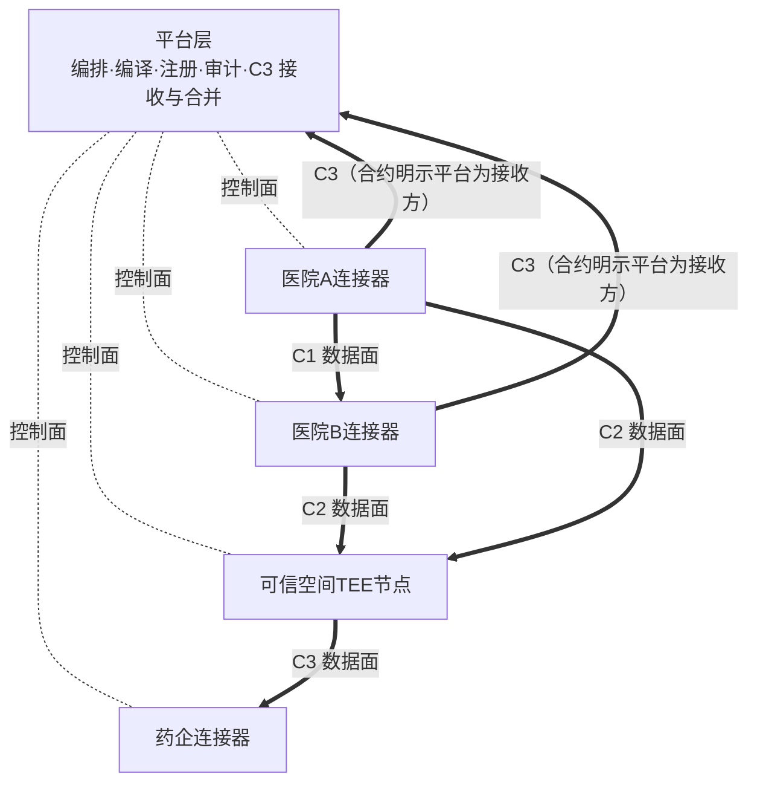
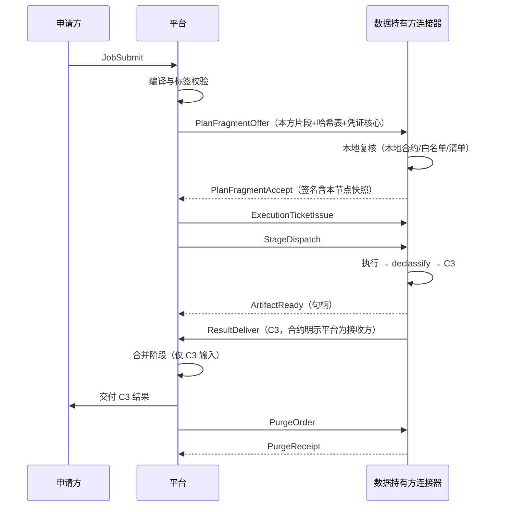
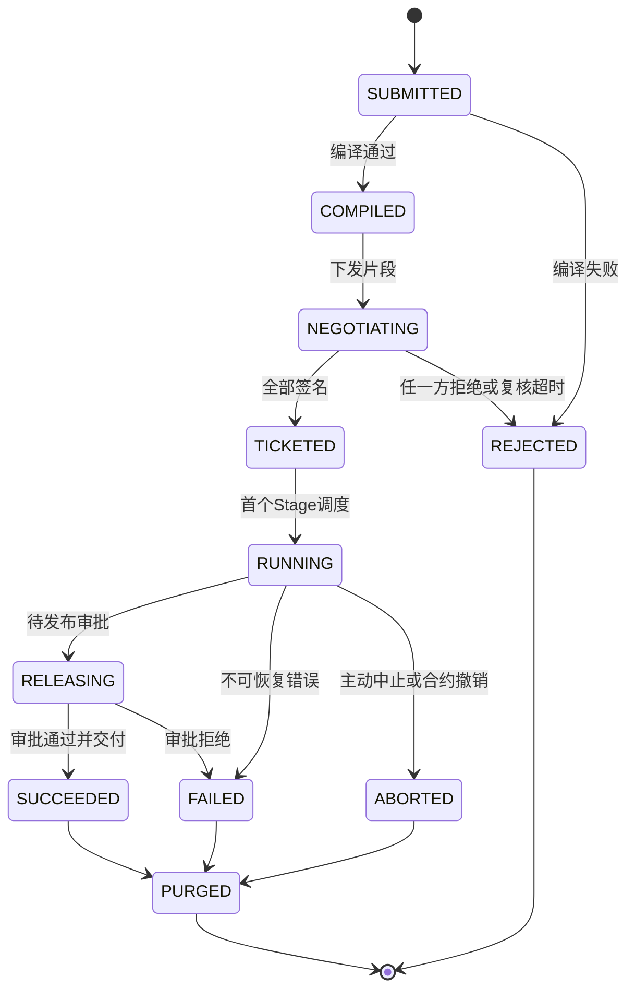
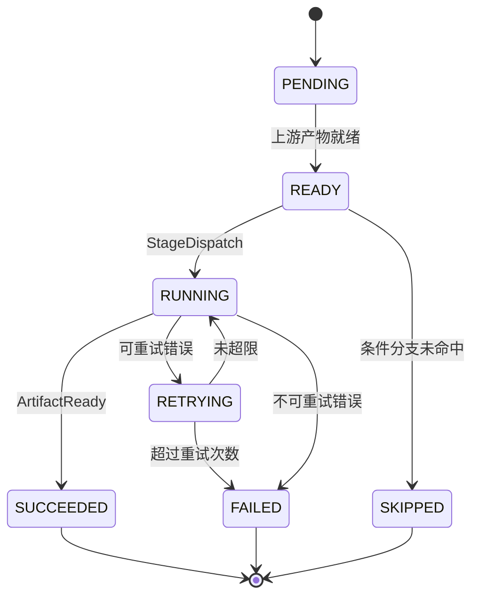

# 医疗数据跨节点算子编排协议规范（MDOP）v0.2

2026-09-24 · @goly · v0.2 修订稿（待审）

## 0. 修订说明（v0.1 → v0.2）

本版依据 2026-09-24 对 MedTrust 现有代码的逐项核查，以及两项裁决修订：一是用 MDOP 全面替换现有编排；二是由平台作为合约明示的 C3 接收方。落地变更为 `openspec/changes/mdop-kernel/`。

> 2026-09-25 补：新增 **§4.5 出域形态的适用性（C3 聚合出域 vs C2 可信空间节点）**。该节为**适用性说明**，
> 不改变本期开关——C2 与可信空间节点仍然默认关闭（§4.2 R4、D-MDOP-6）。

| # | 位置 | 修订 | 理由 |
| --- | --- | --- | --- |
| 1 | 全文 | 流动等级 L0–L3 改名为 **C0–C3**（confidential），含义与方向不变：C0 最严，C3 可发布 | 与能力图谱 L1–L7、RWS 分析阶梯 L0–L4、合规「L2 保障级」撞名 |
| 2 | §2 P1 | 平台可以作为合约明示的 C3 接收方与合并方，也可以作为安全聚合服务端（只见掩码后的和）；C0 与 C2 永不经平台 | 平台继续承担跨院合并与展示；v0.1 的 `ResultDeliver` 隐含了接收方必须自建节点 |
| 3 | §2 P2、§7.5 | 写明信任边界：执行方只凭**本方签名**放行；他方签名以空间 CA 证书校验，只能审计、不能防伪。参与方自生成密钥，公钥指纹写入合约；平台密钥按用途三分 | v0.1 的 P2「平台不可信」与「平台运营身份与证书服务」自相矛盾 |
| 4 | §3、§14 | 定位为国家数据基础设施连接器接口（NDI-TR-2025、TC609-6-2025 系列）之上的**计算编排 profile**；身份、目录、合约优先对齐国标 | 不另起一套与国标并行的连接器协议 |
| 5 | §5.2 | 算子增加 `kind: wasm \| oci \| system`：分析算子只能是 wasm 或 oci；院内接触 C0 的第三方算子只收源码可复现构建的 wasm；oci 限平台自研的重计算且须可复现构建；system 只承载机制 | 「镜像 + SBOM」无法排除不透明二进制 |
| 6 | §4.2 R4、§9 | C2 与可信空间节点在协议中保留，但硬件远程证明（海光 CSV 等）可用前默认关闭；软件隔离 MUST NOT 声明 C2 能力 | 没有硬件证明，C2 无法如实成立 |
| 7 | §6.1、§7.4、§7.5 | `data_snapshots` 改为在接受时锁定：各持有方把本节点快照标识与凭证核心一起签名，凭证逐签署方记录；plan_hash 不含快照 | 快照要在复核时由持有方计算，提交时写不进计划 |
| 8 | §6.4、§7.5 | `plan_hash = SM3(JCS({作业头, 片段哈希表}))`；每个节点只收到本方片段全文与片段哈希表 | 节点能独立重算，又看不到他院片段内容 |
| 9 | §7.1 | SM2 按 GM/T 0003.2（Z_A 预处理，缺省用户 ID `1234567812345678`）+ GM/T 0009 DER 编码；`kid` 为公钥 SM3 全长；规范化用 RFC 8785（JCS） | v0.1 只写了「SM2」，不足以跨实现互通 |
| 10 | §7.3、§7.4 | 复核缺省按合约预授权自动签署；人工复核须由合约显式选择；超时视同拒绝 | 每个作业都人工复核，常规任务会不可用 |
| 11 | §7.2 | 控制面与数据面接口分离，控制面消息不得夹带数据；补充能力通告的内容 | 让「哪些接口携带数据」可审计 |
| 12 | §11 | 新增 `E_CONTRACT_UNSIGNED`、`E_SNAPSHOT_CHANGED` | 对应持有方签署合约与快照锁定 |
| 13 | §12 | 以平台为聚合方的联邦训练必须用安全聚合（C1）；各院模型增量属于 C0 | 防止把「平台接收 C3」误读成可以明文收模型增量 |
| 14 | §13 | 合约扩展字段增加：接收方角色（merger / final）、复核方式与时限、各方公钥指纹 | 支撑 P1 修订与本地复核 |
| 15 | §14 | 一期验收改为「两家医院 + 平台作 C3 接收方，跑通 L1.5 多中心统计」，TEE 汇聚移到三期；一致性测试中与 KMS、预算相关的两项随对应能力补测 | 硬件 TEE 未就绪时，v0.1 的一期验收无法如实完成 |
| 16 | 待决问题 | 新增「药企同意的密码学签名」「身份锚脱离平台」 | 本版信任边界中尚未闭合的两处 |

## 1. 概述

MDOP 定义平台层与医院、药企、可信数据空间连接器之间的算子编排协议。它用一套协议同时承载两种体系：「数据不流动」（联邦学习、MPC、本地计算）和「数据在可信空间内受控流动」（TEE、使用控制），并支持多步骤、跨节点的计算任务。

**定位。** MDOP 是国家数据基础设施连接器接口之上的计算编排 profile。参与方身份、数据目录、合约的表达与交换优先对齐 NDI-TR-2025 系列与 TC609-6-2025 系列标准；MDOP 只定义这些标准没有覆盖的部分：计划、编译、执行凭证、流动等级、算子清单、制品与回执。

**适用范围。** 本规范覆盖任务描述、策略校验、计划编译、控制面消息、执行状态、制品句柄、安全与审计。不覆盖具体隐私计算协议的密码学实现（如 MPC 电路、同态方案），这些由算子实现方自行保证，并在算子清单中声明。

**术语与缩写。**

| 术语 | 含义 |
| --- | --- |
| 平台（Orchestrator） | 负责任务编排、计划编译、算子注册、审计的中心服务；不接触 C0 与 C2 数据，只在合约明示时接收 C3 |
| 连接器（Connector） | 部署在数据持有方或使用方的代理，含本地策略引擎、执行器、数据适配器 |
| 可信空间节点（Enclave Node） | 部署在可信数据空间内、具备硬件远程证明能力的执行节点 |
| 算子（Operator） | 经注册、签名的可执行计算单元 |
| 逻辑计划（Logical Plan） | 用户提交的算子 DAG，不含放置与协议细节 |
| 物理计划（Physical Plan） | 编译后的、按节点切分的可执行计划 |
| 子计划片段（Plan Fragment） | 物理计划中分配给单个节点的部分，含该节点的全部边界边 |
| 执行凭证（Execution Ticket） | 各持有方与平台对凭证核心（含计划哈希）的联合签名 |
| 制品句柄（Artifact Handle） | 中间结果的引用，含位置、等级、摘要、有效期，不含数据本身 |
| 流动等级（Confidentiality Class） | C0–C3 安全标签，见第 4 节 |
| 降密（Declassify） | 将产物从高保护等级降为可发布等级的受控操作 |

**规范性用语。** 「必须」（MUST）表示强制要求；「应当」（SHOULD）表示除非有充分理由否则应遵守；「可以」（MAY）表示可选。

## 2. 设计原则

协议的安全性不依赖平台诚实：数据持有方对涉及自身数据的每一步拥有最终否决权。以下六条原则是后续所有章节的约束来源。

| 编号 | 原则 | 协议层面的体现 |
| --- | --- | --- |
| P1 | 控制面与数据面分离 | 平台只传递计划、状态、句柄。C0 与 C2 数据永不经平台。C3 数据只有在合约明示平台为接收方时才可交给平台。平台作为安全聚合服务端时，只接收掩码后的 C1 数据，只得到聚合和 |
| P2 | 平台不可信假设 | 连接器用本地合约、本地白名单、本地清单独立复核子计划；执行凭证锁定计划哈希；执行方只凭本方签名放行，平台无法让它执行未经它签署的计划 |
| P3 | 持有方否决权 | 任一数据持有方的本地策略引擎拒绝，或复核超时，整个作业不得执行 |
| P4 | 流动性边级化 | 「数据是否流动」是 DAG 中每条边的标签属性，而非整个系统的模式 |
| P5 | 可信空间节点化 | 可信空间被建模为一类执行节点；数据进入后，对编排器而言等同于该节点的本地数据 |
| P6 | 默认最小化 | 输出默认不可发布；只有显式降密算子、经合约授权和审批后才能出域 |

由 P4 和 P5 可以推出一个关键结论：联邦学习、MPC 与 TEE 汇聚可以出现在同一个 DAG 中，编译器用同一套标签规则校验，不需要两套编排系统。

**P2 的信任边界（如实说明）。** 执行凭证对某个执行方的约束，来自该执行方自己的签名：平台改动计划、伪造该执行方的接受、替换算子，都会被它拒绝。凭证中其他持有方的签名用空间 CA 证书校验；在平台同时运营 CA 的部署中，「平台伪造他方接受」只能事后发现（该方的回执链里没有这次接受），不能事前阻止。要做到不可伪造，身份锚必须脱离平台，例如用 did:web 或国家身份基础设施。

## 3. 总体架构与参与角色

系统由一个平台层和若干连接器组成，可信空间节点是一类特殊连接器。控制面汇聚到平台；C0/C1/C2 数据面只在节点之间点对点连接（C1 可以经不可解密的中继）；C3 数据面从产物节点直达合约接收方，接收方可以是平台。



虚线是控制面：计划、凭证、状态、句柄、回执。粗线是数据面：MPC 份额、联邦梯度、密封数据、可发布结果。连接器只需主动出站：控制面可以用长轮询下发；C1 点对点通道可以经中继建立，中继不能解密。

**平台层组件。**

| 组件 | 职责 |
| --- | --- |
| 任务编排器 | 接收作业，调度阶段，汇总状态 |
| 计划编译器 | 标签校验、算子放置、协议选择、切分子计划 |
| 算子注册中心 | 存储算子清单、签名、审核记录、版本、吊销名单 |
| 合约与策略中心 | 存储数据使用合约（ODRL 表达 + 医疗扩展字段），供编译器和连接器引用 |
| 隐私预算账本（副本） | 按「数据集 × 快照」记录 DP 预算消耗；以持有方本地账本为准 |
| 审计存证服务 | 接收各方签名回执，校验回执链，把链头锚定到区块链 |
| 身份与证书服务 | 为参与方公钥签发证书，并负责吊销；MUST NOT 生成或持有参与方私钥 |
| C3 接收与合并（可选） | 合约明示时，接收 C3 投递并执行只处理 C3 输入的合并阶段 |

**连接器组件。**

| 组件 | 职责 |
| --- | --- |
| 本地策略引擎 | 用本地合约副本独立校验子计划片段，签发或拒绝接受 |
| 执行器 | 在本地运行时（Wasm 沙箱、容器、TEE、MPC 运行时、联邦客户端）中执行算子 |
| 数据适配器 | 对接 HIS/EMR/LIS/PACS 或数据仓库，映射到 OMOP CDM 或 FHIR |
| 本地合约库 | 保存本方签署的合约全文与签名，是复核的唯一依据 |
| 算子白名单 | 本机构允许执行的算子摘要集合，只能在本地修改 |
| 制品存储 | 本地保存中间产物，按 TTL 销毁 |
| 本地审计 | 记录本地执行与数据访问，形成签名回执链并上报 |

**可信空间节点**在连接器组件之外，还具备三项能力：硬件远程证明、基于证明的密钥释放（KMS）、使用控制（禁止明文导出、会话隔离）。没有硬件远程证明的节点 MUST NOT 声明可信空间能力。

**信任边界。** 平台被视为「诚实但好奇、且可能出错」的编排者：可以看到元数据和执行状态，看不到记录级数据；只在合约明示时看到 C3 结果。各数据持有方彼此不信任。可信空间节点的可信性来自硬件证明，而非运营方声明。

## 4. 安全标签模型

每个制品和每条边都带一个流动等级标签，编译器据此在执行前拒绝任何可能泄露数据的计划。两套体系的差异，全部收敛到这四个等级上。

### 4.1 等级定义

| 等级 | 含义 | 允许出现的位置 | 典型形态 |
| --- | --- | --- | --- |
| C0 本地明文 | 原始数据或明文中间结果 | 仅所属节点内部 | 本地队列、特征表、四格表中间结果、联邦客户端本地模型与模型增量 |
| C1 密态 | 单方无法还原的密态数据 | 仅同一协议实例的参与方之间（含作为协议参与方的聚合服务端） | MPC 份额、同态密文、安全聚合掩码梯度、PSI 中间值 |
| C2 受控流动 | 加密封装、附带使用策略的数据信封 | 仅流向通过硬件远程证明的可信空间节点 | 数据信封（见 9.3） |
| C3 可发布 | 满足发布条件的结果 | 可交付给合约接收方列表中的主体（可含平台） | DP 统计量、阈值抑制后的汇总表、已审批模型 |

四个等级构成一个格（lattice），而不是全序：C0 最严格，C3 最宽松，C1 与 C2 互不可比。C1 与 C2 之间不能直接转换，除非经过同时声明两类能力的显式算子（如在 TEE 内合并 MPC 份额）。

### 4.2 传播规则

- **R1 取严。** 普通算子的输出等级，等于其全部输入等级在格上的最严上界；若输入同时含 C1 与 C2，输出为 C0，只能留在执行节点本地。
- **R2 显式降密。** 只有类别为 `declassify` 的算子可以降低等级；其输出等级由清单声明，且其参数 MUST NOT 弱于合约 `release_conditions`（如 `min_cell_count` 不得小于合约值）。
- **R3 协议升级。** 协同算子（PSI、MPC、安全聚合）可以把 C0 输入转为 C1 边上的传输形态，但各参与方的本地输出仍按清单声明，通常为 C0。
- **R4 进入可信空间。** C0 数据只能经 `seal` 算子封装为 C2 信封后，流向可信空间节点；在节点内解封后，视为该节点的 C0。**在参与方都具备硬件远程证明之前，C2 默认关闭。**
  - **R4 的两条补充（2026-09-25）**，实现已在 `packages/mdop` 落地并有用例：
    ① `seal` 类算子（协议 §5.1 的 `seal` 类别，实现形态为 `system` 机制）是**唯一**可声明固定输出等级的机制型算子，
    方向固定：**封装**（`label_rule: C2`）只接受 C0 输入、**解封**（`label_rule: C0`）只接受 C2 输入；两个方向都不许携带别的等级。
    ② R1 的 join 语义不变，但**从非 C2 输入算出 C2** 一律 `E_LABEL_VIOLATION`——否则任何普通算子都能把明文标成「信封」，
    凭空绕过信封与远程证明这两道前提。纯 C2 输入仍可传递 C2（例如节点内搬运）。
- **R5 不可逆出。** 可信空间节点内的 C0 数据不得以任何形式回流到原持有方以外的节点，除非经过 R2。

### 4.3 能力匹配规则

- 一条 C1 边的所有端点，必须声明支持同一协议及版本（如 `mpc.aby3@2`）。
- 一条 C2 边的目标节点，必须声明 TEE 能力，且其证明策略满足数据合约中的 `attestation_policy`。
- 一条 C3 边的目标，必须在合约的 `recipients` 列表中。
- 平台节点只接受 C3 输入；作为安全聚合服务端时，还可以接受该协议的 C1 输入。

### 4.4 编译期校验

编译器按拓扑序遍历 DAG，对每个阶段计算输出等级，并检查 R1–R5 与 4.3。任何一条失败，编译器必须返回 `E_LABEL_VIOLATION` 或 `E_CAPABILITY_MISMATCH`，并指出违规的边。连接器在本地复核时，必须用本地清单对本方子图（本方片段及全部边界边）重复这一校验，不得信任平台的编译结果。连接器的数据面出口还必须再拦截一次：非 C3 制品不得发往本节点之外。

### 4.5 出域形态的适用性：聚合出域（C3）与可信空间节点（C2）

C2 的代价远高于 C3：它多出一整层「硬件证明 + 代码度量 + 密钥释放 + 运营方」的信任面。因此本协议的
**选型原则是：能用 C3 解决的问题，不得使用 C2**。判断标准不是「数据有多少」，而是**要算的函数是否可分解**
（decomposable）——信息损失发生在**选择出域内容的那一刻**，而不是精度损失。

#### 4.5.1 判断标准：可分解性

| 分析形态 | C3 聚合出域 | 原因 |
| --- | --- | --- |
| 计数、求和、均值、矩（率、PRR/ROR/IC、Meta 合并） | 能做 | 可分解：各节点出局部量，接收方能加总 |
| 分位数 / 中位数 / 去重计数 / 集合交并 | 很勉强 | 不可分解或需跨节点排序、去重；联邦实现复杂且对分片方式敏感 |
| **跨节点同一主体配对（join）** | **做不到** | 需要可对齐的标识符出域，而标识符出域正是 C0 红线：这是数学上无解，不是工程难度 |
| 亚组 / 新分层的重新计算 | 做不到（须重跑整个作业） | 分层维度在提交时即冻结；已出的统计量把其他维度边缘化掉了 |
| 非线性模型（提升树、深度模型、聚类、异常检测） | 严重受限 | 分裂点搜索、逐样本迭代难以联邦化，或在非独立同分布下明显退化 |
| 影像、病理、文本、多模态 | 近乎不能 | 特征化即丢信息；只能「模型下到各节点各训一份再合并」 |
| 交互式数据探索（先看数据再决定怎么切） | 做不到 | 每次探索即一次新作业；且探索路径本身构成泄露 |

#### 4.5.2 四个典型例子

**（1）跨节点队列交集。** A 院只有暴露（用药）记录，B 院只有结局（诊断）记录，同一主体在两院都就诊。
要算「用药者中的事件发生率」必须**按主体把两边的行接起来**。C3 下 A 院只能报「用药 1200 人」、B 院只能报
「有该诊断 800 人」，两者**无法求交**——真实交集可能是 0，也可能是 800。C2 下，各院把**假名化但可对齐的
主体键**送进可信空间节点，在节点内做 join，**只出 C3**（交集人数与配对后的率）。这是 C3 在数学上无法完成、
而 C2 可以的第一类问题。

**（2）亚组与切点的重新计算。** 申请方在第一轮拿到结果后想追加「65 岁以上女性亚组」，或把生存曲线的
分箱换成另一组切点。C3 下必须**重新发起一次作业**（编译 → 要约 → 各持有方复核签名 → 凭证 → 执行），
因为上一轮出的表里没有可复用的信息；C2 下同一会话内可直接出亚组表——**但这必须受查询预算约束**（见 4.5.4）。

**（3）模型能力的降级。** 「只回传模型参数」这一形态本身就限制了模型族：参数少、可线性平均的模型才现实。
当前的 L4 之所以是逻辑回归与 LoRA 增量，正是 C3 约束下的折中。C2 内可直接执行标准训练栈（提升树、
深度模型），模型能力不因协议打折。

**（4）影像、病理与多模态。** 若先把切片提成结构化特征再出域，信息已经损失；若每院各训一个模型再合并参数，
在非独立同分布数据上退化明显。C2 允许切片直接进入可信空间节点执行——代价是带宽与**侧信道**（内存访问模式
不在 TDX/SEV-SNP 的防护范围内），因此进入节点的仍须是最小投影，而非「反正 TEE 里能解密，随便送」。

#### 4.5.3 代价对照

| 维度 | C3 聚合出域 | C2 可信空间节点 |
| --- | --- | --- |
| 信任锚 | 数据持有方自己的物理与运维控制 | CPU 厂商证明根 + 代码度量 + **可信空间运营方** + KMS 释放策略 |
| 合规定性 | 数据不出域 | **委托处理 / 数据提供（出域）**，需额外协议与告知 |
| 可审查性 | 出域内容**人可以逐项看懂**（数字对不对一眼可判） | 只能「信任度量」，要么信要么不信 |
| 撤回能力 | 出域前可拦 | 数据已出域，**不可撤回** |
| 侧信道 | 不适用 | 内存访问模式不防护，须靠最小投影与噪声兜底 |
| 单位成本 | 近似为零 | 节点内存与加密开销；大影像训练明显慢于本地 GPU |
| 运营接受度 | 高 | 药企自建可信空间节点时医院常不接受，通常要求**中立第三方或监管侧**运营，且密钥释放权留在持有方或共管 |

#### 4.5.4 选型与硬约束

选型先问三句：① 目标是否只是**事先可确定的统计量**？是 → 用 C3（或对密态中间结果用 C1），不要动 C2。
② 是否需要**跨节点逐样本配对、亚组重算、非线性模型、影像文本**？是 → C2 才有意义。③ 数据持有方是否
接受该运营方与 KMS 归属？不接受 → 只能回到 C1（MPC / 安全聚合）或放弃该分析。

**硬约束（C2 不等于「可以随便查」）**：查询预算账本（§10.1）、差分隐私与发布审查（§10.2）必须在可信空间
节点**内部、由被测代码强制**执行，而不是靠运营方自觉。缺少这三者，C2 会退化成「把医院数据库的远程终端
交给申请方」——用大量允许出域的小统计量反推个体，其后果与直接出明细同级。

> **实现现状（2026-09-26 补注）**：**查询预算账本**与**发布审查**（小单元格抑制 + 二次抑制）已在可信空间
> 节点内由被测代码强制（有用例）；**ε-差分隐私加噪尚未实现**——节点只**如实记录** `dp` 声明
> （缺省 `{mode:"none"}`），**不施加噪声**，`{mode:"epsilon"}` 是声明、不等于已加噪。
> 在 TRUST P-CTL-3 落地前，任何界面、清单与对外表述 MUST NOT 把 C2 表述为「已具备 ε-DP 保证」。

**与既有规则的关系**：R5（不可逆出）与数据面出口守卫不变——节点内的 C0/C1 一律不得回流，离开节点的只有
经发布审查的 C3；证明度量不符时由 KMS 拒绝释放密钥（§9.4），而不是发出一条事后告警。

## 5. 算子模型

连接器只执行「在注册中心签名、且在本机构白名单中」的算子；任务中不得携带临时代码。这一条是「算子动、数据不动」不退化为「任意代码进院」的前提。

### 5.1 算子分类

| 类别 | 标识 | 典型算子 | 执行环境 |
| --- | --- | --- | --- |
| 数据接入 | `source` | 数据集引用、CDM 映射、快照锁定 | 本地 |
| 本地计算 | `local` | 队列筛选、特征工程、本地统计、本地推理；平台上只处理 C3 输入的合并 | 本地 / TEE / 平台（仅 C3） |
| 协同计算 | `collab` | PSI、MPC 统计、安全聚合、横向/纵向联邦 | MPC 运行时 / 联邦客户端 |
| 可信环境 | `enclave` | 多方汇聚、联合训练、记录链接 | TEE |
| 封装传输 | `seal` | 数据信封封装、解封 | 本地（封）/ TEE（解） |
| 降密发布 | `declassify` | DP 发布、小单元格抑制（含二次抑制）、去标识化、模型发布审查 | 产物所在节点 |
| 控制 | `control` | 条件分支、循环、人工审批网关、等待 | 平台 |

### 5.2 算子实现形态与清单

`kind` 与类别正交，描述算子的实现形态：

| kind | 摘要 | 适用 | 准入 |
| --- | --- | --- | --- |
| `wasm` | 模块字节的 SM3 | 分析算子，首选 | 源码提交；平台用锁定工具链复现构建（两个独立构建器结果一致）；静态能力检查、沙箱动态测试、影子发布；零导入沙箱执行 |
| `oci` | 镜像内容摘要 | 平台自研、无法 Wasm 化的重计算（如深度学习训练、生存分析内核） | 可复现构建 + SBOM + 平台与第三方审计双签；执行期禁止外联；第三方提交的不透明镜像 MUST NOT 准入 |
| `system` | 组件构建版本 | 只承载机制：数据接入、降密、封装、平台上的 C3 合并、控制 | 随连接器或平台版本发布；MUST NOT 承载受托分析逻辑 |

```yaml
apiVersion: mdop/v0.2
kind: Operator
metadata:
  id: cohort.filter
  version: 2.1.0
  publisher: urn:tds:space-x:participant:ops-platform   # 或 did:web
  category: local
implementation:
  kind: wasm
  digest: sm3:9f2c...          # 必须以内容摘要锁定
  build: {toolchain: "asc@0.27.x", reproducible: true, builders: 2}
  # kind: oci 时为 image: registry.example.cn/mdop/xxx@sha256:...，并附 sbom
environments: [wasm-sandbox, tee.csv]   # 可运行的执行环境
inputs:
  - name: dataset
    schema: omop.cdm/5.4#person,condition_occurrence,drug_exposure
    accept_labels: [C0]
  - name: criteria
    schema: mdop.criteria/1.0     # 入排标准的结构化表达，不得含可执行脚本
    accept_labels: [C3]
outputs:
  - name: cohort
    schema: mdop.cohort/1.0
    label_rule: inherit           # 非 declassify 算子必须为 inherit
params:
  max_runtime_s: {type: int, default: 3600}
security:
  network: none                   # 执行期禁止外联
  writes: artifact_store_only
  side_channel_notes: "输出行数本身可能泄露信息，下游须经 declassify"
resources: {cpu: 4, memory_gb: 16}
signatures:
  - by: registry                  # 注册中心密钥
    alg: SM2-SM3
  - by: auditor
    alg: SM2-SM3
```

字段要求：
- `implementation.digest` 必须是内容摘要，不能是标签引用；
- 除协同算子外，`network` 必须为 `none`；协同算子必须在 `protocol` 字段声明协议名、版本和安全模型（半诚实或恶意）；
- 非 `declassify` 算子的 `label_rule` 必须为 `inherit`。

### 5.3 注册、审核与白名单


平台上架不等于机构授权，每个连接器独立决定自己的白名单。白名单缺省为空，只能在本地修改，平台没有任何远程修改白名单的途径。算子升级会产生新摘要，必须重新走白名单流程。

吊销名单由平台签名，随控制面下发。连接器必须验签、持久化、只接受版本更高的名单；启动后收到有效名单之前，不得执行需要白名单的算子。

## 6. 逻辑计划描述语言

用户只描述「算什么」，不描述「在哪算、用什么协议算」，后者由编译器生成。逻辑计划由作业（Job）、阶段（Stage）、边（Edge）三类对象组成。

### 6.1 Job 字段

| 字段 | 必填 | 说明 |
| --- | --- | --- |
| `job_id` | 是 | 全局唯一，由平台分配 |
| `purpose` | 是 | 用途编码，须与各合约的许可用途匹配（见 13 节） |
| `requester` | 是 | 申请方主体标识（机构 + 项目） |
| `contracts` | 是 | 引用的数据使用合约列表；合约必须带持有方签名 |
| `ethics_ref` | 视场景 | 伦理审查批件编号 |
| `privacy_budget` | 视场景 | 本作业申请的 DP 预算上限 |
| `data_snapshots` | 由协议填写 | 各持有方在接受时计算并签入本节点快照标识，凭证逐签署方记录（见 7.5）；申请方不必、也无法预先填写 |
| `deadline` | 否 | 整体截止时间 |
| `stages` | 是 | 阶段集合 |

### 6.2 Stage 字段

| 字段 | 必填 | 说明 |
| --- | --- | --- |
| `op` | 是 | 算子 ID@版本 |
| `at` | 否 | 指定节点；省略则由编译器放置。与数据所在节点冲突时编译失败 |
| `inputs` | 是 | 数据集引用（`ds://`）或上游阶段输出（`stage.output`） |
| `parties` / `clients` | 协同类必填 | 参与方阶段列表 |
| `params` | 否 | 算子参数 |
| `expect_label` | 否 | 期望输出等级；与推导结果不一致时编译失败 |
| `approvals` | declassify 必填 | 审批人角色列表；合约预授权的可自动放行 |
| `retry` | 否 | 重试策略 |
| `ttl` | 否 | 中间产物保存时长，默认 72 小时 |

### 6.3 示例：混合模式的真实世界研究

医院 A、B 的数据不出域，医院 C 的数据已进入可信空间；三方联合训练，结果经 DP 发布给药企。本例示范协议的目标形态；其中 C2 部分（医院 C）要等可信空间节点具备硬件远程证明后才可执行。

```yaml
apiVersion: mdop/v0.2
kind: Job
job_id: job-rws-drugx-t2dm-2026-001
purpose: RWS.EFFECTIVENESS
requester: org:pharma-x/proj-t2dm
contracts: [ctr-hospA-001, ctr-hospB-002, ctr-space-hospC-003]
ethics_ref: IRB-2026-0917
privacy_budget: {epsilon: 1.0, delta: 1.0e-6}
# data_snapshots 由各持有方在接受时签入凭证，不在此填写

stages:
  cohort_A: {op: cohort.filter@2.1, at: hospA, inputs: {dataset: ds://hospA/omop, criteria: inline:crit-01}}
  cohort_B: {op: cohort.filter@2.1, at: hospB, inputs: {dataset: ds://hospB/omop, criteria: inline:crit-01}}
  cohort_C: {op: cohort.filter@2.1, at: tee://space/enclave-02, inputs: {dataset: ds://space/hospC, criteria: inline:crit-01}}

  dedup:
    op: psi.ecdh@1.3
    parties: [cohort_A, cohort_B, cohort_C]
    expect_label: C0        # 各方只得到本地重复标记

  feat_A: {op: feature.build@1.4, inputs: {cohort: cohort_A.cohort, dup: dedup.flags}}
  feat_B: {op: feature.build@1.4, inputs: {cohort: cohort_B.cohort, dup: dedup.flags}}
  feat_C: {op: feature.build@1.4, inputs: {cohort: cohort_C.cohort, dup: dedup.flags}}

  train:
    op: fl.fedavg@3.0
    clients: [feat_A, feat_B, feat_C]   # 可信空间节点作为普通联邦客户端
    params: {rounds: 50, secure_aggregation: true, min_clients: 3}

  release:
    op: declassify.dp_release@1.0
    inputs: {metrics: train.metrics}
    params: {epsilon: 0.5, min_cell_count: 10}
    approvals: [hospA.data_office, hospB.data_office, space.operator]
    expect_label: C3
```

### 6.4 编译输出

编译器输出物理计划，内容包括：
- 每个阶段的执行节点与运行时；
- 每条边的等级、传输协议与通道；
- 协同算子的会话参数（参与方顺序、协议版本、随机种子承诺）；
- 每个节点的子计划片段（含其全部边界边）及片段哈希；
- 整体计划哈希 `plan_hash`。

`plan_hash = SM3(JCS({作业头, fragments: {节点: 片段哈希}}))`，作业头包括 `job_id`、`purpose`、`requester`、`contracts`、`ethics_ref`、`privacy_budget`、有效期。

未指定 `at` 的阶段按「数据就近、能力满足、代价最低」放置：以 `ds://<node>/…` 为输入的阶段放在该节点；只依赖单个节点输出的阶段跟随该节点；依赖多个节点的阶段只能放在协同协议中，或放在能接收 C3 的合并节点上。放置结果必须通过第 4 节校验。

## 7. 控制面协议

控制面采用「平台提议、各方独立复核、联合签名后执行」的流程；执行凭证锁定计划哈希，是整个协议安全性的锚点。

### 7.1 传输与封装

控制面必须由连接器主动出站建立，建议采用 HTTPS + JSON 或 gRPC；平台发往连接器的消息可以用长轮询下发。传输层建议双向 TLS（国密场景可用 TLCP）。应用层每条消息使用统一信封：

```json
{
  "mdop": "0.2",
  "msg_id": "01J8Z6...",
  "msg_type": "PlanFragmentOffer",
  "job_id": "job-rws-drugx-t2dm-2026-001",
  "sender": "urn:tds:space-x:participant:platform",
  "receiver": "urn:tds:space-x:participant:hospA",
  "timestamp": "2026-09-24T10:00:00+08:00",
  "nonce": "b7e1...",
  "idempotency_key": "job-...:stage:cohort_A:attempt:1",
  "body": {},
  "sig": {"alg": "SM2-SM3", "kid": "<公钥 SM3 全长的 64 位十六进制>", "value": "<DER>"}
}
```

**签名口径。**
- 签名内容为「去掉 `sig` 后的信封」经 RFC 8785（JCS）规范化，再取 SM3 摘要。
- SM2 签名按 GM/T 0003.2 计算，带 Z_A 预处理，未另行约定时用户 ID 为 `1234567812345678`；签名值按 GM/T 0009 用 DER 编码。
- 密钥标识 `kid` 是**公钥 SM3 摘要的完整 64 位十六进制**（不含 `sm3:` 前缀）；摘要输入是未压缩点 `04‖x‖y` 的 65 字节，独立实现（gmssl/Tongsuo）算同一口径。
- 签名实现与库有两处已知陷阱，实现方须按此对齐：① `sm-crypto` 的 `arrayToHex` 用 TypedArray 的 `map`，直接传 `Buffer`/`Uint8Array` 会被强制转回数字而签出与真实字节无关的值（须先摊平成普通数组）；② GmSSL 3.2 命令行 `sm2sign -in` 把输入当 C 字符串，**遇 0x00 截断**，与它互验时不要把含 0x00 的二进制摘要直接喂给命令行。
- 身份标识可用 `urn:tds:<space>:participant:<id>` 或 did:web。

**接收方校验。** 接收方必须校验签名、收件人是否为自己、时间窗（±5 分钟），并用 `nonce` 防重放。nonce 必须至少保留到时间窗结束，且重启后不能丢失。

**控制面与数据面分离。** 控制面消息不得夹带制品内容；数据面投递只承载与边等级相符的数据，且应当走独立接口，便于审计。

### 7.2 消息类型总表

| 阶段 | 消息 | 方向 | 说明 |
| --- | --- | --- | --- |
| 注册 | `CapabilityAdvertise` | 连接器 → 平台 | 上报运行时、system 算子版本、白名单摘要、TEE 证明能力、协同协议版本 |
| 注册 | `CatalogPublish` | 连接器 → 平台 | 发布数据目录（仅元数据与粗粒度画像） |
| 注册 | `Heartbeat` / `RevocationSync` | 双向 | 存活；签名吊销名单同步 |
| 合约 | `ContractOffer` / `ContractAgree` / `ContractTerminate` | 双向 | 数据使用合约协商；`ContractAgree` 由持有方用本方私钥签署 |
| 提交 | `JobSubmit` / `JobCompiled` | 申请方 ↔ 平台 | 提交逻辑计划，返回物理计划摘要 |
| 复核 | `PlanFragmentOffer` | 平台 → 连接器 | 下发本方片段全文、片段哈希表、凭证核心 |
| 复核 | `PlanFragmentAccept` / `PlanFragmentReject` | 连接器 → 平台 | 签名（凭证核心 + 本节点快照），或只带错误码的拒绝 |
| 复核 | `ExecutionTicketIssue` | 平台 → 全体 | 汇集全部签名的执行凭证 |
| 执行 | `StageDispatch` | 平台 → 连接器 | 触发某阶段，附凭证编号与幂等键 |
| 执行 | `StageStatus` | 连接器 → 平台 | 状态迁移上报 |
| 执行 | `ArtifactReady` | 连接器 → 平台 | 产物句柄（不含数据） |
| 执行 | `SessionRendezvous` | 平台 → 参与方 | 协同算子的会话参数与对端地址 |
| 发布 | `ReleaseRequest` / `ReleaseApprove` / `ReleaseDeny` | 双向 | 降密产物的审批 |
| 发布 | `ResultDeliver` | 产物节点 → 接收方 | 数据面直接交付 C3 结果；接收方可以是合约明示的平台 |
| 收尾 | `JobAbort` / `PurgeOrder` / `PurgeReceipt` | 双向 | 中止、销毁与销毁回执 |
| 证明 | `AttestationReport` | 可信空间节点 → 平台 | 上报本次会话的**证明报告 + KMS 释放凭据**（会话见证本体，见 §9.5） |
| 证明 | `AttestationWitness` | 平台 → 该作业持有方 | **原样转发**同一份会话见证，供持有方**自己验**（平台不下结论） |
| 数据面 | `C2EnvelopeSubmit` | 数据持有方 → 平台 | 提交待中继的 **C2 数据信封**（密文 + 密钥封套；平台只转运不解密，见 §9.6） |
| 数据面 | `C2EnvelopeRelay` | 平台 → 可信空间节点 | 把同一份 C2 信封转给目标节点（目标是**本作业的片段节点**） |
| 审计 | `AuditReceipt` | 各方 → 存证服务 | 每步签名回执 |

> **平台侧 ingest 的身份绑定（2026-09-26 补注）**：上表里**凡写入状态、写链或推进状态机的消息类型**，
> 平台 MUST 用**消息层已认证的上下文**（信封 sender + 证书目录里的公钥）判身份，MUST NOT 采信正文里的
> 自述字段。逐类判据：`AuditReceipt` 的 `signer` = 发送方且签名可验；`PurgeReceipt` 的 `node` = 发送方
> 且签名可验；`StageStatus` 的上报方 = 该阶段落点节点；`PlanFragmentAccept` / `PlanFragmentReject` 的
> `signer` = 发送方（**拒绝消息没有签名，身份绑定是唯一可控点**）；`ContractAgree` 的提交方 = 该合约的
> 提供方（签名只证明条款是提供方签的，不证明现在由它提交）。任一不符即拒，不得落库、不得推进状态机、
> 不得广播。

### 7.3 交互流程

下图为平台作为合约明示的 C3 接收方时的流程。接收方是药企节点时，`ResultDeliver` 由产物节点直达药企节点，平台只收到句柄。



流程按七个阶段推进：注册与发现、合约协商、提交与编译、本地复核与签发凭证、分阶段执行、发布与销毁、审计。第四阶段是安全关键路径：任何一方拒绝或复核超时，作业直接进入 `REJECTED`。

**复核方式。** 合约约定复核方式：
- `auto`（预授权）：七项检查全部通过即自动签署；
- `manual`：七项通过后，由持有方人员在本地确认。

缺省应当为 `auto`，以免常规任务都要人工处理；高风险用途由合约显式选择 `manual`。

### 7.4 本地复核内容

连接器收到 `PlanFragmentOffer` 后，必须用**本地合约副本、本地白名单、本地算子清单**逐项检查以下内容，全部通过才可签名：

1. 片段中每个算子的摘要都在本地白名单中，未被吊销，清单签名有效。
2. `purpose`、数据集、期限与本方合约一致；凭证有效期落在合约有效期内。
3. 对本方子图（本方片段及全部边界边）重算等级，符合第 4 节规则。
4. 所有对端节点身份有效；C3 目标在合约接收方列表内；C2 目标的证明策略满足合约。
5. 申请的 DP 预算不超过本方数据集的剩余预算（以本地账本为准）；没有启用账本的节点，必须拒绝任何预算申请。
6. 需要伦理批件或知情同意范围的场景，引用的批件有效且与合约一致。
7. 片段哈希与片段哈希表一致；用作业头和片段哈希表重算的 `plan_hash` 与凭证核心一致。

接受时，连接器计算本节点的数据快照标识，并把它与凭证核心一起签名。

> **可信空间节点同样适用本节（2026-09-25 补注）**。节点是**一等参与方**：它的片段也要复核并
> 自己签名接受，否则平台收不齐全部片段的接受签名，凭证签不出来（`holderNodes` 取全部片段节点）。
> 两处判据与数据持有方**刻意不同**，不要按「逐条相同」去实现：
> - **第 5 项（预算）**：数据持有方本地没有账本，任何预算申请一律拒；**节点有账本**，
>   可以接受预算，由节点在执行与出口时 assert→charge（见 D-TEE-2）。
> - **第 3/4 项的跨节点输入**：节点的片段里可能引用**别家**的阶段（如两家持有方的封存阶段），
>   本地没有它们的阶段定义，因此等级取**边界边声明的 label**；片段相关的全部边界边必须随要约给出，
>   缺边即无法独立重算 → 拒。
> - **第 4 项的 C2 目标**：节点是 C2 的**接收方**，它判的是「这条 C2 边的目标必须是我自己」
>   以及「凭证为我冻结的执行环境期望与**我当下的证明能力**相符」（链型 / 度量白名单 / TCB 下限；
>   软件实现必然过不去）。
>
> **复核用的合约副本从哪来（2026-09-25 补注）**：`ContractOffer` 只发给合约提供方，可信空间节点拿不到，
> 因此**要约随带已双签的合约副本**（canonical + 持有方签名 + 平台副署）。节点**本地验签后存档**：
> 平台副署用部署配置的平台节点公钥验，持有方签名用**参与方登记公钥表**（部署锚）验且其 `kid` 必须等于
> 条款里的 `provider_public_key_kid`；任一不过即整条丢弃（不留半份副本）。缺副本或签名不全不算错——
> 由第 2 项按「本地没有可用副本」拒，两处判据各自独立、不互相掩盖。

### 7.5 执行凭证

凭证核心在要约时确定；各持有方签署的正是这份核心，外加本节点快照标识。

```json
{
  "ticket_id": "tkt-01J8Z7...",
  "job_id": "job-rws-drugx-t2dm-2026-001",
  "plan_hash": "sm3:5c1e...",
  "fragments": {
    "hospA": "sm3:a31f...",
    "hospB": "sm3:77d0...",
    "platform": "sm3:e9b2..."
  },
  "not_before": "2026-09-24T10:30:00+08:00",
  "not_after": "2026-10-08T23:59:59+08:00",
  "attestation": {
    "tee": "tdx",
    "measurement": "sm3:4d17...",
    "min_tcb": "3.1.2"
  },
  "signatures": [
    {"signer": "urn:tds:space-x:participant:hospA", "snapshot": "sm3:0f3a...", "alg": "SM2-SM3", "value": "..."},
    {"signer": "urn:tds:space-x:participant:hospB", "snapshot": "sm3:88c1...", "alg": "SM2-SM3", "value": "..."},
    {"signer": "urn:tds:space-x:participant:platform", "alg": "SM2-SM3", "value": "..."}
  ]
}
```

> **`attestation` 字段（C2 作业专用，2026-09-25 补注）**：核心新增**可选的执行环境期望**——
> 链型、代码度量与最低可信基。它是各持有方签署的内容之一（核心被签 ➜ 该期望也被签），
> 含义是「本院批准在**这份代码**下执行」。
>
> **逐次会话的证明不进核心**：quote 摘要与当次 TCB 每次重新证明都会变，把它们冻进一次性凭证会与
> 「每次会话重新证明」直接冲突（每次执行都判不一致）。因此：
> - **核心里的 `attestation`** = 稳定期望（代码身份 + 策略），要约时冻结；
> - **KMS 的会话释放凭据** = 本次证明的处置结果（quote 摘要、度量、TCB、有效期），随会话产生。
>
> 执行前两者都要核：实际证明须满足核心里的期望（同链型、同度量、TCB 达标），且须有一份绑定本作业、
> 与本次证明同源、未过期的释放凭据。实现见 `packages/mdop` 的 `attestation/execution.ts`。
> 非 C2 作业的凭证不带该字段（向后兼容）。

每个 `StageDispatch` 必须引用凭证。执行器必须校验：
- 本方对「凭证核心 + 本节点快照」的签名在凭证中且有效；
- 平台签名能用本地固定的平台公钥验证；
- 当前时间在有效期内；
- 待执行片段的哈希与凭证一致；
- 重算的快照标识与签入的一致，不一致返回 `E_SNAPSHOT_CHANGED`。

> **可信空间节点的「快照」是什么（2026-09-25 补注，D-TEE-5）**：节点在要约时刻**没有任何数据**
> ——封存信封要到执行阶段才由平台中继送来。因此节点签入的不是数据快照，而是**执行环境快照**：
> 将被执行的算子摘要（`id@version` + `op_digest`）、凭证里冻结的执行环境期望，以及**本节点当下的
> 证明能力（链型 + 可信基）**。执行前用**当下**的能力重算并比对：本节点换了链型或可信基变了
> （固件/微码升级、被救援过的机器）即 `E_SNAPSHOT_CHANGED`，作业须重新要约——持有方批准的是
> 特定环境下执行，环境变了原先的批准就失去依据。
> 环境本身另有**更强**的一道把关：会话解封时的证明与 KMS 释放凭据（§9.4、§9.5 与
> `attestation/execution.ts` 的 `verifyC2Execution`）。快照这一道是**声明层的绑定**（签名覆盖到
> 片段与期望），两道都要过，谁都不能替代谁。

可信空间节点的 KMS 在释放密钥前，还必须校验证明报告中的度量值与凭证所指算子摘要一致。计划有任何变化，都要求重新签发凭证。其他持有方签名的效力见 §2 的信任边界说明。

## 8. 状态机

作业与阶段各有一套状态机。失败处理的原则是「可重试则幂等重试，不可重试则补偿销毁」，任何终态都必须以中间产物销毁结束。

### 8.1 Job 状态机



进入 `PURGED` 的条件，是收齐所有相关节点的 `PurgeReceipt`。最终交付的 C3 结果（包括合约明示平台接收的 C3）不在销毁范围内。

### 8.2 Stage 状态机



实现必须以显式的合法迁移表约束状态变化，非法迁移必须拒绝并记审计。

> **C2 阶段下发前的证明复检（2026-09-25 补注）**：`READY → RUNNING` 之前，平台必须对
> **接收 C2 的阶段**（上游产物等级为 C2）再核一次目标节点的证明登记：链型、度量清单、TCB 下限、
> 未过期（§4.3）。编译期已经查过，但**编译到下发之间证明可能已经过期**——此时 MUST NOT 下发，
> 阶段按 `E_ATTESTATION_FAILED` 失败并走 §8.5 的销毁路径（不得把「平台侧登记过期」伪装成
> 「节点执行失败」：两者在排障与责任划分上完全不同）。这一条同样意味着：缺证明登记服务时
> **判不了就不下发**（fail-closed），「没接服务所以照发」会让这条要求退化成可选项。

### 8.3 幂等与重试

- 每个 `StageDispatch` 携带 `idempotency_key`（`job_id:stage:attempt`）；执行器对相同的键必须返回已有结果，不重复执行。
- 本地算子默认可重试 3 次，指数退避。
- 协同算子的重试必须重建整个协议会话，不得复用旧会话的随机数或份额，否则可能泄露信息。
- 联邦训练以轮次为检查点，恢复时从最后一个完成的轮次继续；检查点必须持久化。
- 消耗 DP 预算的算子失败时，已消耗的预算不退回，除非能证明结果未离开执行环境。

> **阶段级幂等与指令撤回（2026-10-07 补注，真机事故后）**：幂等键是 `job_id:stage:attempt`，但
> 「执行过没有」是**阶段**的事实，不是 attempt 的。至少一次投递下，同一阶段的多个 attempt 的
> `StageDispatch` 可能同时到达执行器（依赖中断期间积压、恢复后一并送到）；只按 attempt 判幂等会把
> 每个 attempt 各跑一遍——对封装算子就是各封一次、各换一把密钥、各送一份信封。因此：
> - **执行器**：同一张凭证下某阶段成功执行过，后到的任何 attempt 都 MUST 沿用那一份产物并如实回报成功，
>   MUST NOT 重新执行；产物送达失败按本 attempt 失败（可重试）上报，重试只重投同一份产物；
>   成功状态未送达时 MUST 在指令重发时补报，MUST NOT 重新执行。可信空间节点的这份登记 MUST 落盘
>   （重启后仍有效）：解封与出口有不可重来的副作用（密钥释放、预算扣减、C3 交付）。
> - **平台**：`StageStatus` 被接受（成功 / 失败 / 进入退避）即视为对那份 `StageDispatch` 的应答，
>   指令 MUST 随即撤回、不再重发；新 attempt 顶替旧 attempt（任一时刻每阶段至多一条在途指令）；
>   比当前 attempt 旧的状态 MUST NOT 驱动状态机。
> - **批次有界**：平台随长轮询重发的是「尚未终结」的消息。携带大载荷的消息（如 `C2EnvelopeRelay`）
>   送出后在重投间隔内 MUST NOT 随每一轮重发全文，单批大载荷总量 MUST 有上限；
>   作业离开执行态后，执行类消息（`StageDispatch` / `C2EnvelopeRelay`）MUST 清理。
> - **接收方**：出站请求 MUST 有覆盖「读完响应体」的时限——滴流的响应触发不了传输层的空闲超时。
>   长轮询的响应体 SHOULD 按**进展**判（窗口内收到的字节数低于下限即中止），不按总时长：
>   总时限会把慢链路上「慢但在传」的大批次反复掐断（2026-10-07 真机实测）。

### 8.4 掉线处理

协同算子设置 `min_clients` 或 `min_parties`。参与方掉线后如果仍满足下限，可以继续，但必须在结果元数据中记录实际参与方，因为某家机构缺席可能引入人群偏倚。低于下限时，阶段进入 `FAILED`。参与方较少时，可以把下限设为全员、不实现掉线恢复：任一方掉线即整轮重建会话。

### 8.5 补偿与销毁

作业进入失败或中止态后，平台向所有持有该作业中间产物的节点发送 `PurgeOrder`。节点销毁产物、TEE 会话密钥与临时缓存后，返回签名的 `PurgeReceipt`，内容包括被销毁的句柄列表与销毁时间；重复的指令返回同一份回执。产物 TTL 到期时，节点必须自主销毁并发出回执，无需等待平台指令。

> **销毁回执的身份与签名（2026-09-26 补注）**：平台收 `PurgeReceipt` 时 MUST 按序判两件事——
> ① 回执声明的 `node` 就是**消息层已认证的发送方**；② 回执签名能被该参与方证书公钥验过。
> 任一不符即拒收（不计入「已收到销毁回执」）。没有这两条，任何已认证参与方都能替别家
> **宣布已销毁**，把作业推成 `PURGED`，而对方机器上可能还留着制品——「收齐回执才销毁完成」
> 这个保证会当场失效。

## 9. 数据面与制品句柄

控制面只传句柄，数据面按边的等级选择通道。可信空间的解封密钥，只对通过证明、且度量值与执行凭证一致的执行环境释放。

### 9.1 制品句柄

```json
{
  "handle": "art://hospA/job-rws-.../cohort_A/cohort",
  "label": "C0",
  "schema": "mdop.cohort/1.0",
  "digest": "sm3:0a9c...",
  "producer": {"stage": "cohort_A", "op": "cohort.filter@2.1", "digest": "sm3:9f2c..."},
  "ticket_id": "tkt-01J8Z7...",
  "expires_at": "2026-09-27T10:00:00+08:00",
  "stats": null
}
```

句柄不含数据，也不应含行数等可能泄露信息的统计量；只有 C3 句柄可以填写 `stats`。

### 9.2 各等级的通道要求

| 等级 | 通道 | 要求 |
| --- | --- | --- |
| C0 | 无（不跨节点） | 执行器及数据面出口必须拒绝任何把 C0 产物发往其他节点的请求 |
| C1 | 参与方之间的点对点 mTLS，或经中继 | 每个会话独立密钥；平台只通过 `SessionRendezvous` 交换地址与参数；中继不可解密。平台作为安全聚合服务端时，各方交换的密钥协商公钥必须由各方自持的身份密钥签名，防止被替换 |
| C2 | 持有方到可信空间节点 | 数据以信封形式传输；接收方在证明通过前只能存储密文。硬件远程证明可用前关闭 |
| C3 | 产物节点到接收方 | 仅在审批通过（或合约预授权）后发送；接收方必须在合约接收方列表中；附带发布记录编号 |

### 9.3 数据信封

```json
{
  "envelope": "mdop.env/1.0",
  "payload": {"cipher": "AES-256-GCM", "ciphertext_ref": "blob://...", "digest": "sm3:..."},
  "wrapped_key": {"kms": "kms://space.example.cn", "key_id": "k-7781"},
  "policy": {
    "contract": "ctr-space-hospC-003",
    "purpose": ["RWS.EFFECTIVENESS"],
    "allowed_ops": ["sm3:9f2c...", "sm3:3be1..."],
    "attestation_policy": {"tee": ["csv", "tdx"], "min_tcb": "2026-06"},
    "export": "C3_only",
    "not_after": "2027-09-30"
  },
  "watermark": "wm:hospC:0912:space",
  "origin_sig": {"signer": "urn:tds:space-x:participant:hospC", "alg": "SM2-SM3", "value": "..."},
  "aad": {"job_id": "job-...", "credential_id": "tkt-...", "contract_id": "ctr-space-hospC-003"}
}
```

> **`aad` 为一个必填字段（2026-09-25 补注）**：AEAD 的附加数据 MUST 绑定 `job_id`、执行凭证编号与合约——
> 否则同一份密文可以在另一个作业里被重放使用（信封本身不含作业上下文，绑定必须写进认证范围）。
> 实现上这由 AEAD 认证保证；`packages/mdop` 另提供同一判据的显式版本 `assertEnvelopeBinding`，
> 供入口守卫在解密前先拒（`E_ENVELOPE_POLICY`），也给不依赖密码学库的用例一个落点。

> **载荷 AEAD 的算法如实标注（2026-09-26 补注）**：`payload.cipher` MUST 写**实际算法名**，
> MUST NOT 写成 `SM4-GCM`。本期实现是 **AES-256-GCM**（Node 无原生 SM4-GCM；仓内现有 SM4 实现是
> CBC 且无完整性校验），这是对 D8「通信用国密加密」的**临时偏离**，已登记在 DECISIONS D8 的落地补注。
> **收回条件**：引入受审计的 SM4-GCM 实现（或自研并过安全评审）后替换 `aeadSeal`/`aeadOpen`、
> 把 `cipher` 改回 `SM4-GCM`。在收回前，C2 载荷 MUST NOT 被表述为「国密信封 / 全链国密」。

> **`attestation_policy.min_tcb` 的两种写法（2026-09-25 补注）**：不同证明链的 TCB 版本**不在同一体系**——
> 海光 CSV 用年月（`2026-06`），Intel TDX / AMD SEV-SNP 用点分数字（`3.1.2` / `1.55`），二者之间没有序关系。
> 因此该字段允许单个字符串（只在该链体系内可解释），也允许**按链给出阈值**
> （`{"csv": "2026-06", "tdx": "3.1.2"}`）。判定侧 MUST 先判版本体系：体系不同即视为**不可比**并按
> fail-closed 拒绝，MUST NOT 用数值大小跨体系比较（否则 `"2026-06"` 会误判 `"3.1.2"` 为过旧）。

### 9.4 密钥释放流程

1. 可信空间节点启动算子所在的 TEE 实例，生成证明报告，报告中包含算子度量值和一次性公钥。
2. 节点向 KMS 提交证明报告、执行凭证和信封中的 `key_id`。
3. KMS 校验：证明有效且满足 `attestation_policy`；度量值在 `allowed_ops` 中，且与凭证所指片段一致；凭证签名完整且在有效期内；合约未终止。
   **释放方归属（2026-09-26 细化）**：KMS MUST 就是信封 `wrapped_key.kms` 指定的那个保管方；
   凭据里的 `kms` 与信封不一致时，节点 MUST 拒收该凭据（`E_KEY_RELEASE_DENIED`）——
   签名只证明「是配置内的某个 KMS」，不证明「是我指定的那个」（D-TEE-1：各持有方可自建/共管 KMS）。
4. 全部通过后，KMS 用一次性公钥加密数据密钥返回；密钥只存在于该 TEE 实例的内存中。
5. 实例退出即密钥失效；再次计算必须重新证明。

数据持有方可以自建 KMS，或与可信空间运营方共管密钥，以免单一运营方获得解密能力。

> **collateral 新鲜度（2026-09-26 补注）**：第 3 步的「证明有效」包含**校验 quote 所需信任材料的时效**
> （CRL / QVL / VCEK / 参考值）——气隙或受限网络的院内环境只能预取后离线校验，因此材料 MUST 随证明
> 一起携带 `fetched_at` 与 `next_update`。**缺料、已过 `next_update`、超出部署侧定的离线刷新窗口、
> 或时间倒挂，一律拒（`E_ATTESTATION_FAILED`），KMS MUST NOT 释放密钥**。真实实现的信任根 MUST 声明
> 该策略（`TrustedRootWithCollateral` / `createHardwareAttestationVerifier`）；只验 quote、不看材料时效的
> 校验器 MUST NOT 用于真实链。

> **作业之前的证明登记（2026-09-25 补注，D-TEE-6）**：上面的流程都以「已经有一份被校验方认定有效的
> 证明」为前提，而放置阶段（§7.4/§7.5）正是拿这份登记判定「能不能把 C2 阶段放在该节点」。登记有两条
> 来源：**会话见证**（§9.5，作业中产生、绑定 job/凭证/key_id）与**校验方背书**——由部署白名单内的
> 校验方（KMS / 证明服务）在**作业之前**对证明摘要签名推送，平台用部署配置里的校验方公钥验签后登记。
> 后者是必需的：没有任何作业时就不存在会话见证，若只有前者，**除「刚跑完一次会话的窗口内」以外的
> 作业都会在放置阶段被拒**（先有鸡还是先有蛋）。
>
> 这条推送走的是**部署侧接口**（与 CA / 管理接口同类），**不进** §7.2 的参与方消息表；平台不因此获得
> 验 quote 的能力或职责——它记录的仍是「配置白名单内的校验方已验过」。背书只接受硬件链型
> （软件实现不得作为 C2 目标），且必须在有效期内；节点侧配套一条**探针**：真跑一次证明交给校验方，
> 并**自己验**回传的背书是否就是给本次这份证明的。

### 9.5 会话见证：把「在什么代码下处理过」交给持有方自己验

释放凭据是**逐会话**产生的（证明缺省 10 分钟有效期），因此它不可能随凭证或要约下发——凭证与要约都在
执行之前。协议为此定义**会话见证**的传递：

1. 节点在**每次会话**结束后（解封、执行、出口完成），把「本次证明报告 + KMS 释放凭据」作为会话见证
   上报平台（`AttestationReport`）；
2. 平台**原样转发**给该作业的数据持有方（`AttestationWitness`），并把见证本体登记留存（一次会话一条）；
3. 持有方用**部署配置或合约里的 KMS 公钥**验签，把本次证明与本院签下的期望（凭证核心里的
   `attestation[node]`）对拍；通过记 `WITNESS_VERIFIED`、拒绝记 `WITNESS_REJECTED`，两者都进审计回执链。
  > **拒绝回执的粒度（2026-09-26 补注）**：`WITNESS_REJECTED` 的 `detail` MUST 带**结构化错误码**
  > （`code`）与一句固定说明——把码压进自然语言或只回给平台一句话，审计侧就**无法按码统计拒绝原因**
  > （「这批拒绝全是密钥不可用」与「全是度量不符」要能分开）。

三点边界必须写清：

- **平台不代替持有方下结论**：平台没有厂商证明根，不声称验过 quote；它只做严格解析、用部署配置里的
  KMS 公钥验签、登记本体并转发。平台能「不给」，做不到「伪造」，这正是它可以做搬运工的理由。
- **必须送本体，不能只送摘要**：摘要不可验签。凭据里的数据密钥是用证明报告中的**一次性公钥**封的，
  只有该节点实例能解开，因此本体经平台转发也不构成额外泄露。
- **验签公钥 MUST 来自部署配置或合约**，MUST NOT 取自消息本身；未配置时一律拒绝（fail-closed）。

### 9.6 C2 信封怎么到达节点：平台中继（只转运不解密）

C2 是「密文出域 + 只在被证明过的代码里解密」。密文要能到节点，且**不能**把解密能力交给平台：

1. 持有方按 `C2EnvelopeSubmit` 把信封（`mdop.env/1.0`：密文 + 密钥封套 + 策略 + 持有方签名）
   交给平台；数据密钥用**目标节点本次会话的一次性公钥**封装，平台没有那把私钥。
2. 平台逐项检查后才转发：信封签名有效；合约在本作业的合约列表里**且声明了 `attestation_policy`**；
   AAD 绑定的作业与合约与信封自身一致；**密文摘要**与信封 `payload.digest` 一致；
   目标是**本作业的片段节点**；信封未过期。
3. 平台按 `C2EnvelopeRelay` 入发件箱，目标节点长轮询取走（与连接器同一套通道与认证）；
   重复提交按「密钥 + 目标」幂等。
   > **同源只留一份（2026-10-07 补注）**：「密钥 + 目标」只挡得住同一份信封的重复提交。
   > 持有方对同一作业**重封**（换了密钥）再提交时，平台 MUST 撤回它此前提交给同一目标的旧信封，
   > 只留最新一份；平台只为**执行中**的作业转运；消费该信封的节点阶段终结后，信封 MUST 从发件箱撤回。
4. 节点跑完整判据（入口守卫 → KMS 释放 → 解封 → 节点内执行 → 发布审查 → 只出 C3），
   并以**节点身份**登记句柄、投递 C3、上报会话见证（§9.5）。
   每个阶段结束后节点还要**回报阶段状态**（`StageStatus`：成功带摘要与等级、失败带错误码）——
   平台按它把下游阶段置为就绪并按 §8.3 决定退避重试；节点不报，作业会停在第一个节点阶段。
   > **上报方的身份（2026-09-26 补注）**：平台 MUST 核对上报者**就是该阶段的落点节点**
   > （身份取自消息层已认证的上下文，MUST NOT 采信消息自述）。阶段状态直接驱动状态机：
   > `SUCCEEDED` 会解锁下游下发、`FAILED` 会触发重试或把作业判失败——不核对就等于允许
   > 任何已认证参与方**替别家上报**，既能催着计划在数据未到时前进，也能把别家的作业打成失败。

**阶段落点**：一个节点的片段里通常不止一个阶段（首个场景是「跨院配对 → 降密」）。判据只有一条：
某阶段的产物若还有**同节点下游**，它就是**节点内中间制品**——留在节点本地（只登记句柄，不投递载荷，
也不出口）；没有同节点下游的才是该节点的**终点产出**，才走发布审查与出口。
配对这类阶段可以吃**多条**封存输入（每家持有方一条）：一次会话内解封全部输入，一次证明、逐份释放、
逐份见证。发布审查在整个流程里只做一次（由 `declassify` 阶段承载），出口只是把审查过的产物放行。

**平台在这条链上不是接收方**：它解不开密文、不做发布审查、不参与密钥释放（§9.4），
在队列里短暂持有密文只是转运；审计只留句柄与摘要，不在中继记录里再存一份密文。
若某部署具备专线条件，允许持有方直连节点（等价语义，但网络与信任面由该部署自行评估）。

## 10. 安全机制

安全机制按「谁能做、在哪做、做了什么、结果能不能出」四个问题分层。其中最容易被忽视的是跨任务的组合攻击，要靠隐私预算账本和查询审计来防。

| 层次 | 机制 | 要点 |
| --- | --- | --- |
| 身份 | PKI / DID | 节点、机构、项目、人员分级身份；参与方自生成密钥，平台不得生成或持有参与方私钥；证书短期有效、可吊销；平台密钥按用途分离（CA / 平台节点 / 注册中心）；国密算法按 GM/T 0003 |
| 授权 | 双重授权 | 平台做项目级授权；连接器本地策略引擎（如 OPA/Rego）用本地合约逐片段复核，本地结果优先 |
| 执行环境 | 沙箱与远程证明 | 分析算子在零能力 Wasm 沙箱或受限容器中执行；证明结果绑定密钥释放，而非一次性检查；TCB 版本设下限；软件隔离不得表述为 TEE |
| 算子 | 供应链控制 | 摘要锁定、源码复现构建、双签名、SBOM、本地白名单、签名吊销名单；执行期默认禁止外联 |
| 隐私 | 预算账本 | 按「数据集 × 快照」累计 DP 消耗，超限拒绝；以持有方本地账本为准 |
| 输出 | 发布审查 | 小单元格抑制与二次抑制、再识别风险评估、模型成员推断测试、人工审批 |
| 组合攻击 | 查询审计 | 检测差分查询（相似条件多次查询）、同一申请方的累计输出 |
| 追溯 | 审计存证 | 各方签名回执形成哈希链，链头锚定到区块链；支持第三方离线独立验证 |

### 10.1 隐私预算账本

账本以「数据集 × 快照版本」为单位，记录每个作业消耗的 ε 与 δ。平台维护账本副本，但每个持有方连接器必须保留本地账本并独立累计，以本地为准，防止平台少记。预算上限在合约中约定；快照更新后是否重置预算，也须在合约中明确。

### 10.2 输出发布审查

`declassify` 算子执行以下自动检查，任一不通过即拒绝发布：

- 统计表中任何单元格计数低于合约阈值（建议默认 10）时抑制，并做二次抑制防反推。随结果发布的总数、比率与质量报告，同样受此约束。
- 结构化数据发布前计算再识别风险（如 k-匿名、l-多样性指标）。
- 模型发布前做成员推断测试，记录攻击成功率。
- 自动检查通过后，按 `approvals` 列表收集审批；审批人必须来自数据持有方，而非平台或申请方。合约预授权的统计发布可以自动放行，并在回执中标注。

### 10.3 审计回执

```json
{
  "receipt_id": "rcpt-...",
  "job_id": "job-...",
  "stage": "cohort_A",
  "event": "STAGE_SUCCEEDED",
  "input_digests": ["sm3:..."],
  "op_digest": "sm3:9f2c...",
  "output_digest": "sm3:0a9c...",
  "label": "C0",
  "prev_receipt_hash": "sm3:...",
  "signer": "urn:tds:space-x:participant:hospA",
  "sig": {"alg": "SM2-SM3", "value": "..."}
}
```

每个节点的回执形成本地哈希链，并定期把链头锚定到平台存证服务或区块链存证平台，使任何一方都无法单方面篡改历史。锚定失败时进入补偿队列重试，不得伪造交易号。

> **收链时的身份与签名（2026-09-26 补注）**：平台（存证服务）收下一条回执时 MUST 按序判三件事——
> ① `signer` 就是**消息层已认证的发送方**（否则任何已认证参与方都能把记录写进别人的链，
> 把对方的证据链打成 DoS）；② 回执签名能被该参与方的**证书公钥**验过（结构校验不验密码学签名）；
> ③ `prev_receipt_hash` 与上一条一致。任一不过即拒收并留痕，MUST NOT 落库、MUST NOT 参与后续锚定。

> **锚定记录的形状（2026-09-26 补注）**：锚定结果以 `anchorRecord` 表达——未锚即 `status=pending`
> 且**不带交易号字段**（不得用空串、占位符或本地降级回执编号冒充），已锚带 `tx_id` 与 `anchored_at`。
> 判据收在 `packages/mdop/src/anchor/anchor.ts#anchorChainHead`，协议核、平台与两处试点骨架共用同一份实现。
> 同一条规则适用于**证明摘要**（§9.4 的登记）：登记时链不可达则链上字段留空并进补偿队列，
> 由平台的节拍补齐（**幂等**：已锚的不重复上链；始终不写假交易号）——「进补偿队列」不是一句修辞，
> 队列必须有人排空。

## 11. 错误码与异常处理

错误码按阶段归类，并标明是否可重试；拒绝类错误的原因描述，不得泄露对方的数据细节或策略全文。

| 错误码 | 阶段 | 含义 | 可重试 |
| --- | --- | --- | --- |
| `E_AUTH_INVALID` | 任意 | 签名、证书、密钥用途或时间窗校验失败 | 否 |
| `E_REPLAY` | 任意 | `nonce` 重复 | 否 |
| `E_LABEL_VIOLATION` | 编译 / 复核 | 违反标签传播规则 | 否 |
| `E_CAPABILITY_MISMATCH` | 编译 / 复核 | 节点不具备所需运行时、协议版本，或接收方不在合约中 | 否 |
| `E_OP_NOT_WHITELISTED` | 复核 | 算子摘要不在本地白名单 | 否 |
| `E_OP_REVOKED` | 复核 / 执行 | 算子已吊销 | 否 |
| `E_REVOCATION_UNSYNCED` | 复核 / 执行 | 本节点尚未同步到有效的算子吊销名单（未同步即拒执行 wasm，fail-closed） | 否 |
| `E_ENVELOPE_POLICY` | 复核 / 执行 | 数据信封的使用策略不满足（出口形态非 `C3_only`、AAD 绑定不符、策略未覆盖合约允许的算子等） | 否 |
| `E_PURPOSE_MISMATCH` | 复核 | 用途与合约不符 | 否 |
| `E_CONTRACT_EXPIRED` | 复核 / 执行 | 合约失效或已终止 | 否 |
| `E_CONTRACT_UNSIGNED` | 编译 / 复核 | 合约没有有效的持有方签名 | 否 |
| `E_BUDGET_EXCEEDED` | 复核 / 执行 | DP 预算不足，或本节点未启用预算账本 | 否 |
| `E_ETHICS_MISSING` | 复核 | 缺少伦理批件，或批件失效 | 否 |
| `E_ATTESTATION_FAILED` | 执行 | TEE 证明失败或度量不符 | 视原因 |
| `E_MEASUREMENT_NOT_ALLOWED` | 执行 | 实际执行环境的代码度量不在允许清单内（注册中心白名单 ∩ 合约） | 否 |
| `E_TCB_TOO_OLD` | 执行 | 执行环境可信基版本低于要求（或与阈值不可比：跨链版本体系不可互比） | 否 |
| `E_KEY_RELEASE_DENIED` | 执行 | 数据密钥释放被拒（凭据签名无效、不属于本作业、与本次证明不同源，或已过期） | 否 |
| `E_TICKET_INVALID` | 复核 / 执行 | 凭证缺签、过期，或片段哈希不符 | 否 |
| `E_SNAPSHOT_CHANGED` | 执行 | 执行时数据快照与接受时签入的不一致 | 否（须重新提交） |
| `E_PEER_UNREACHABLE` | 执行 | 协同对端不可达 | 是 |
| `E_QUORUM_LOST` | 执行 | 参与方低于下限 | 是（重建会话） |
| `E_RUNTIME` | 执行 | 算子运行时错误 | 是 |
| `E_TIMEOUT` | 执行 | 超过 `max_runtime_s` | 是 |
| `E_RELEASE_CHECK_FAILED` | 发布 | 自动发布检查不通过 | 否 |
| `E_RELEASE_DENIED` | 发布 | 人工审批拒绝 | 否 |

**拒绝理由的粒度。** 连接器在 `PlanFragmentReject` 中只返回错误码和一段面向申请方的说明，不返回本地策略原文、剩余预算精确值或数据集规模，避免拒绝信息本身成为侧信道。

**超时。** 平台对每个阶段设置等待上限：复核阶段按合约约定（人工复核缺省 72 小时），执行阶段按算子清单的 `max_runtime_s`。复核超时视同拒绝。

## 12. 场景模板

七类典型场景都可以用第 5 节的算子组合表达，区别只在边的等级和放置。平台应当为每类场景提供预审过的计划模板，降低各方的复核成本。

| 场景 | 主模式 | 算子组合 | 最终输出 |
| --- | --- | --- | --- |
| 多中心真实世界研究 | 数据不流动 | `source` → `local`（队列、特征）→ `collab`（PSI 去重、安全聚合或联邦）或 `declassify` → 合并 | DP 统计量或效应估计 |
| 临床试验患者招募 | 数据不流动，之后转为受控流动 | `local`（入排筛选）→ `declassify`（阈值计数）；患者同意后 `seal` → `enclave` | 各中心候选人数；同意后的受控数据 |
| 药物警戒与上市后安全 | 数据不流动 | `local`（信号检测）→ `declassify` → 合并；或 `collab`（MPC 联合比例失衡分析）→ `declassify` | 信号指标 |
| 多院联合 AI 建模 | 两者皆可 | 联邦：`local` → `collab`（FedAvg + 安全聚合）；汇聚：`seal` → `enclave`（训练）→ `declassify`（模型审查） | 通过成员推断测试的模型 |
| 外部对照臂 | 受控流动 | `seal` → `enclave`（记录链接、倾向评分匹配）→ `declassify` | DP 对照组统计 |
| 可信空间内科研数据集使用 | 受控流动 | `seal` → `enclave`（交互式分析沙箱，禁止导出）→ `declassify`（每次导出审查） | 审查后的分析结果 |
| 医院与商保、医保数据联合 | 数据不流动 | `collab`（PSI 对齐）→ `collab`（MPC 联合统计或纵向联邦） | 汇总指标或联合模型 |

**平台作为聚合方的联邦训练。** 各院的模型增量属于 C0，即使平台是合约明示的 C3 接收方，也不得明文接收。平台作为聚合方时必须使用安全聚合（C1）：平台只看到掩码后的向量与聚合和，各方的密钥协商公钥由其自持身份密钥签名。

**患者招募的特殊处理。** 入排标准由药企提供，但以结构化条件（`mdop.criteria`）下发，不得是可执行脚本。回传的只有各中心满足条件的人数，且需经阈值抑制。联系患者必须由医院自己完成；药企在患者签署知情同意前拿不到任何身份信息。

**交互式沙箱的特殊处理。** 研究者在可信空间内交互式分析时，每次查询都视为一个阶段，记入预算账本和审计链；导出窗口只允许 C3 结果通过。

## 13. 合规映射

合规要求应当编码为合约字段和本地策略规则，由协议在复核阶段自动检查，而不是依赖流程外的人工把关。下表是设计层面的对应关系，具体适用须经各机构法务与数据合规部门确认。

| 法规或规范 | 关注点 | 协议中的落点 |
| --- | --- | --- |
| 《个人信息保护法》 | 医疗健康信息属敏感个人信息；处理需具备合法性基础（如单独同意），并做个人信息保护影响评估；匿名化信息不属于个人信息 | 合约 `legal_basis`、`consent_scope`、`pia_ref` 字段；C3 发布前的再识别风险评估 |
| 《数据安全法》及数据分类分级要求 | 重要数据识别与保护 | 数据目录的分级字段；高级别数据集默认只允许 C0/C1 模式 |
| 《医疗卫生机构网络安全管理办法》 | 医疗机构数据全生命周期安全 | 连接器本地审计、访问日志、销毁回执 |
| 《人类遗传资源管理条例》及实施细则 | 人类遗传资源信息的对外提供与国际合作需按规定审批或备案 | 数据集 `hgr: true` 标记；申请方为外方单位或外资控制主体时，复核必须校验 `hgr_approval_ref` |
| 数据出境相关规定 | 向境外提供个人信息或重要数据的安全评估、标准合同或认证 | 合约 `recipients` 的司法辖区字段；境外接收方只能获得 C3，且须附 `cross_border_ref` |
| 《涉及人的生命科学和医学研究伦理审查办法》 | 研究须经伦理审查 | 作业的 `ethics_ref`；复核校验批件有效期与研究范围 |
| 可信数据空间相关政策 | 可信空间的准入、使用控制与互联互通 | 可信空间节点的准入证明、使用控制策略、跨空间互通时的合约传递 |

**合约字段扩展。** 建议在 ODRL 策略之外，增加以下医疗与协议扩展字段：

| 字段 | 用途 |
| --- | --- |
| `legal_basis`、`consent_scope`、`pia_ref` | 合法性基础、同意范围、个人信息保护影响评估 |
| `hgr`、`hgr_approval_ref` | 人类遗传资源标记与审批编号 |
| `ethics_ref` | 伦理批件 |
| `cross_border_ref` | 数据出境依据 |
| `release_conditions` | 发布条件，如 `min_cell_count` |
| `privacy_budget_cap` | DP 预算上限 |
| `attestation_policy` | 可信空间节点的证明策略 |
| `recipients[].role` | 取值 `merger` / `final`，平台作为合并方时必须显式列入 |
| `review`、`review_timeout` | 复核方式（`auto` / `manual`）与时限 |
| `party_key_fingerprints` | 各方公钥指纹，用于不经平台 CA 核验签名 |

合约必须由数据持有方用自持私钥签署；没有持有方签名的合约不得授权 MDOP 作业。

## 14. 实施路线与参考标准

建议分三期落地：先倒置信任根，搭协议骨架并迁移一条统计链路；再迁完全部分析类型，补齐联邦安全聚合与预算账本；最后引入点对点协同协议与可信空间节点。

| 阶段 | 范围 | 验收标志 |
| --- | --- | --- |
| 一期：骨架 | 控制面消息、本地策略引擎与本地合约库、执行凭证、审计回执链与锚定；签名国标化、参与方密钥自持、平台三钥分离；算子为本地统计（wasm）、降密（含二次抑制）、平台侧 C3 合并；OMOP CDM 接入机制 | 两家医院 + 平台作为合约明示的 C3 接收方，跑通一个多中心统计场景（L1.5 失衡检测）；通过下列一致性测试中的本期适用项 |
| 二期：迁移与协同 | 其余分析类型全部算子化（统计类 wasm；因果与训练内核 oci）；横向联邦改为安全聚合；DP 发布与隐私预算账本；持有方发布审批；场景模板与计划编辑器；下线旧编排 | 旧编排全部下线；联合建模场景跑通（安全聚合下平台不见明文增量） |
| 三期：扩展 | PSI、通用 MPC、纵向联邦、点对点中继；可信空间节点（硬件远程证明 + 证明绑定 KMS）与 C2；交互式沙箱；跨平台互通 | 与外部隐私计算平台或其他可信空间完成互通测试；外部对照臂场景跑通 |

**一致性测试。** 连接器实现方必须通过以下测试才可接入；括号内为一期的处理方式：

- 消息签名与防重放，含重启后的 nonce；
- 篡改计划片段后执行器拒绝执行；
- 把 C0 产物发往外部节点被拒，编译、复核、出口三处都要拦；
- 证明度量不符时 KMS 拒绝释放密钥（一期以「C2 边被编译拒绝」代测，三期补测）；
- 超 DP 预算被拒（一期以「未启用账本的节点拒绝任何预算申请」代测，二期补测）；
- `PurgeOrder` 后产物不可再读取；TTL 到期自主销毁；
- 审计链断链可被检测，平台与离线工具都要能发现；
- 任一持有方拒签或复核超时，作业进入 `REJECTED`，且没有任何阶段被调度；
- 以他钥伪造本方接受签名时，执行器拒绝执行。

**可参考的开源项目与标准。**

- 国家数据基础设施技术文件：NDI-TR-2025-05（连接器）、NDI-TR-2025-02/03（互联互通）、NDI-TR-2025-06（目录）；TC609-6-2025-01（可信数据空间技术架构）、TC609-6-2025-15（使用控制）。
- GM/T 0003（SM2）、GM/T 0004（SM3）、GM/T 0002（SM4）、GM/T 0009（SM2 密码算法使用规范）。
- RFC 8785：JSON 规范化（JCS）。
- 隐语 SecretFlow 及其 Kuscia：跨机构隐私计算任务编排，与本规范控制面思路接近。
- 隐私计算互联互通相关规范（中国信通院等牵头）：C1 协议层互通。
- Dataspace Protocol 与 Eclipse Dataspace Components：合约协商与传输流程，可扩展「计算传输」语义。
- W3C ODRL：数据使用策略表达。
- OMOP CDM 与 HL7 FHIR：医疗数据语义层。
- IEEE 3652.1：联邦学习架构参考。
- OPA / Rego：本地策略引擎实现。

**待决问题。**

- [ ] 平台是否可以同时运营可信空间节点，还是必须由独立第三方运营？
- [ ] DP 预算在数据快照更新后是否重置，由谁决定？
- [ ] 可信空间节点的 KMS 采用持有方自建、运营方托管还是共管模式？
- [ ] 协同算子默认采用半诚实还是恶意安全模型？
- [ ] 药企（申请方）的同意是否要求密码学签名（如浏览器持钥），还是沿用平台记录的知悉确认？
- [ ] 身份锚何时脱离平台（did:web / 国家身份基础设施），让他方签名从「可审计」升级为「不可伪造」？
