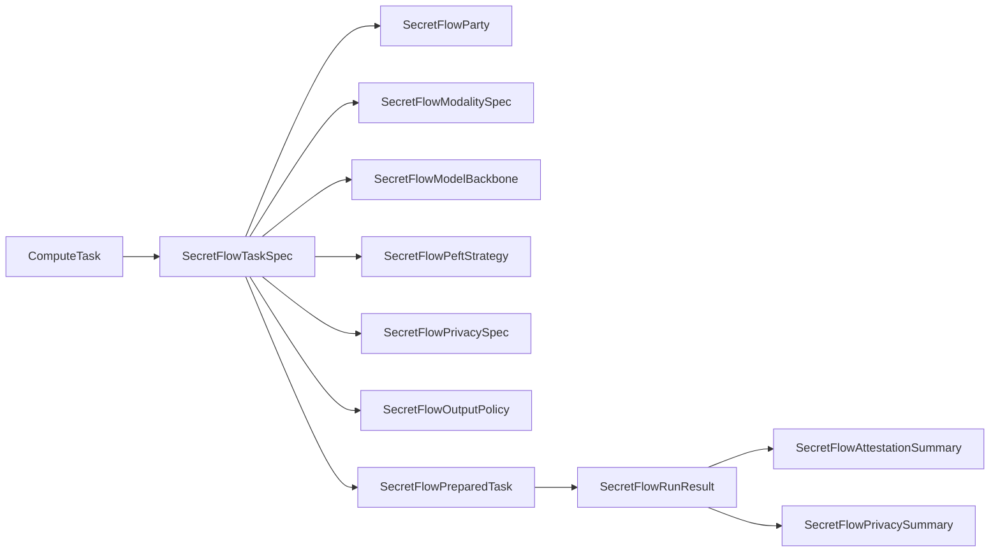

# SecretFlow Workload Runtime Data Model

## Existing Model Integration

### ComputeTask

Existing entity: `packages/database/src/entities/compute-task.entity.ts`

Relevant fields:

- `id`
- `tenantId`
- `contractId`
- `name`
- `description`
- `method`
- `workloadType`
- `algorithmParams`
- `dataAssets`
- `status`
- `resultSummary`

SecretFlow MVP uses:

- `workloadType = "secretflow"`
- `method = "tee"` or `method = "mpc"`
- `algorithmParams.secretflowSpec = SecretFlowTaskSpec`

## New Domain Types

### SecretFlowTaskSpec

Represents the submitted multimodal confidential training task.

Attributes:

- `parties: SecretFlowParty[]`
- `modalities: SecretFlowModalitySpec[]`
- `llmBackbone: SecretFlowModelBackbone`
- `peftStrategy: SecretFlowPeftStrategy`
- `fusionBridge?: SecretFlowFusionBridge`
- `privacy: SecretFlowPrivacySpec`
- `outputPolicy: SecretFlowOutputPolicy`

Validation:

- Must include at least one party.
- Must include at least one modality.
- Must include LLM backbone model type and path.
- Must include LoRA PEFT strategy.
- Must include privacy settings.
- Must include output policy.

### SecretFlowParty

Represents a participant in a SecretFlow task.

Attributes:

- `participantId: string`
- `role: "provider" | "consumer" | "coordinator"`
- `spaceId?: string`
- `connectorId?: string`
- `dataResidency?: string`

### SecretFlowModalitySpec

Represents a local multimodal data input declaration.

Attributes:

- `type: "dicom" | "genomics" | "clinical_text" | "structured_ehr"`
- `dataProductId?: string`
- `manifestUri?: string`
- `count?: number`
- `schema?: string`

Notes:

- MVP uses manifests and metadata only.
- Real DICOM/VCF parsing is out of scope.

### SecretFlowModelBackbone

Represents the LLM or multimodal backbone.

Attributes:

- `modelType: string`
- `modelNameOrPath: string`

### SecretFlowPeftStrategy

Represents LoRA fine-tuning settings.

Attributes:

- `type: "lora"`
- `r: number`
- `alpha: number`
- `targetModules: string[]`

### SecretFlowFusionBridge

Represents optional multimodal feature alignment.

Attributes:

- `type: "linear_projection" | "perceiver_resampler"`
- `hiddenSize: number`
- `numQueries?: number`

### SecretFlowPrivacySpec

Represents runtime privacy requirements.

Attributes:

- `teeRequired: boolean`
- `heuEnabled: boolean`
- `dpSgd?: SecretFlowDpSgdSpec`

### SecretFlowDpSgdSpec

Attributes:

- `clipNorm: number`
- `noiseMultiplier: number`
- `targetEpsilon?: number`

### SecretFlowOutputPolicy

Represents allowed output artifact kinds.

Attributes:

- `allowedArtifacts: SecretFlowArtifactKind[]`

Allowed artifact kinds:

- `lora_delta_hash`
- `encrypted_delta_ref`
- `aggregate_metrics`
- `attestation_report`
- `model_card`

## Runtime Types

### SecretFlowPreparedTask

Connector-local prepared runtime state.

Attributes:

- `taskId: string`
- `specHash: string`
- `partyCount: number`
- `modalityTypes: string[]`
- `preparedAt: string`

### SecretFlowRunResult

Safe output envelope.

Attributes:

- `taskId: string`
- `roundsCompleted: number`
- `metrics: Record<string, number>`
- `loraDeltaHash: string`
- `encryptedDeltaRef: string`
- `attestation: SecretFlowAttestationSummary`
- `privacySummary: SecretFlowPrivacySummary`
- `modelCard?: SecretFlowModelCardSummary`

Must not contain:

- raw DICOM
- raw VCF
- patient-level rows
- unencrypted gradients
- intermediate embeddings

### SecretFlowAttestationSummary

Attributes:

- `reportHash: string`
- `runtime: "mock" | "cli" | "teeu"`
- `generatedAt: string`
- `specHash: string`

### SecretFlowPrivacySummary

Attributes:

- `teeRequired: boolean`
- `heuEnabled: boolean`
- `dpSgdEnabled: boolean`
- `safeOutputOnly: true`

## Relationships

## Storage

MVP storage:

- `SecretFlowTaskSpec` lives in `ComputeTask.algorithmParams.secretflowSpec`.
- `SecretFlowRunResult` can be stored in `ComputeTask.resultSummary` or connector-local runtime memory during mock execution.

Future storage:

- Connector-local persisted task table.
- Control-plane attestation reference table.
- Catalog modality metadata on data products.
